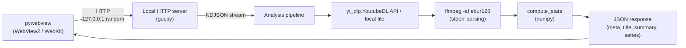

# analyze-loudness

A tool that analyzes the audio loudness of YouTube videos in compliance with BS.1770 / EBU R128.
It comes in two forms: a CLI version and a GUI application version (Windows / macOS).

## Documentation languages

- **Override of the global CLAUDE.md's 「ドキュメント」 language rule**: this file is written entirely in English, and the documents are maintained in both English and Japanese — English at `README.md`, `docs/architecture.md` and the decision records `docs/decisions/<subject>.md`, Japanese at `README.ja.md`, `docs/architecture.ja.md` and `docs/decisions/<subject>.ja.md`. The decision records are kept section for section, with the Japanese file under the same headings as the English one.

## Architecture overview



The GUI consists of pywebview (Windows: WebView2 / macOS: WebKit) + a local HTTP server. The details are in `docs/architecture.md`.

## Directory layout

```mermaid
graph LR
    root["analyze-loudness/"]
    root --> wf[".github/workflows/"]
    wf --> wf_ci["ci.yaml<br>PR / push<br>runs pytest with the coverage of the Python package and of frontend/*.js and uploads both to Codecov<br>caches the apt package files and the Playwright browsers, saved only by the runs that are not PRs"]
    wf --> wf_rel["release.yaml<br>v* tag / workflow_dispatch on a tag"]
    wf --> wf_tag["tag-release.yml<br>after a successful CI run of a push to master, or by a workflow_dispatch given a commit: when it is a version bump, tags that commit and starts release.yaml"]
    wf --> wf_ffw["ffmpeg-watch.yml<br>daily, detects a new ffmpeg on osxexperts.net, opens the pin update and version bump PRs<br>with a GitHub App's token and merges them without review<br>when detect cannot connect, dispatches itself to run detect again on another runner, up to 3 attempts"]
    wf --> wf_chk["workflow-checks.yml<br>on every PR, checks the rules for SHA pinning of uses: and for same-repository references"]
    wf --> wf_chkt["workflow-checks-test.yml<br>runs the check's fixture tests, the tests of dependabot-auto-merge.yml's trigger, conditions and auto-merge decision,<br>the tests of tag-release.yml's tagging step and the tests of ffmpeg-watch.yml's land step and retry of detect"]
    wf --> wf_dam["dependabot-auto-merge.yml<br>on a Dependabot PR that is one commit at the head, written by Dependabot alone, committed by GitHub (web-flow) and with a verified signature, schedules an auto-merge for an update of the Python dependencies (uv) or of the submodule,<br>and for a semver patch or minor update of a GitHub Action. Required check auto-merge"]
    root --> ght[".github/tests/"]
    ght --> ght_sh["workflow-checks-test.sh<br>test that runs workflow-checks.yml with a fake gh and a fixture git tree"]
    ght --> ght_am["dependabot-auto-merge-test.sh<br>test that dependabot-auto-merge.yml runs on every PR, with only its steps limited to Dependabot PRs,<br>and of which updates and commits (their authors, how many, whether the last is the head, who committed it, whether its signature is verified)<br>its step schedules or turns off an auto-merge for, with a fake gh"]
    ght --> ght_tag["tag-release-test.sh<br>test that runs tag-release.yml's checks and tagging step with a fake gh and a fixture repository"]
    ght --> ght_land["ffmpeg-watch-land-test.sh<br>test that runs ffmpeg-watch.yml's land step with a fake gh that answers by the token of each call and a fixture repository,<br>its detect step with a fake CLI, and the dispatch of the next attempt of detect"]
    root --> r_dep[".github/dependabot.yml<br>version updates every day at 00:00 JST of the GitHub Actions, the py-analyze-common submodule<br>(without Dependabot's default three-day cooldown) and the Python dependencies (uv;<br>yt-dlp and yt-dlp-ejs in one pull request, pyobjc-core and pyobjc-framework-* in another)"]
    root --> r_claude["AGENTS.md"]
    root --> r_readme["README.md"]
    root --> r_readme_ja["README.ja.md"]
    root --> r_pyproj["pyproject.toml<br>CLI tool (pip install -e #quot;.[dev]#quot;)"]
    root --> req["requirements/<br>release.txt, release-build.txt, sign-manifest.txt: the hash-pinned packages the release jobs install,<br>generated by uv from pyproject.toml and the .in files (Pinned release dependencies)"]
    root --> src["src/analyze_loudness/"]
    src --> src_init["__init__.py<br>sys.path injection of vendor, SCHEMA_VERSION"]
    src --> src_main["__main__.py"]
    src --> src_cli["cli.py<br>argparse + main orchestration (CLI)"]
    src --> src_gui["gui.py<br>pywebview + local HTTP server (GUI)"]
    src --> src_dl["download.py<br>yt_dlp.YoutubeDL API, resolving local files (resolve_source), ffprobe duration"]
    src --> src_ana["analysis.py<br>ebur128 stderr parsing, compute_stats"]
    src --> src_cmp["compare.py<br>building and validating single / comparison JSON, statistics of the truncated range"]
    src --> src_upd["update.py<br>auto-update identity (UPDATE_CONFIG: product name, repository, public key, mutex name)"]
    src --> src_plot["plot.py<br>matplotlib figure generation (CLI only)"]
    root --> fe["frontend/"]
    fe --> fe_idx["index.html"]
    fe --> fe_main["main.js<br>fetch + NDJSON progress + DOM rendering + theme toggle"]
    fe --> fe_theme["theme.js<br>getTheme(): chart color provider (light / dark)"]
    fe --> fe_gate["gate.js<br>computeGate(): BS.1770 gating rebuilt from series.M"]
    fe --> fe_i18n["i18n.js<br>the en/ja DICT, which py-analyze-common's /common/i18n.js turns into window.i18n (t / setLang / onChange)"]
    fe --> ch["charts/"]
    ch --> ch_tl["timeline.js<br>uPlot wrapper (theme-aware, GATE lane plugin)"]
    ch --> ch_hist["histogram.js<br>Canvas histogram (theme-aware, no internal title)"]
    ch --> ch_seg["segments.js<br>Canvas segment bars (theme-aware, no internal title)"]
    fe --> fe_css["style.css<br>CSS variables + [data-theme=#quot;dark#quot;] rules"]
    fe --> fe_vendor["vendor/<br>uPlot (bundled)"]
    root --> t["tests/"]
    t --> t_init["__init__.py"]
    t --> t_conf["conftest.py<br>also points py-analyze-common's analyze_common.testing at this repository and package"]
    t --> t_ana["test_analysis.py"]
    t --> t_flow["test_analysis_flow.py<br>analysis, streaming and cache contracts through the GUI's HTTP endpoint"]
    t --> t_cmp["test_compare.py"]
    t --> t_cli["test_cli.py"]
    t --> t_clis["test_cli_single.py<br>single-source CLI analysis with real local audio and its output figure"]
    t --> t_dl["test_download.py"]
    t --> t_gui["test_gui.py"]
    t --> t_plot["test_plot.py"]
    t --> t_pkg["test_package.py<br>the vendor/py-analyze-common entry that the package puts on sys.path once"]
    t --> t_upd["test_update.py<br>UPDATE_CONFIG and the installer.iss / spec / release.yaml that match it"]
    t --> t_ffb["test_ffmpeg_binary.py<br>reads the ffmpeg / ffprobe on PATH with the app's parsers<br>(EXPECT_FFMPEG_DIR points at the bundled binaries)"]
    t --> t_rwf["test_release_workflow.py<br>release.yaml runs test_ffmpeg_binary.py on the ffmpeg / ffprobe inside the distributables;<br>only create-release can write and it runs no Python; the job holding UPDATE_SIGNING_KEY has a read-only token<br>and installs only the hash-pinned yt-dlp; the Developer ID identity is imported right before codesign<br>and deleted when codesign ends; the release jobs install packages only from requirements/*.txt<br>and build tools only after a SHA256 check; requirements/release.txt satisfies pyproject.toml<br>and every requirements/*.txt resolves, with its own pins as constraints, to exactly the packages it pins<br>under the same environment markers (runs py-analyze-common's analyze_common.testing.release_workflow)"]
    t --> t_font["test_chart_font.py<br>no script names a font of its own (runs analyze_common.testing.chart_font)"]
    t --> t_ejs["test_yt_dlp_ejs.py<br>the installed yt-dlp-ejs has the version (major.minor) and script hashes the installed yt-dlp accepts<br>(runs analyze_common.testing.yt_dlp_ejs)"]
    t --> t_tpl["test_third_party_licenses.py<br>the GPL full texts THIRD_PARTY_LICENSES.txt points at, and the spec / installer.iss that bundle them<br>(runs analyze_common.testing.third_party_licenses)"]
    t --> t_fe["test_frontend.py<br>Playwright headless Chromium runner"]
    t --> t_chart["test_chart_rendering.py<br>renders the real chart scripts and exports their pixels in Chromium"]
    t --> t_static["test_static_server.py<br>initial assets are served during bounded connection bursts"]
    t --> t_jsc["js_coverage.py<br>with --js-coverage, the V8 coverage of frontend/*.js that the Playwright tests run, written as LCOV<br>(the same file as analyze-spectrum's)"]
    t --> t_jsct["test_js_coverage.py<br>js_coverage.py: matching V8 ranges to lines, and the LCOV it writes<br>(the same file as analyze-spectrum's)"]
    t --> tf["frontend/"]
    tf --> tf_html["test_ui.html<br>test harness page (DOM + stubs)"]
    tf --> tf_js["test_ui.js<br>browser-based UI state tests"]
    root --> docs["docs/"]
    docs --> docs_arch["architecture.md"]
    docs --> docs_arch_ja["architecture.ja.md"]
    docs --> docs_dec["decisions/<br>closed decisions: what was chosen and what was rejected;<br>each record is an English .md and a Japanese .ja.md"]
    docs_dec --> docs_dec_cmp["comparison-mode.md, comparison-mode.ja.md<br>the comparison mode"]
    docs_dec --> docs_dec_lfi["local-file-input.md, local-file-input.ja.md<br>local audio files as input"]
    docs --> docs_shot["screenshot.png"]
    root --> vend["vendor/py-analyze-common/<br>git submodule (used through sys.path injection)"]
    root --> r_build["build.py<br>Build script: py-analyze-common's analyze_common.build with this app's names<br>(asset download + PyInstaller + Inno Setup / DMG)"]
    root --> r_spec["analyze-loudness.spec<br>PyInstaller spec"]
    root --> r_iss["installer.iss<br>Inno Setup script"]
    root --> r_lic["THIRD_PARTY_LICENSES.txt<br>Bundled license file"]
    root --> r_gpl["licenses/<br>Full texts of GPL v2 / v3 (pointed at by the FFmpeg section of THIRD_PARTY_LICENSES.txt;<br>the spec bundles them at the same level)"]
    root --> ba_pin["build_assets/ffmpeg.json<br>series of the bundled ffmpeg / ffprobe, and URL / SHA256 of the macOS build"]
    root --> ba_sum["build_assets/checksums.json<br>version and SHA256 of the bundled uPlot files"]
    root --> ba_icon["build_assets/icon_draft.svg<br>the source of icon.ico / icon.png / icon.iconset (PYTHONPATH=vendor/py-analyze-common/src python -m analyze_common.icons build_assets)"]
    root --> ba["build_assets/bin/<br>ffmpeg, ffprobe, deno (not tracked by git)"]
```



## CLI usage

```
python3 -m venv .venv            # Windows: python -m venv .venv
source .venv/bin/activate        # Windows: .venv\Scripts\activate
pip install -e ".[dev]"
analyze-loudness "https://www.youtube.com/watch?v=XXXXX"
analyze-loudness "https://..." --duration 10 --output-dir ./out
analyze-loudness ./recording.wav                       # local audio file
analyze-loudness "https://..." ./loudness_saved.json   # comparison (2-6 sources, --duration not allowed)
```

### CLI dependencies

- `yt-dlp` — dependency in pyproject.toml (used through the Python API)
- `ffmpeg` / `ffprobe` — the `static-ffmpeg` package. Imported only when ffmpeg is not on PATH (decided with py-analyze-common's `find_executable()`, [Starting ffmpeg / ffprobe by absolute path](#starting-ffmpeg--ffprobe-by-absolute-path))
- `numpy` — statistics (used by both the CLI and the GUI); `matplotlib` — CLI only (the plot)
- `pytest`, `pytest-cov` — development dependencies (`pip install -e ".[dev]"`)

## GUI usage

### Launching during development

```
pip install -e ".[gui]"
analyze-loudness-gui
```

### Build and distribution

```bash
# Windows
.venv/Scripts/python build.py              # download assets + PyInstaller bundle
.venv/Scripts/python build.py --installer  # + Inno Setup installer (.exe)

# macOS (requires create-dmg: brew install create-dmg)
.venv/bin/python build.py
.venv/bin/python build.py --installer      # + DMG
```

The flags are in the "Building a consumer" section of `vendor/py-analyze-common/README.md`.

> **Note**: run it with the python of this project's venv: `.venv/bin/python` (macOS) / `.venv/Scripts/python` (Windows).

### GUI dependencies

- `pywebview` — optional dependency (`pip install -e ".[gui]"`)
- `numpy` — statistics
- `yt-dlp` — bundled as a Python library (PyInstaller includes it automatically)
- `yt-dlp-ejs` — the YouTube challenge solver scripts yt-dlp runs on deno, pinned to the version of yt-dlp's `pin` extra. yt-dlp's own PyInstaller hook (`yt_dlp/__pyinstaller/hook-yt_dlp.py`) bundles their `.js` files; without them yt-dlp warns `n challenge solving failed: Some formats may be missing`; `tests/test_yt_dlp_ejs.py` fails when its version or scripts are not the ones the installed yt-dlp accepts, and Dependabot moves yt-dlp and yt-dlp-ejs in one pull request (the `yt-dlp` group of `.github/dependabot.yml`)
- ffmpeg, ffprobe, deno — placed in `build_assets/bin/` and bundled (PyInstaller frozen mode)
- `certifi` — CA used by the auto-update HTTPS (`pip install -e ".[gui]"`). PyInstaller builds the bundle with only a warning when certifi is missing, so `check_prerequisites()` of py-analyze-common's `analyze_common/build.py` (which `build.py` runs) stops the build when it is missing
- `py-analyze-common` — git submodule (`vendor/py-analyze-common`). Provides OS detection, subprocess kwargs, dark mode detection, the ffmpeg/ffprobe wrapper, the yt-dlp download, JSON sanitizing and auto-update. Not listed in pyproject.toml; used through `sys.path` injection

## Tests

```bash
pytest -q                                          # all tests
pytest -q --cov --cov-report=term-missing          # with line and branch coverage of src/analyze_loudness, without __main__.py ([tool.coverage.run] in pyproject.toml)
pytest -q --js-coverage=coverage-js.lcov           # with the line coverage of frontend/*.js that the Playwright tests run, as LCOV (tests/js_coverage.py)
python -m playwright install --with-deps chromium  # first time only (used by tests/test_frontend.py)
python build.py --ffmpeg-only && EXPECT_FFMPEG_DIR=build_assets/bin pytest -q tests/test_ffmpeg_binary.py  # with the bundled ffmpeg / ffprobe
```

For how the browser binary is handled, see [Frontend UI tests](#frontend-ui-tests).

The procedures this app shares with analyze-spectrum (running the tests from a git worktree, test runs for each commit of a pull request, probing the real app on macOS) are in `vendor/py-analyze-common/docs/development.md`.

CI (`.github/workflows/ci.yaml`) runs `pytest -q --cov --cov-report=xml --js-coverage=coverage-js.lcov` and uploads `coverage.xml` and `coverage-js.lcov` to Codecov with `codecov/codecov-action`. The job's `id-token: write` lets the upload authenticate with GitHub's OIDC token (`use_oidc: true`), so the repository holds no Codecov token. On a pull request a failed upload fails `Test 🧪` (`fail_ci_if_error: true`); on a push to master the step's `continue-on-error` leaves the run green ([.github/workflows/ci.yaml:126](https://github.com/semnil/analyze-loudness/blob/5586edea5e683eb3f2809670ccb15838cf4f5d73/.github/workflows/ci.yaml#L126)). `codecov/project` is a required check of master, reported by Codecov once the upload has arrived, after the run; `ffmpeg-watch.yml`'s land therefore hands its merges to auto-merge, which waits for it. `codecov/patch` is not required. `vendor/py-analyze-common` is not measured here (`source_pkgs` names this package only); py-analyze-common's own CI uploads its coverage.

## GUI endpoints

| Endpoint | Method | Description |
|----------|--------|-------------|
| `/analyze` | POST | Downloads audio from a URL, or uses a local file as is, and runs the EBU R128 analysis. NDJSON stream response |
| `/save` | POST | Saves the analysis result JSON with a native file dialog |
| `/save-image` | POST | Saves the chart composite PNG (base64) with a native dialog |
| `/compare` | POST | Returns the comparison JSON of 2-6 single results truncated to the shortest track, and the statistics of the truncated range (`stats`) |
| `/load` | POST | Picks a JSON with a native dialog and visualizes the result again. Adds `stats` to a comparison JSON and does not put it in the single-result cache. A single result loaded with `{"queue": true}`, which the page sends while the queue holds tracks, is not put in the cache either: it joins the queue with its data, or the page refuses it at the limit |
| `/browse` | POST | Picks a local audio file with a native dialog and returns its path |
| `/upload` | POST | Places a dropped file (the body as is, the name in `X-Filename`) in a temporary directory and returns its path. Limit 500 MB; extensions per `AUDIO_EXTENSIONS` in `src/analyze_loudness/download.py` |
| `/common/settings.js` | GET | Returns py-analyze-common's `settings.js` preceded by the theme and language saved in the settings file (`window.analyzeSettingsStored`). Reads the settings file on every load (`Cache-Control: no-store`) |
| `/settings` | POST | Saves exactly one of `{"theme": ...}` or `{"lang": ...}` to the app's settings file and returns `{"theme", "lang"}` after saving. Anything else is 400; 500 when it cannot be written |
| `/update/status` | POST | Returns the running version (`current`), whether the build can apply updates (`supported`) and the "Check at launch" setting (`launch_check`) |
| `/update/settings` | POST | Saves `{"launch_check": bool}` to the app's settings file and returns the value after saving. Non-bool is 400; 500 when it cannot be written |
| `/update/check` | POST | Checks `latest.json` of the latest Release; `{"available": true, "version"}` when there is a newer version, otherwise `{"available": false}`. Failure is 502 |
| `/update/install` | POST | Fetches, verifies the signature of and applies `{"version"}` (only the version the preceding check reported is accepted), returns `{"restarting": true}` and ends the app. Failure is 500. When macOS cannot restart after the swap, returns `{"installed": true, "restart_error"}` and keeps running |

POST is accepted only when the Content-Type is `application/json` (`application/octet-stream` for `/upload`); anything else is 415. `/analyze`, `/compare`, `/save`, `/save-image` and `/load` answer a body that is not JSON with 400 (`Invalid JSON body`). The Host and Content-Type checks, `/browse`, `/save-image`, `/settings`, `/update/*` and the `/common/*` files come from py-analyze-common's `GuiHandler` (`analyze_common/server.py`), which `AnalyzeHandler` extends with this app's state (`updater()`, `ui_settings()`, `window()`, `dialog_lock()`, `exit_for_update()`).

## Response format (GUI NDJSON)

Progress events:
```json
{"type":"progress","stage":"download","message":"Downloading audio..."}
{"type":"progress","stage":"analyze","message":"Running EBU R128 analysis...","estimate_sec":12,"duration_sec":600}
```

Warning event (sent when ffmpeg exits non-zero; shown in the status area, and processing continues with what was parsed from stderr):
```json
{"type":"warning","message":"ffmpeg exited with code 1"}
```

Result event:
```json
{
  "type": "result",
  "data": {
    "meta": {
      "schema_version": 3,
      "version": "1.0.0",
      "analyzed_at": "2026-04-03T12:34:56+00:00",
      "source_url": "https://www.youtube.com/watch?v=..."
    },
    "title": "Video Title",
    "summary": {
      "duration_sec": 600, "frames": 5999,
      "integrated": -18.1, "true_peak": 0.8, "lra": 9.3,
      "gate_threshold": -28.5,
      "short_term": { "median": -19.4, "mean": -20.5, "p10": -24.1, "p90": -15.4 },
      "momentary": { "median": -20.8, "mean": -21.3, "p10": -26.9, "p90": -14.4 },
      "silence_pct": 1.0
    },
    "series": { "t": [...], "S": [...], "M": [...] }
  }
}
```

## Typical timings (10 minutes of audio)

| Stage                     | Time    |
|---------------------------|---------|
| Audio DL with yt_dlp API  | 3-8 s   |
| ffmpeg ebur128            | ~11 s   |
| stderr parse + JSON       | <1 s    |
| **Total**                 | **~20 s** |

## Design decisions

### ebur128 parsing

Parses the stderr of `ffmpeg -af ebur128=peak=true -f null -` with the regex `t:\s*([\d.]+)\s+TARGET.*?M:\s*([-\d.]+)\s+S:\s*([-\d.]+)`. The Summary block takes Integrated / LRA / True Peak from `output.rfind("Summary")` onward. The stderr is decoded as UTF-8 with undecodable bytes replaced, on every OS: ffmpeg writes paths in UTF-8 and metadata values as the raw bytes of the file, and Python's default decoding on Windows (the system code page) fails on them, which leaves `stderr` as `None`.

### Memory constraints

Decoding 50 minutes of audio to WAV takes more than 4 GB and runs out of memory.
No raw decode is done; only the stderr text output of ffmpeg ebur128 is processed.

### Silence thresholds

Statistics use only frames with Short-term > -60 LUFS (`SILENCE_THRESHOLD`). The silence ratio is computed with S < -40 LUFS
(`SILENCE_PCT_THRESHOLD`). However, **ebur128's warm-up frames are left out of the denominator** —
S is a 3-second window, so the first 29 frames do not fill the window and output the silence floor -120.7. Without the exclusion,
a 36-second clip shows 8.1% silence (measured; the actual figure is 0.0%). The decision is centralized in `first_full_window()` / `compute_silence_pct()` of `src/analyze_loudness/analysis.py`
and shared by three places: the CLI, the GUI and the matplotlib plot.

### Middle extraction

Cuts the audio directly during the ebur128 analysis with `ffmpeg -ss`/`-t`, starting at `(total length - extract minutes*60) / 2`. When the source is shorter than the given number of minutes, the full length is used.

This feature is exposed through the CLI's `--duration` option (single analysis only). The GUI does not implement a minutes input UI by policy (it keeps the simple workflow of entering only a URL or a local file path, and always analyzes the full length). The GUI backend's `/analyze` endpoint keeps the validation that accepts a `duration` field, but the frontend never sends it.

### Local files

The input field accepts a URL or a local path. Input that contains `://` or starts with `javascript:` is a URL only when it is http(s);
anything else is treated as a local path (`/analyze` in `src/analyze_loudness/gui.py` on the server, and `_sourceKind` in `frontend/main.js` on the frontend, mirror
the same rule). UNC paths and device paths starting with `\\` or `//`, and NT namespace paths that start with `\??\` once `.` / `..` segments are applied
(`\??\UNC\host\share\...`, `\.\??\...`), are refused before resolving or checking existence
(`is_network_path` in `src/analyze_loudness/download.py`; on the frontend, `"network"` of `_sourceKind`). A local file is made absolute and kept as is in `meta.source_url`, and its title is the
file name without the extension. The file's modification time is added to the cache key, and of the results read by `/load`, those with a local source
are not put in the cache. A dropped file is placed by `/upload` in a temporary directory (deleted on exit), so
the `meta.source_url` of that result is a path in the temporary directory.

### Download format

opus (much smaller than uncompressed WAV). Calls the Python API of `yt_dlp.YoutubeDL` directly and extracts with the `FFmpegExtractAudio` postprocessor. The title is taken from the return value of `extract_info(download=True)`, so there is no need to run title fetching and the download in parallel.

### yt-dlp Python API (not a binary)

Bundling a PyInstaller onefile binary such as `yt-dlp_macos` causes a Team ID mismatch in the internal `Python.framework` at CI's codesign re-signing (macOS hardened runtime). Installing `yt-dlp` as a Python dependency and using the `YoutubeDL` class directly avoids this problem. Windows / Linux use the same approach for consistency.

### yt-dlp version pin

`pyproject.toml` has an exact pin `yt-dlp==<version>`. Who updates it, why it is pinned and the check before a release are in the "yt-dlp version pin" section of `vendor/py-analyze-common/CLAUDE.md`.

### macOS is Apple Silicon (arm64) only (v1.3.0+)

The reason is in the "Building a consumer (build)" section of `vendor/py-analyze-common/CLAUDE.md`.

### Bundled ffmpeg pin

`build_assets/ffmpeg.json` holds the pin. How each OS bundles it, how it is updated and how the release build checks the distributed copies are in the "Bundled ffmpeg pin (ffmpeg_release)" section of `vendor/py-analyze-common/CLAUDE.md`.

`tests/test_ffmpeg_binary.py` here reads a 1 kHz sine wave written with numpy through the ffmpeg / ffprobe on PATH and the app's parsers (`run_ebur128()` / `probe_duration()`), and compares Integrated, the relative gate and True Peak with the BS.1770 calculation, and also reads a copy with a non-ASCII name and a copy with a tag that is not UTF-8.

### Starting ffmpeg / ffprobe by absolute path

`run_ebur128()` in `src/analyze_loudness/analysis.py`, and py-analyze-common's `probe_info()` / `download_audio()`, start ffmpeg / ffprobe (and yt-dlp's deno) by the absolute path that py-analyze-common's `find_executable()` returns. It searches only the absolute entries of PATH, in order; the frozen app puts the bundled `bin` folder at the front of PATH (`main()` in `src/analyze_loudness/gui.py`). The reason is in the "Programs start by absolute path (find_executable)" section of `vendor/py-analyze-common/CLAUDE.md`. When the program they run is not on PATH (ffmpeg for `run_ebur128()` / `download_audio()`, ffprobe for `probe_info()`), they raise `FileNotFoundError` without starting a process. `tests/test_ffmpeg_binary.py` checks `EXPECT_FFMPEG_DIR` with the same `find_executable()`.

### deno (yt-dlp dependency)

yt-dlp needs the deno runtime for YouTube's JavaScript extraction. `build.py` downloads the latest version and bundles it. The challenge solver scripts yt-dlp runs on it come from `yt-dlp-ejs` (GUI dependencies).

### Local HTTP server + pywebview

Starts an HTTPServer on a random port of 127.0.0.1 (port 0). Shows the window with pywebview (Windows: WebView2 / macOS: WebKit).
Shows real-time progress with NDJSON streaming. Estimates the remaining time with `_speed_factor`, calibrated at run time.

### Dark mode

Three-state theme switching light / dark / auto with CSS variables + `[data-theme="dark"]`.
CSS variable names are shared with analyze-spectrum (`--text` / `--bg-card` / `--text-secondary` / `--text-muted` etc.). The CSS variables and rules that are the same in both apps live in py-analyze-common's `analyze_common/web/common.css`, which `src/analyze_loudness/gui.py` serves as `/common/common.css` (the PyInstaller spec bundles it in `analyze_common/web`). `frontend/index.html` loads it before `frontend/style.css`, and `frontend/style.css` holds the remaining variables (accent color etc.) and its own rules. The `h1` of the narrow-screen `@media (max-width: 480px)` has to come after the `h1` of each `style.css`, so it stays in `style.css`.
The default is `auto` (follows the OS `prefers-color-scheme`). The choice is saved with `/settings` to `theme` in the app's settings file (the same `settings.json` as "Settings" in the "Auto-update" section). The page starts drawing with `window.analyzeSettings.theme` passed by `/common/settings.js` (py-analyze-common's `UiSettings.script()`; `Cache-Control: no-store`), `main()` decides the window's background color with `UiSettings.background_color()`, and `analyze_common.ui_settings.show_window_color_until_paint()` right after `create_window()` shows that color on macOS until the page is drawn (pywebview attaches WKWebView to the window only after the first load finishes, and WKWebView draws white until its first paint, so its background is turned off; the mechanism is in the "Theme and language settings" section of `vendor/py-analyze-common/CLAUDE.md`). When saving fails, the chosen theme stays and the status area shows an error.
The theme toggle UI is a pill button fixed at the top right (SVG of a sun / crescent moon / half-filled circle, generated by `_createThemeIcon()` of py-analyze-common's `analyze_common/web/ui.js`). Unified with analyze-spectrum.
Chart colors are managed in one place by `getTheme()` of `frontend/theme.js`, and the charts are redrawn on a theme switch.

### i18n (languages)

`frontend/i18n.js` holds the en / ja dictionary, which py-analyze-common's `analyze_common/web/i18n.js` (`/common/i18n.js`, loaded before it) turns into `window.i18n`. However, the display items of tables and charts (table.*, chart.*, summary.frames/min etc.) are English-only, unified with analyze-spectrum. The ja dictionary also has the English values for these keys. The UI chrome such as buttons, status and error messages keeps its Japanese translation.
The chosen language is saved with `/settings` to `lang` in the same settings file as the theme, and passed to the next page through `window.analyzeSettings.lang`. When nothing is saved, it follows `navigator.language` (`ja*` is ja, anything else en).
Elements whose text `main.js` writes according to state (the theme button's `aria-label`, the submit button's text and `aria-label`) do not get `data-i18n*`; `main.js` writes them on load and on `window.i18n.onChange` (with the attributes, DOMContentLoaded and every language switch would reset them to a fixed text).

### Chart titles drawn once (unified with analyze-spectrum)

The title of each chart (timeline / histogram x2 / segments) is drawn only as an HTML `<h3 class="chart-title">`; Canvas / uPlot `ctx.fillText` and the `title:` option are not used. Drawing inside the canvas is forbidden because it leads to a double display and a duplicate in the PNG export (`captureImage()` burns the titles into the composite PNG with the `label` of each element `{canvas, label}` of `chartCanvasRefs`). The HTML titles have tooltips (`tip.chart_timeline` / `tip.chart_histogram` / `tip.chart_segments`) through `_addTip()`.

`role="img"` + `aria-label` go on the canvas itself for the histograms, and on the container div for timeline / segments. The title is always placed outside that node (ARIA treats the descendants of `role="img"` as presentational, so inside it the title and the tooltip text do not reach assistive technology).

### GATE lane (excluded blocks on the timeline)

Integrated aggregates only the 400 ms blocks that pass BS.1770's absolute gate (-70 LUFS) and relative gate (the mean of the blocks that passed the absolute gate -10 LU).
A 12 px high band is placed in the timeline's x-axis gutter (between the bottom of the plot and the tick labels), showing excluded blocks in amber (at or below the relative gate) / slate (at or below the absolute gate).

ffmpeg outputs a frame every 100 ms, but the Momentary window is 400 ms, so **the first 3 frames
(t = 0.1 / 0.2 / 0.3) do not fill the window and output the silence floor -120.7**. They are not gating blocks,
so `computeGate` decides the start from `series.t` and excludes them (`_firstGatedIndex`). Without the exclusion,
both the silence ratio and the denominator grow (the measurements are in the "GATE lane" section of `docs/architecture.md`).
The decision is relative to `t[0]`, so it also works when cut with `-ss`. The warm-up of S (3-second window) is 29 frames, and
the summary's silence ratio excludes those with the same rule ([Silence thresholds](#silence-thresholds)).

The relative gate value comes from `summary.gate_threshold` (schema 2); only when it is missing does `computeGate()` of `frontend/gate.js`
recompute it from `series.M`. JSON saved with schema 1 takes this fallback path.
The agreement between the recomputed Integrated and the saved value is measured in the "GATE lane" section of `docs/architecture.md`.
The band appears with either path. For a JSON whose `series.M` length differs from `series.t`, the band is not shown
(the correspondence with the time axis cannot be guaranteed).

The ffmpeg Summary has **two** `Threshold:` lines (the Integrated one and the LRA one).
The regex in `src/analyze_loudness/analysis.py` anchors on the `I:` line and takes the former. The latter is something else.

The values ffmpeg outputs are rounded to 1 decimal place, so the results of the two paths do not match exactly. Rounding changes the decision
only for blocks that sit exactly on the threshold (the measured counts are in the "GATE lane" section of `docs/architecture.md`).
The 1-decimal side reproduced ffmpeg's Integrated more faithfully in 12 of 13 saved JSON files.

### JSON schema version

`SCHEMA_VERSION` is in `src/analyze_loudness/__init__.py`. It is raised independently of `__version__` (the app version).

| ver | Added |
|-----|------|
| 1 | Initial version |
| 2 | `summary.gate_threshold` — ffmpeg's relative gate. When missing, the frontend recomputes it from `series.M`. At the same time `summary.silence_pct` started leaving ebur128's warm-up frames out of the denominator (values already saved with schema 1 keep the old computation) |
| 3 | Comparison JSON (`compare.tracks`). The contents of a single result are the same as schema 2 |

`/load` only validates that `meta.schema_version` is an int and does not reject by its value. Single or comparison is branched on the presence of `compare`.
New fields **branch on their presence, not on the version number** — a hand-edited JSON may lack them.

The band's space is made by widening the x axis's `gap` / `size` and the chart height by the same 11 px each. The plot bbox does not change
with or without the band (measured in the "GATE lane" section of `docs/architecture.md`). When a pixel column mixes included and excluded blocks, it is drawn as excluded, so
on long recordings the band's filled area exceeds the actual exclusion ratio. Drag-zooming converges on the actual excluded ranges.

The colors are defined in two places: `gateTrack` / `gateOut` / `gateSilent` in `frontend/theme.js` and the CSS variables
`--gate-track` / `--gate-out` / `--gate-silent` (for the canvas and for the legend chips).
Changing only one makes the legend and band colors drift apart.

### Comparison mode

Overlays 2-6 results from the start and truncates all tracks to the length of the shortest track. The statistics of the truncated range are
computed only by `truncated_stats()` in `src/analyze_loudness/compare.py`; the frontend shows the `stats` returned by `/compare` and `/load`.
The Integrated and the GATE band of the truncated range recompute the relative gate (they do not use the full-length `summary.gate_threshold`).
The verification measurements and the shape of the comparison JSON are in the "Comparison mode" section of `docs/architecture.md`. What was chosen for the track colors and for the rest of the mode, with the rejected alternatives, is in `docs/decisions/comparison-mode.md`.
On Submit, `_queueUrlInput()` moves the field's source into `compareQueue` (a source the queue holds stays in the field, and `+ Add Track` refuses it with `err.duplicate_track`). One row is a single analysis whose row keeps its result, two or more are a comparison, and one JSON row is shown without a request. `_effectiveTrackCount()` decides the Submit button label; the button is refreshed on the field's `input` event and after Browse.
`_maybeInvalidateResults()` drops the results on screen when `+ Add Track`, removing a row, Load JSON or a dropped file that joins the queue leaves tracks in the queue, Clear All also drops the status, and moving a row reorders a comparison on screen (`_moveTrack()`).
`MAX_TRACKS` comes from py-analyze-common (`analyze_common/server.py`, mirrored in `analyze_common/web/ui.js`). `MIN_TRACKS` is mirrored between `src/analyze_loudness/compare.py` and `frontend/main.js`, the gate constants
(`GATE_ABSOLUTE` / `GATE_RELATIVE_OFFSET` / `GATE_BLOCK_SEC`) between `src/analyze_loudness/compare.py` and `frontend/gate.js`,
and the track colors (light) between `trackColors` in `frontend/theme.js` and `TRACK_COLORS` in `src/analyze_loudness/plot.py`; always update them together.

### Frontend UI tests

`tests/frontend/test_ui.html` + `tests/frontend/test_ui.js` run through `tests/test_frontend.py` (Playwright + headless Chromium). They check `fmt`, `_setBusy`, `_addTip`, the theme/lang toggles, the fetch mock paths of /analyze + /load, coverage of the dictionary keys and more. The harness runs with normal and delayed update-check JSON replies; its accepted-install case waits for the install request before inspecting it. `test_frontend.py` also checks percent-encoded non-ASCII upload filenames through the application page. Static and application-page servers share the request queue size; `test_static_server.py` serves the HTML first, then checks script response bodies in bounded connection bursts, holding the first accept until its burst has connected. `tests/frontend/test_ui.html` places a stub of `window.analyzeSettings` (language en, theme light; saves are recorded instead of sent) before `frontend/i18n.js`, to decide the language and to check saving. `_isolated_settings` in `tests/conftest.py` points each test's app settings file at a temporary folder.

With `--js-coverage=PATH`, `tests/js_coverage.py` starts V8's precise coverage on every Chromium page the tests open, before the page loads anything, and takes it before each navigation the test starts (`goto`, `reload`, `go_back`, `go_forward`), which leaves the scripts of the document behind, and when the page, its context or its browser is closed; each take adds the counts since the previous one. It counts the scripts of `frontend/` outside `frontend/vendor/`, served either from the project root (`/frontend/main.js`, `tests/frontend/test_ui.html`) or by the app's handler (`/main.js`), and writes every one of them to PATH as LCOV, a script no test loaded with zero hits. A line's hit count is the count of the innermost V8 range that contains all of its code, summed over pages; blank lines and lines that start a comment are not counted. It fails the test whose page ran a script of another length than the file on disk. py-analyze-common's scripts (`/common/*.js`) are not counted.

In CI (GitHub Actions), `pip install -e ".[dev]"` installs the Playwright Python package, but the browser binary needs a separate `python -m playwright install --with-deps chromium` step. `tests/test_frontend.py` uses `skipif` only on `_HAS_PLAYWRIGHT` (whether the package can be imported), so without the binary `BrowserType.launch` fails at run time. A dedicated step in the same form as analyze-spectrum's is in `.github/workflows/ci.yaml`. Before it, `ci.yaml` restores the cached browsers (`~/.cache/ms-playwright`) and the cached apt package files that `--with-deps` installs; the cache keys and the runs that save them are in the comment at the top of `ci.yaml`.

### Analysis cancel

During an analysis the Analyze button changes to a Cancel button. `AbortController` aborts the fetch + NDJSON stream reading.
The `_isBusy` flag disables the Load JSON button to prevent a double run.

### Auto-update

How an update runs, what the user sees, what is verified, how each OS applies it and the signing key are in `vendor/py-analyze-common/docs/auto-update.md`.

What this app holds:

- `UPDATE_CONFIG` in `src/analyze_loudness/update.py`: the product name, the repository, the public key `PUBLIC_KEY`, the temporary directory prefix and the mutex name
- `src/analyze_loudness/gui.py` gives `GuiHandler` the `Updater` and the way the app exits: on macOS `_exit_now()` runs the atexit cleanup itself and ends with `os._exit(0)`
- `frontend/main.js` stops the input field, analysis, saving results and the settings dialog during the download
- Settings: "Check at launch" is `update_check_at_launch` in the app's settings file (macOS `~/Library/Application Support/analyze-loudness/settings.json`, Windows `%APPDATA%\analyze-loudness\settings.json`)

### Temp folders of a killed run

`src/analyze_loudness/gui.py` holds py-analyze-common's `InstanceLock` while it runs, and the CLI holds one while its work folder exists. When the GUI ends, `_cleanup_orphan_tempdirs()` removes the `loudness_*` temp folders a killed run left behind, unless another instance runs (the "Temp folders a killed process left behind (tempdirs)" section of `vendor/py-analyze-common/CLAUDE.md`).

### Window icon

Why `webview.start(icon=...)` gets the icon only on Windows, and what the AppUserModelID does, are in the "Window icon" section of `vendor/py-analyze-common/CLAUDE.md`. `main()` sets `com.semnil.loudness-analyzer` with `set_app_user_model_id()`.

### Windows subprocess console hiding

In PyInstaller frozen mode, `STARTF_USESHOWWINDOW` hides the console window of the ffmpeg / ffprobe the app starts. yt-dlp runs as a Python API, and its own `Popen` (`yt_dlp/utils/_utils.py`) sets `STARTF_USESHOWWINDOW` on Windows for the ffmpeg / ffprobe / deno it starts.

## Release procedure

The steps are in the "Releasing a consumer" section of `vendor/py-analyze-common/CLAUDE.md`. In this app `__version__` is in `src/analyze_loudness/__init__.py`, the Windows installer is `LoudnessAnalyzer-X.Y.Z-setup.exe` and the macOS DMG is `Loudness-Analyzer.dmg`.

### Pinned release dependencies

What the release jobs install, the commands that regenerate `requirements/*.txt` and what fails when they are not regenerated are in the section of the same name in `vendor/py-analyze-common/CLAUDE.md`.

### Patch release for an ffmpeg update

What `.github/workflows/ffmpeg-watch.yml` does daily, and its prerequisite, are in the section of the same name in `vendor/py-analyze-common/CLAUDE.md`.

## Versioning

The only source of the version is `__version__` in `src/analyze_loudness/__init__.py`. Every other file gets it dynamically from there:

| File | How it gets the version |
|----------|----------|
| `pyproject.toml` | `[tool.hatch.version]` `path` (regex extraction, no import) |
| `analyze-loudness.spec` | read with a regex in `_read_version()` |
| `installer.iss` | injected with `/DMyAppVersion=` by `_build_inno()` of py-analyze-common's `analyze_common/build.py` (run by `build.py`) |

A version bump changes only `__version__` in `src/analyze_loudness/__init__.py`.
