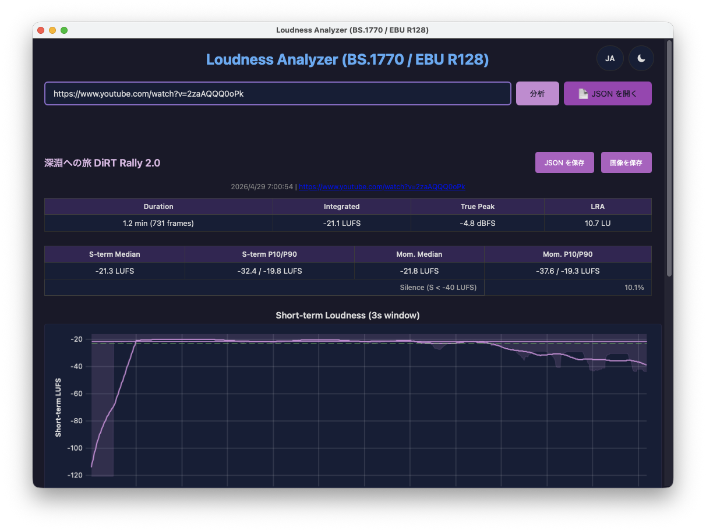
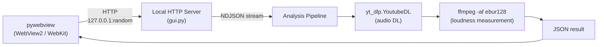

# analyze-loudness

> For the English version, see [README.md](README.md).

YouTube 動画の音声ラウドネスを BS.1770 / EBU R128 準拠で分析するツール。
CLI 版と GUI アプリケーション版 (Windows / macOS) の 2 形態を持つ。



## 機能

- YouTube 動画の音声をダウンロード (yt_dlp Python API, opus 形式)
- EBU R128 ラウドネス分析 (Momentary 400ms / Short-term 3s)
- 数値サマリー (Integrated, True Peak, LRA, 中央値, P10/P90, 無音率)
- CLI: 4 段構成の PNG グラフ生成 (matplotlib)
- GUI: ブラウザ上でインタラクティブなグラフ描画 (uPlot + Canvas)
- 分析結果の JSON 保存
- ローカルの音声ファイルの分析 (パス入力・ファイル選択・ドラッグ & ドロップ)
- 比較モード: 2〜6 本の結果を重ねて比較 (一番短いトラックの長さにそろえる)。URL と保存済み JSON を混在でき、比較結果も JSON と画像で保存できる
- インストール版 (Windows / macOS) のアプリの自動更新 (確認してから更新する。起動時の確認は設定で止められる)

## アーキテクチャ



GUI は pywebview (Windows: WebView2 / macOS: WebKit) + ローカル HTTP サーバーで構成。

## 動作環境

- Windows (x64)
- macOS: **v1.3.0 以降は Apple Silicon (M1 以降) 専用**。Intel Mac (x86_64) は非対応 (macOS 26 で表示される「Intel プロセッサ用アプリの対応は終了します」警告への対応として、同梱する ffmpeg / ffprobe を Apple Silicon ネイティブビルドのみに切り替えたため)。Intel Mac をご利用の場合は [v1.2.0](../../releases/tag/v1.2.0) をご利用ください

## ローカル環境構築

### 前提条件

- Python 3.11+
- ffmpeg / ffprobe (システムにインストール済みなら `static-ffmpeg` は不要)

### セットアップ

```bash
git clone --recurse-submodules <repo-url>
cd analyze-loudness

python -m venv .venv
source .venv/bin/activate        # Windows: .venv\Scripts\activate
pip install -e ".[dev]"

python -m pytest tests/ -v
```

### CLI 使い方

```bash
# 全尺分析
analyze-loudness "https://www.youtube.com/watch?v=XXXXX"

# 中盤 10 分を分析、出力先を指定
analyze-loudness "https://www.youtube.com/watch?v=XXXXX" \
    --duration 10 \
    --output-dir ./out

# 比較 (2〜6 本。保存済みの単体 JSON も渡せる)
analyze-loudness "https://www.youtube.com/watch?v=AAAAA" ./loudness_B.json

# ローカルの音声ファイル (比較にも使える)
analyze-loudness ./recording.wav
```

比較では `loudness_compare.json` と `loudness_compare.png` を出力する (同名のファイルがあるときは `_2`, `_3` … を付ける)。比較に `--duration` は使えない。

#### CLI オプション

| オプション | デフォルト | 説明 |
|---|---|---|
| `--duration` | なし (全尺) | 分析対象の長さ (分)。動画の中央部分を切り出して分析する (単体のみ) |
| `--output-dir` | `.` | PNG 出力ディレクトリ |

#### CLI 出力例

```
========================================================
  Video Title
========================================================
  Duration          : 30.5 min (18265 frames)
  Integrated        : -20.8 LUFS
  True Peak (max)   : +0.3 dBFS
  LRA               : 4.5 LU
  Short-term median : -21.4 LUFS
  Short-term P10/P90: -24.3 / -20.1 LUFS
  Momentary  median : -21.2 LUFS
  Momentary  P10/P90: -34.8 / -19.2 LUFS
  Silence (S<-40)   : 13.8%
========================================================
```

### GUI 使い方

```bash
pip install -e ".[gui]"
analyze-loudness-gui
```

比較するときは、URL を入れて「+ Add Track」で待ち行列に並べる。待ち行列が空でないときの「Load JSON」は、保存済みの単体 JSON を待ち行列に加える。2 本以上並べて「Compare」を押すと、URL の行を順に分析して比較を表示する。保存済みの比較 JSON は、待ち行列が空のときに「Load JSON」で開ける。

入力欄には URL かローカルファイルのパスを入れる (「Browse」でファイルを選ぶか、ウィンドウにファイルをドロップしてもよい)。GUI は常に全尺を分析する。`--duration` 相当 (分析対象長の指定) は GUI に実装しない。中盤のみを分析したい場合は CLI の `--duration` オプションを使用する。

### アプリの更新

インストール版のアプリは、起動時に [GitHub の Releases](../../releases) で新しい版があるかを確認する (分析で取得する音声を除くと、アプリが自分から行う通信はこれだけ)。新しい版があれば「バージョン X が利用可能です。今すぐ更新しますか?」と確認し、OK を押したときだけ更新を取得し、改ざんされていないことを署名で確かめてからインストールし、アプリを再起動する。再起動すると、保存していない分析結果は消える。

- 右上の歯車ボタンの設定で、起動時の確認を止められる (「起動時に確認」)。「今すぐ確認」で手動でも確認できる
- Windows: インストーラーが動くときに、ユーザーアカウント制御 (UAC) の確認が出る。そのときアプリはもう閉じているので、「いいえ」を選ぶと更新はされず、アプリは閉じたままになる。もう一度起動すると、更新の確認がまた出る
- macOS: アプリを「アプリケーション」フォルダに入れて使う。フォルダに書き込む権限が無いときは管理者のパスワードを求める。同じアプリを 2 つ起動しているときは、片方を終了してから更新する
- 分析中は更新しない。分析が終わってから「今すぐ確認」を押す

### ビルド & 配布

```bash
python build.py              # download assets + PyInstaller bundle
python build.py --installer  # + Inno Setup installer (.exe) / DMG (macOS)
```

macOS の DMG には create-dmg が要る (`brew install create-dmg`)。

## テスト

```bash
source .venv/bin/activate        # Windows: .venv\Scripts\activate
python -m pytest tests/ -v
```

UI テスト (`tests/test_frontend.py`) は Playwright の Chromium を使う。初回は `python -m playwright install --with-deps chromium` を実行する。

## プロジェクト構成

```
analyze-loudness/
├── .github/                    # ワークフロー (CI・リリース・ffmpeg の監視・ワークフローの検査) とそのテスト、Issue テンプレート
├── .gitignore
├── .venv/                      # Python 仮想環境 (git 管理外)
├── CLAUDE.md                   # AI 向けプロジェクト指示書
├── README.md
├── README.ja.md
├── pyproject.toml              # CLI tool (pip install -e ".[dev]")
├── src/analyze_loudness/       # Python package
│   ├── __init__.py             # vendor/ の sys.path 注入、SCHEMA_VERSION
│   ├── __main__.py
│   ├── cli.py                  # argparse + main orchestration (CLI)
│   ├── gui.py                  # pywebview + local HTTP server (GUI)
│   ├── download.py             # yt_dlp.YoutubeDL API, local files, ffprobe duration
│   ├── analysis.py             # ebur128 stderr parsing, compute_stats
│   ├── compare.py              # result / comparison JSON, truncated statistics
│   ├── update.py               # 自動更新の設定 (UPDATE_CONFIG)
│   └── plot.py                 # matplotlib figure generation (CLI only)
├── frontend/
│   ├── index.html
│   ├── main.js                 # fetch + NDJSON progress + DOM rendering
│   ├── theme.js                # チャートの色 (ライト / ダーク)
│   ├── gate.js                 # GATE レーンの BS.1770 ゲート
│   ├── i18n.js                 # en / ja の UI の文言
│   ├── charts/
│   │   ├── timeline.js         # uPlot wrapper
│   │   ├── histogram.js        # Canvas histogram
│   │   └── segments.js         # Canvas segment bars
│   ├── style.css
│   └── vendor/                 # uPlot (bundled)
├── tests/                      # pytest (tests/frontend/ は Playwright で実行する UI テスト)
├── docs/
│   ├── architecture.md
│   ├── architecture.ja.md
│   └── security-audit.md
├── vendor/py-analyze-common/   # 共有ライブラリ (git submodule)
├── build.py                    # Build script (asset download + PyInstaller + Inno Setup / DMG)
├── analyze-loudness.spec       # PyInstaller spec
├── installer.iss               # Inno Setup script
├── THIRD_PARTY_LICENSES.txt    # Bundled license file
├── licenses/                   # GPL v2 / v3 の全文
├── build_assets/ffmpeg.json    # 同梱する ffmpeg / ffprobe の固定
└── build_assets/bin/           # ffmpeg, ffprobe, deno (git 管理外)
```
