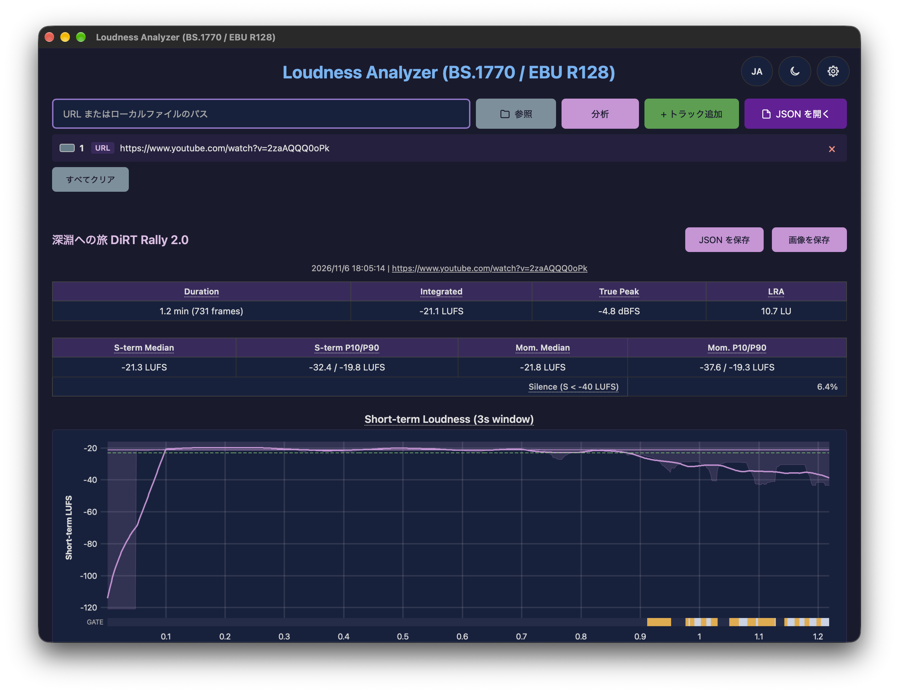
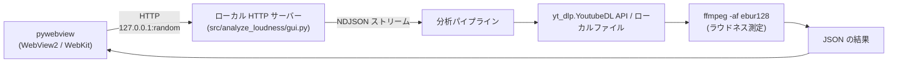

# analyze-loudness

[](https://codecov.io/gh/semnil/analyze-loudness)

> For the English version, see [README.md](README.md).

YouTube 動画とローカルの音声ファイルの音声ラウドネスを BS.1770 / EBU R128 準拠で分析するツール。
コマンドライン (CLI) 版とグラフィカルな画面 (GUI) のアプリケーション版 (Windows / macOS) の 2 形態を持つ。



## 機能

- YouTube 動画の音声をダウンロード (yt_dlp Python API, opus 形式)
- EBU R128 ラウドネス分析 (Momentary 400ms / Short-term 3s)
- 数値サマリー (Loudness Units relative to Full Scale (LUFS) での Integrated, True Peak, Loudness Range (LRA), 中央値, 10 / 90 パーセンタイル (P10/P90), 無音率)
- CLI: 4 段構成の PNG グラフ生成 (matplotlib)
- GUI: アプリのウィンドウ上でインタラクティブなグラフ描画 (uPlot + Canvas)
- GUI: 分析結果の JSON と画像での保存
- ローカルの音声ファイルの分析 (パス入力・ファイル選択・ドラッグ & ドロップ)
- 比較モード: 2〜6 本の結果を重ねて比較 (一番短いトラックの長さにそろえる)。URL・ローカルファイル・保存済み JSON を混在でき、比較結果も JSON と画像で保存できる
- GUI: ライト / ダーク / 自動のテーマと英語 / 日本語の表示
- インストール版 (Windows / macOS) のアプリの自動更新 (確認してから更新する。起動時の確認は設定で止められる)

## 動作環境

配布するアプリは次の環境で動く。

- Windows (x64)
- macOS: **v1.3.0 以降は Apple Silicon (M1 以降) 専用**。Intel Mac (x86_64) は非対応 (macOS 26 で表示される「Intel プロセッサ用アプリの対応は終了します」警告への対応として、同梱する ffmpeg / ffprobe を Apple Silicon ネイティブビルドのみに切り替えたため)。Intel Mac をご利用の場合は [v1.2.0](../../releases/tag/v1.2.0) をご利用ください

## 使い方

### CLI

このリポジトリのクローンからインストールする (「開発」の「セットアップ」節)。そのあと次のように使う。

```bash
# 全尺分析
analyze-loudness "https://www.youtube.com/watch?v=XXXXX"

# 中盤 10 分を分析、出力先を指定
analyze-loudness "https://www.youtube.com/watch?v=XXXXX" \
    --duration 10 \
    --output-dir ./out

# 比較 (2〜6 本。保存済みの単体 JSON も渡せる)
analyze-loudness "https://www.youtube.com/watch?v=AAAAA" ./loudness_B.json

# ローカルの音声ファイル (比較にも使える)
analyze-loudness ./recording.wav
```

単体の分析は `<title>_loudness.png` を出力する (`--duration` を付けると `<title>_<分>m_loudness.png`)。比較では `loudness_compare.json` と `loudness_compare.png` を出力する (同名のファイルがあるときは `_2`, `_3` … を付ける)。比較に `--duration` は使えない。保存済みの JSON は比較でだけ使える。

#### オプション

| オプション | デフォルト | 説明 |
|---|---|---|
| `--duration` | なし (全尺) | 分析対象の長さ (分)。上限は 240。ソースの中央部分を切り出して分析する (単体のみ) |
| `--output-dir` | `.` | PNG と、比較では JSON の出力ディレクトリ |

#### 出力例

```
========================================================
  Video Title
========================================================
  Duration          : 30.4 min (18265 frames)
  Integrated        : -20.8 LUFS
  True Peak (max)   : 0.3 dBFS
  LRA               : 4.5 LU
  Short-term median : -21.4 LUFS
  Short-term P10/P90: -24.3 / -20.1 LUFS
  Momentary  median : -21.2 LUFS
  Momentary  P10/P90: -34.8 / -19.2 LUFS
  Silence (S<-40)   : 13.8%
========================================================
```

### GUI

```bash
pip install -e ".[gui]"
analyze-loudness-gui
```

入力欄に URL かローカルファイルのパスを入れて (「参照」でファイルを選ぶか、ウィンドウにファイルをドロップしてもよい)、「分析」を押す。入力した内容は入力欄からトラックの待ち行列へ移る。GUI は常に全尺を分析する。`--duration` 相当 (分析対象長の指定) は GUI に実装しない。中盤のみを分析したい場合は CLI の `--duration` オプションを使用する。

比較するときは、次の URL かローカルファイルのパスを入れて「比較」を押す (待ち行列と入力欄を合わせて 2 本以上あるとき、ボタンは「比較」になる)。先に「+ トラック追加」で並べてもよい。別の音源を単体で分析するときは、先に「すべてクリア」を押す。「すべてクリア」は表示中の結果も消し、トラックの追加と削除も、待ち行列にトラックが残るときは表示中の結果を消す。トラックを動かすと、表示中の比較の順番も入れ替わる。入力欄の音源が待ち行列に既にあるときは、入力欄に残って二重には追加されない。「JSON を開く」とドロップしたファイルは確かめない。待ち行列が空でないときは、「JSON を開く」は保存済みの単体 JSON を待ち行列に加え、ドロップしたファイルも待ち行列に加わる (複数のファイルを一度にドロップしたときも同じ)。「比較」を押すと、まだ結果を持たない行を順に分析して比較を表示する。待ち行列が 1 行のときは、「分析」でその行を分析する (JSON の行は分析せずに表示する)。保存済みの比較 JSON は、待ち行列が空のときに「JSON を開く」で開ける。

ダークモード対応 (ライト / ダーク / 自動の 3 段階切替、デフォルトは OS 設定に追従)。選んだテーマと表示言語 (EN / JA) は、アプリを起動し直しても残る。

### アプリの更新

インストール版のアプリは、起動時に新しい版があるかを確認し、確認に OK すると自分を更新する。何をするか、どこへ接続するか、確認の止め方は [py-analyze-common の文書](https://github.com/semnil/py-analyze-common/blob/main/docs/auto-update.ja.md#%E5%88%A9%E7%94%A8%E8%80%85%E3%81%AB%E8%A6%8B%E3%81%88%E3%82%8B%E3%81%93%E3%81%A8) にある。リクエストの User-Agent は `analyze-loudness/<version>`。

## アーキテクチャ

GUI は pywebview (Windows: WebView2 / macOS: WebKit) + ローカル HTTP サーバーで構成し、サーバーは進捗と結果を改行区切りの JSON (NDJSON) で流す。



詳細は [docs/architecture.ja.md](docs/architecture.ja.md) 参照。

## 開発

### セットアップ

前提条件:

- Python 3.11 以降
- `PATH` 上の ffmpeg / ffprobe (`PATH` に ffmpeg が無いとき、CLI はこのプロジェクトと一緒に入る `static-ffmpeg` パッケージを使う。ソースから動かす GUI は使わない)

```bash
git clone --recurse-submodules https://github.com/semnil/analyze-loudness.git
cd analyze-loudness

python3 -m venv .venv            # Windows: python -m venv .venv
source .venv/bin/activate        # Windows: .venv\Scripts\activate
pip install -e ".[dev]"
```

`--recurse-submodules` を付けずにクローンしたときは `git submodule update --init` を実行する。

### テスト

```bash
source .venv/bin/activate        # Windows: .venv\Scripts\activate
python -m pytest tests/ -v

# カバレッジ付き
python -m pytest tests/ --cov=analyze_loudness --cov-report=html
```

UI テスト (`tests/test_frontend.py`、`tests/test_chart_rendering.py`) は Playwright の Chromium を使う。初回は `python -m playwright install --with-deps chromium` を実行する。

### ビルドと配布

```bash
python build.py              # アセットのダウンロード + PyInstaller バンドル
python build.py --installer  # + Inno Setup インストーラー (.exe) / DMG (macOS)
```

バンドルは `dist/analyze-loudness/` (macOS は `dist/Loudness Analyzer.app`)、インストーラーは `installer_output/` に出力する。

前提条件、`build.py` がダウンロードするもの、フラグは [py-analyze-common の README](https://github.com/semnil/py-analyze-common/blob/main/README.ja.md#consumer-%E3%81%AE%E3%83%93%E3%83%AB%E3%83%89) にある。

## プロジェクト構成

```mermaid
graph LR
    root["analyze-loudness/"]
    root --> gh[".github/<br>ワークフロー (継続的インテグレーション、リリースとタグ付け、ffmpeg の監視、<br>ワークフローの検査、Dependabot の自動マージ) とそのテスト、<br>Dependabot の設定、Issue テンプレート"]
    root --> r_ignore[".gitignore"]
    root --> r_mod[".gitmodules"]
    root --> r_venv[".venv/<br>Python 仮想環境 (git 管理外)"]
    root --> r_claude["CLAUDE.md<br>AI 向けプロジェクト指示書"]
    root --> r_readme["README.md"]
    root --> r_readme_ja["README.ja.md"]
    root --> r_pyproj["pyproject.toml<br>パッケージ、依存関係、コマンド"]
    root --> req["requirements/<br>リリースのジョブが入れる、ハッシュで固定したパッケージ"]
    root --> src["src/analyze_loudness/<br>Python パッケージ"]
    src --> src_init["__init__.py<br>vendor/ の sys.path 注入、SCHEMA_VERSION"]
    src --> src_main["__main__.py"]
    src --> src_cli["cli.py<br>argparse + 全体の処理の流れ (CLI)"]
    src --> src_gui["gui.py<br>pywebview + ローカル HTTP サーバー (GUI)"]
    src --> src_dl["download.py<br>yt_dlp.YoutubeDL API、ローカルファイル、ffprobe での長さの取得"]
    src --> src_ana["analysis.py<br>ebur128 の stderr の解析、compute_stats"]
    src --> src_cmp["compare.py<br>単体 / 比較の JSON、切り詰めた範囲の統計"]
    src --> src_upd["update.py<br>自動更新でこのアプリを表す値 (UPDATE_CONFIG)"]
    src --> src_plot["plot.py<br>matplotlib の図の生成 (CLI のみ)"]
    root --> fe["frontend/"]
    fe --> fe_idx["index.html"]
    fe --> fe_main["main.js<br>fetch + NDJSON の進捗 + DOM の描画"]
    fe --> fe_theme["theme.js<br>チャートの色 (ライト / ダーク)"]
    fe --> fe_gate["gate.js<br>GATE レーンの BS.1770 ゲート"]
    fe --> fe_i18n["i18n.js<br>en / ja の UI の文言"]
    fe --> ch["charts/"]
    ch --> ch_tl["timeline.js<br>uPlot のラッパー"]
    ch --> ch_hist["histogram.js<br>Canvas のヒストグラム"]
    ch --> ch_seg["segments.js<br>Canvas のセグメントバー"]
    fe --> fe_css["style.css"]
    fe --> fe_vendor["vendor/<br>uPlot (同梱)"]
    root --> t["tests/<br>pytest (tests/frontend/ は Playwright で実行する UI テスト)"]
    root --> docs["docs/"]
    docs --> docs_arch["architecture.md"]
    docs --> docs_arch_ja["architecture.ja.md"]
    docs --> docs_shot["screenshot.png"]
    root --> vend["vendor/py-analyze-common/<br>共有ライブラリ (git submodule)"]
    root --> r_build["build.py<br>ビルドスクリプト (アセットのダウンロード + PyInstaller + Inno Setup / DMG)"]
    root --> r_spec["analyze-loudness.spec<br>PyInstaller の spec"]
    root --> r_iss["installer.iss<br>Inno Setup のスクリプト"]
    root --> r_tpl["THIRD_PARTY_LICENSES.txt<br>同梱するライセンスのファイル"]
    root --> r_gpl["licenses/<br>GNU General Public License (GPL) v2 / v3 の全文"]
    root --> ba["build_assets/"]
    ba --> ba_pin["ffmpeg.json<br>同梱する ffmpeg / ffprobe の固定"]
    ba --> ba_sum["checksums.json<br>uPlot のファイルの SHA256"]
    ba --> ba_icon["icon_draft.svg, icon.ico, icon.png, icon.iconset/<br>アプリのアイコン"]
    ba --> ba_bin["bin/<br>ffmpeg, ffprobe, deno (git 管理外)"]
```



## 依存関係

### 実行時

- numpy
- matplotlib (CLI のグラフ)
- yt-dlp (`pyproject.toml` で 1 つの版に固定)
- yt-dlp-ejs (`pyproject.toml` で 1 つの版に固定。yt-dlp が読む YouTube のチャレンジを解くスクリプト)
- static-ffmpeg (`PATH` に ffmpeg が無いときに CLI が使う)
- pywebview (GUI のみ)
- certifi (GUI のみ。更新の確認に使う認証局 (CA) の証明書)
- py-analyze-common (`vendor/py-analyze-common` の git submodule。`pyproject.toml` には載せない)

### 外部ツール

- ffmpeg / ffprobe
- deno (ビルドしたアプリには同梱する。ソースから動かすときは yt-dlp が `PATH` 上のものを使い、無いときは JavaScript の実行環境なしで動く)

## ライセンス

同梱するサードパーティソフトウェアのライセンスは [THIRD_PARTY_LICENSES.txt](THIRD_PARTY_LICENSES.txt) を参照。`licenses/` には、そのファイルが指す GPL v2 / v3 の全文がある。
