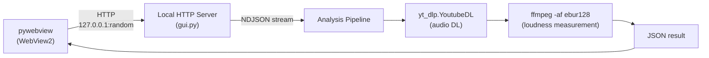

# analyze-loudness

> 日本語版は [README.ja.md](README.ja.md) を参照してください.

A tool that analyzes the audio loudness of YouTube videos in compliance with BS.1770 / EBU R128.
It comes in two forms: a CLI version and a Windows GUI application version.


## Features

- Downloads the audio of a YouTube video (yt_dlp Python API, opus format)
- EBU R128 loudness analysis (Momentary 400ms / Short-term 3s)
- Numeric summary (Integrated, True Peak, LRA, median, P10/P90, silence ratio)
- CLI: generates a 4-row PNG chart (matplotlib)
- GUI: interactive charts drawn in the browser (uPlot + Canvas)
- Saves analysis results as JSON
- Analysis of local audio files (path input, file picker, drag & drop)
- Comparison mode: overlays 2-6 results for comparison (aligned to the length of the shortest track). URLs and saved JSON can be mixed, and the comparison result can also be saved as JSON and as an image
- Auto-update of the installed app (Windows / macOS) (it asks before updating; the check at launch can be turned off in the settings)

## Architecture



The GUI consists of pywebview (WebView2) + a local HTTP server.

## Requirements

- Windows (x64)
- macOS: **v1.3.0 and later are Apple Silicon (M1 or later) only**. Intel Macs (x86_64) are not supported (to stop the warning macOS 26 shows that support for apps for Intel processors is ending, the bundled ffmpeg / ffprobe were switched to Apple Silicon native builds only). If you use an Intel Mac, please use [v1.2.0](../../releases/tag/v1.2.0)

## Local setup

### Prerequisites

- Python 3.11+
- ffmpeg / ffprobe (`static-ffmpeg` is not needed if they are already installed on the system)

### Setup

```bash
git clone <repo-url>
cd analyze-loudness

python -m venv .venv
source .venv/bin/activate        # Windows: .venv\Scripts\activate
pip install -e ".[dev]"

python -m pytest tests/ -v
```

### CLI usage

```bash
# Analyze the full length
analyze-loudness "https://www.youtube.com/watch?v=XXXXX"

# Analyze the middle 10 minutes and set the output directory
analyze-loudness "https://www.youtube.com/watch?v=XXXXX" \
    --duration 10 \
    --output-dir ./out

# Compare (2-6 sources; a saved single-result JSON can be passed too)
analyze-loudness "https://www.youtube.com/watch?v=AAAAA" ./loudness_B.json

# A local audio file (can be used in a comparison too)
analyze-loudness ./recording.wav
```

A comparison writes `loudness_compare.json` and `loudness_compare.png` (when a file with the same name exists, `_2`, `_3` … is appended). `--duration` cannot be used for a comparison.

#### CLI options

| Option | Default | Description |
|---|---|---|
| `--duration` | none (full length) | Length to analyze (minutes). Cuts out the middle part of the video and analyzes it (single analysis only) |
| `--output-dir` | `.` | PNG output directory |

#### CLI output example

```
========================================================
  Video Title
========================================================
  Duration          : 30.5 min (18265 frames)
  Integrated        : -20.8 LUFS
  True Peak (max)   : +0.3 dBFS
  LRA               : 4.5 LU
  Short-term median : -21.4 LUFS
  Short-term P10/P90: -24.3 / -20.1 LUFS
  Momentary  median : -21.2 LUFS
  Momentary  P10/P90: -34.8 / -19.2 LUFS
  Silence (S<-40)   : 13.8%
========================================================
```

### GUI usage

```bash
pip install -e ".[gui]"
analyze-loudness-gui
```

To compare, enter a URL and queue it with "+ Add Track". While the queue is not empty, "Load JSON" adds a saved single-result JSON to the queue. With two or more queued, pressing "Compare" analyzes the URL rows in order and shows the comparison. A saved comparison JSON can be opened with "Load JSON" while the queue is empty.

Enter a URL or a local file path in the input field (you can also choose a file with "Browse" or drop a file onto the window). The GUI always analyzes the full length. An equivalent of `--duration` (specifying the length to analyze) is not implemented in the GUI. To analyze only the middle part, use the CLI's `--duration` option.

### App updates

The installed app checks [GitHub Releases](../../releases) at launch for a newer version (apart from the audio fetched for analysis, this is the only network access the app makes on its own). If a newer version exists, it asks "Version X is available. Update now?", and only when you press OK does it download the update, verify with its signature that it has not been tampered with, install it, and restart the app. Restarting clears analysis results that are not saved.

- The check at launch can be turned off in the settings of the gear button at the top right ("Check at launch"). "Check now" checks manually as well
- Windows: a User Account Control (UAC) prompt appears when the installer runs. The app is already closed at that point, so choosing "No" leaves the app not updated and closed. Launching it again shows the update prompt again
- macOS: keep the app in the "Applications" folder. If you lack permission to write to that folder, it asks for an administrator password. When two copies of the same app are running, quit one before updating
- It does not update during an analysis. Press "Check now" after the analysis finishes

### Build & distribution (Windows)

```bash
python build.py              # download assets + PyInstaller bundle
python build.py --installer  # + Inno Setup installer (.exe)
```

## Tests

```bash
source .venv/bin/activate        # Windows: .venv\Scripts\activate
python -m pytest tests/ -v
```

30 tests: CLI (analysis, cli, download)

## Project layout

```
analyze-loudness/
├── .gitignore
├── .venv/                      # Python virtual environment (not tracked by git)
├── CLAUDE.md                   # Project instructions for AI
├── README.md
├── pyproject.toml              # CLI tool (pip install -e ".[dev]")
├── src/analyze_loudness/       # Python package
│   ├── __init__.py             # _subprocess_kwargs() helper
│   ├── __main__.py
│   ├── cli.py                  # argparse + main orchestration (CLI)
│   ├── gui.py                  # pywebview + local HTTP server (GUI)
│   ├── download.py             # yt_dlp.YoutubeDL API, local files, ffprobe duration
│   ├── analysis.py             # ebur128 stderr parsing, compute_stats
│   ├── compare.py              # result / comparison JSON, truncated statistics
│   └── plot.py                 # matplotlib figure generation (CLI only)
├── frontend/
│   ├── index.html
│   ├── main.js                 # fetch + NDJSON progress + DOM rendering
│   ├── charts/
│   │   ├── timeline.js         # uPlot wrapper
│   │   ├── histogram.js        # Canvas histogram
│   │   └── segments.js         # Canvas segment bars
│   ├── style.css
│   └── vendor/                 # uPlot (bundled)
├── tests/
│   ├── test_analysis.py
│   ├── test_cli.py
│   └── test_download.py
├── docs/
│   ├── architecture.md
│   └── security-audit.md
├── build.py                    # Build script (asset download + PyInstaller + Inno Setup)
├── analyze-loudness.spec       # PyInstaller spec
├── installer.iss               # Inno Setup script
├── THIRD_PARTY_LICENSES.txt    # Bundled license file
└── build_assets/bin/           # ffmpeg, ffprobe, deno (not tracked by git)
```
