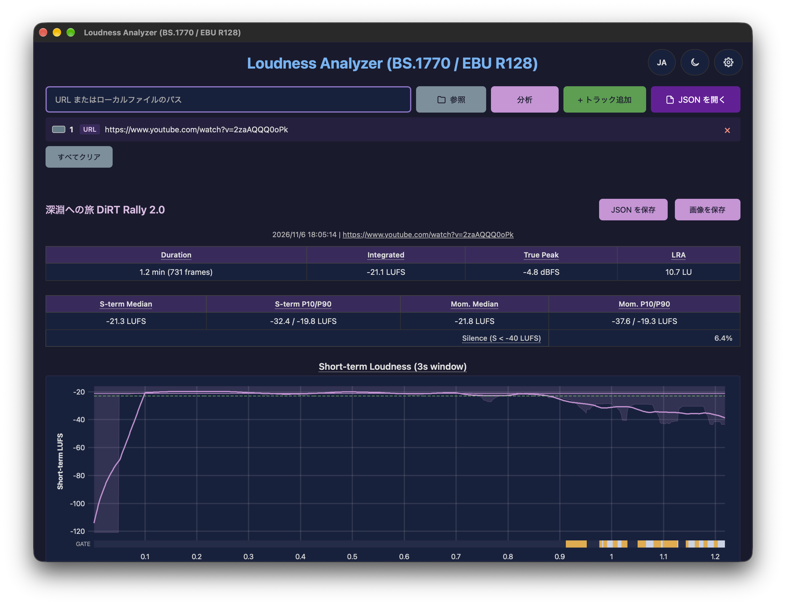
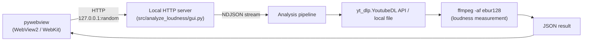

# analyze-loudness

[](https://codecov.io/gh/semnil/analyze-loudness)

> 日本語版は [README.ja.md](README.ja.md) を参照してください.

A tool that analyzes the audio loudness of YouTube videos and local audio files in compliance with BS.1770 / EBU R128.
It comes in two forms: a command-line interface (CLI) version and a graphical user interface (GUI) application version (Windows / macOS).



## Features

- Downloads the audio of a YouTube video (yt_dlp Python API, opus format)
- EBU R128 loudness analysis (Momentary 400ms / Short-term 3s)
- Numeric summary (Integrated loudness in Loudness Units relative to Full Scale (LUFS), True Peak, Loudness Range (LRA), median, 10th and 90th percentiles (P10/P90), silence ratio)
- CLI: generates a 4-row PNG chart (matplotlib)
- GUI: interactive charts drawn in the app window (uPlot + Canvas)
- GUI: saves analysis results as JSON and as an image
- Analysis of local audio files (path input, file picker, drag & drop)
- Comparison mode: overlays 2-6 results for comparison (aligned to the length of the shortest track). URLs, local files and saved JSON can be mixed, and the comparison result can also be saved as JSON and as an image
- GUI: light / dark / auto theme and English / Japanese display
- Auto-update of the installed app (Windows / macOS) (it asks before updating; the check at launch can be turned off in the settings)

## Requirements

The distributed app runs on:

- Windows (x64)
- macOS: **v1.3.0 and later are Apple Silicon (M1 or later) only**. Intel Macs (x86_64) are not supported (to stop the warning macOS 26 shows that support for apps for Intel processors is ending, the bundled ffmpeg / ffprobe were switched to Apple Silicon native builds only). If you use an Intel Mac, please use [v1.2.0](../../releases/tag/v1.2.0)

## Usage

### CLI

Install it from a clone of this repository (the "Setup" section under "Development"), then:

```bash
# Analyze the full length
analyze-loudness "https://www.youtube.com/watch?v=XXXXX"

# Analyze the middle 10 minutes and set the output directory
analyze-loudness "https://www.youtube.com/watch?v=XXXXX" \
    --duration 10 \
    --output-dir ./out

# Compare (2-6 sources; a saved single-result JSON can be passed too)
analyze-loudness "https://www.youtube.com/watch?v=AAAAA" ./loudness_B.json

# A local audio file (can be used in a comparison too)
analyze-loudness ./recording.wav
```

A single analysis writes `<title>_loudness.png` (`<title>_<minutes>m_loudness.png` with `--duration`). A comparison writes `loudness_compare.json` and `loudness_compare.png` (when a file with the same name exists, `_2`, `_3` … is appended). `--duration` cannot be used for a comparison, and a saved JSON can only be used in a comparison.

#### Options

| Option | Default | Description |
|---|---|---|
| `--duration` | none (full length) | Length to analyze in minutes, up to 240. Cuts out the middle part of the source and analyzes it (single analysis only) |
| `--output-dir` | `.` | Output directory of the PNG and, for a comparison, of the JSON |

#### Output example

```
========================================================
  Video Title
========================================================
  Duration          : 30.4 min (18265 frames)
  Integrated        : -20.8 LUFS
  True Peak (max)   : 0.3 dBFS
  LRA               : 4.5 LU
  Short-term median : -21.4 LUFS
  Short-term P10/P90: -24.3 / -20.1 LUFS
  Momentary  median : -21.2 LUFS
  Momentary  P10/P90: -34.8 / -19.2 LUFS
  Silence (S<-40)   : 13.8%
========================================================
```

### GUI

```bash
pip install -e ".[gui]"
analyze-loudness-gui
```

Enter a URL or a local file path in the input field (you can also choose a file with "Browse" or drop a file onto the window) and press "Analyze". The source moves from the input field to the queue of tracks. The GUI always analyzes the full length. An equivalent of `--duration` (specifying the length to analyze) is not implemented in the GUI. To analyze only the middle part, use the CLI's `--duration` option.

To compare, enter the next URL or local file path and press "Compare" (the button reads "Compare" while the queue and the field hold two or more sources), or queue sources first with "+ Add Track". To analyze another source on its own, press "Clear All" first. "Clear All" also clears the result on screen, and adding or removing a track clears it while tracks stay in the queue. Moving a track reorders a comparison on screen. A source in the input field that the queue already holds stays in the field and is not added twice; "Load JSON" and dropped files are not checked. While the queue is not empty, "Load JSON" adds a saved single-result JSON to the queue, and a dropped file joins the queue (so do several files dropped at once). Pressing "Compare" analyzes the rows that hold no result yet in order and shows the comparison. With one row in the queue, "Analyze" analyzes that row (a JSON row is shown without analysis). A saved comparison JSON can be opened with "Load JSON" while the queue is empty.

Dark mode is supported (a 3-way switch Light / Dark / Auto; the default follows the OS setting). The chosen theme and display language (EN / JA) are kept when the app is restarted.

### App updates

The installed app checks for a newer version at launch and updates itself when you confirm. What it does, what it connects to and how to turn the check off are in [py-analyze-common's document](https://github.com/semnil/py-analyze-common/blob/main/docs/auto-update.md#what-the-user-sees). The User-Agent of its requests is `analyze-loudness/<version>`.

## Architecture

The GUI consists of pywebview (Windows: WebView2 / macOS: WebKit) + a local HTTP server, which streams progress and results as newline-delimited JSON (NDJSON).



See [docs/architecture.md](docs/architecture.md) for details.

## Development

### Setup

Prerequisites:

- Python 3.11 or later
- ffmpeg / ffprobe on `PATH` (when ffmpeg is not on `PATH`, the CLI uses the `static-ffmpeg` package installed with this project; the GUI run from source does not)

```bash
git clone --recurse-submodules https://github.com/semnil/analyze-loudness.git
cd analyze-loudness

python3 -m venv .venv            # Windows: python -m venv .venv
source .venv/bin/activate        # Windows: .venv\Scripts\activate
pip install -e ".[dev]"
```

In a clone made without `--recurse-submodules`, run `git submodule update --init`.

### Tests

```bash
source .venv/bin/activate        # Windows: .venv\Scripts\activate
python -m pytest tests/ -v

# With coverage
python -m pytest tests/ --cov=analyze_loudness --cov-report=html
```

The UI tests (`tests/test_frontend.py`, `tests/test_chart_rendering.py`) use Playwright's Chromium. Run `python -m playwright install --with-deps chromium` the first time.

### Build & distribution

```bash
python build.py              # download assets + PyInstaller bundle
python build.py --installer  # + Inno Setup installer (.exe) / DMG (macOS)
```

The bundle is written to `dist/analyze-loudness/` (`dist/Loudness Analyzer.app` on macOS) and the installer to `installer_output/`.

The prerequisites, what `build.py` downloads and its flags are in [py-analyze-common's README](https://github.com/semnil/py-analyze-common/blob/main/README.md#building-a-consumer).

## Project layout

```mermaid
graph LR
    root["analyze-loudness/"]
    root --> gh[".github/<br>workflows (continuous integration, release and tagging, ffmpeg watch,<br>workflow checks, Dependabot auto-merge) and their tests,<br>Dependabot settings, issue templates"]
    root --> r_ignore[".gitignore"]
    root --> r_mod[".gitmodules"]
    root --> r_venv[".venv/<br>Python virtual environment (not tracked by git)"]
    root --> r_claude["AGENTS.md<br>project instructions for AI"]
    root --> r_readme["README.md"]
    root --> r_readme_ja["README.ja.md"]
    root --> r_pyproj["pyproject.toml<br>package, dependencies, commands"]
    root --> req["requirements/<br>hash-pinned packages the release jobs install"]
    root --> src["src/analyze_loudness/<br>Python package"]
    src --> src_init["__init__.py<br>sys.path injection of vendor/, SCHEMA_VERSION"]
    src --> src_main["__main__.py"]
    src --> src_cli["cli.py<br>argparse + main orchestration (CLI)"]
    src --> src_gui["gui.py<br>pywebview + local HTTP server (GUI)"]
    src --> src_dl["download.py<br>yt_dlp.YoutubeDL API, local files, ffprobe duration"]
    src --> src_ana["analysis.py<br>ebur128 stderr parsing, compute_stats"]
    src --> src_cmp["compare.py<br>result / comparison JSON, truncated statistics"]
    src --> src_upd["update.py<br>auto-update identity (UPDATE_CONFIG)"]
    src --> src_plot["plot.py<br>matplotlib figure generation (CLI only)"]
    root --> fe["frontend/"]
    fe --> fe_idx["index.html"]
    fe --> fe_main["main.js<br>fetch + NDJSON progress + DOM rendering"]
    fe --> fe_theme["theme.js<br>chart colors (light / dark)"]
    fe --> fe_gate["gate.js<br>BS.1770 gating for the GATE lane"]
    fe --> fe_i18n["i18n.js<br>en / ja UI strings"]
    fe --> ch["charts/"]
    ch --> ch_tl["timeline.js<br>uPlot wrapper"]
    ch --> ch_hist["histogram.js<br>Canvas histogram"]
    ch --> ch_seg["segments.js<br>Canvas segment bars"]
    fe --> fe_css["style.css"]
    fe --> fe_vendor["vendor/<br>uPlot (bundled)"]
    root --> t["tests/<br>pytest (tests/frontend/ holds the UI tests run with Playwright)"]
    root --> docs["docs/"]
    docs --> docs_arch["architecture.md"]
    docs --> docs_arch_ja["architecture.ja.md"]
    docs --> docs_dec["decisions/<br>records of closed decisions (English .md and Japanese .ja.md)"]
    docs --> docs_shot["screenshot.png"]
    root --> vend["vendor/py-analyze-common/<br>shared library (git submodule)"]
    root --> r_build["build.py<br>build script (asset download + PyInstaller + Inno Setup / DMG)"]
    root --> r_spec["analyze-loudness.spec<br>PyInstaller spec"]
    root --> r_iss["installer.iss<br>Inno Setup script"]
    root --> r_tpl["THIRD_PARTY_LICENSES.txt<br>bundled license file"]
    root --> r_gpl["licenses/<br>full texts of the GNU General Public License (GPL) v2 / v3"]
    root --> ba["build_assets/"]
    ba --> ba_pin["ffmpeg.json<br>pinned ffmpeg / ffprobe builds"]
    ba --> ba_sum["checksums.json<br>SHA256 of the uPlot files"]
    ba --> ba_icon["icon_draft.svg, icon.ico, icon.png, icon.iconset/<br>app icon"]
    ba --> ba_bin["bin/<br>ffmpeg, ffprobe, deno (not tracked by git)"]
```



## Dependencies

### Runtime

- numpy
- matplotlib (the CLI's chart)
- yt-dlp (pinned to one version in `pyproject.toml`)
- yt-dlp-ejs (pinned to one version in `pyproject.toml`; the YouTube challenge solver scripts yt-dlp reads)
- static-ffmpeg (the CLI uses it when ffmpeg is not on `PATH`)
- pywebview (GUI only)
- certifi (GUI only, certificate authority (CA) bundle for the update check)
- py-analyze-common (the git submodule at `vendor/py-analyze-common`, not listed in `pyproject.toml`)

### External tools

- ffmpeg / ffprobe
- deno (the built app bundles it. Run from source, yt-dlp uses the one on `PATH`, and runs with no JavaScript runtime when there is none)

## License

See [THIRD_PARTY_LICENSES.txt](THIRD_PARTY_LICENSES.txt) for bundled third-party software licenses. `licenses/` holds the full texts of the GPL v2 / v3 that file points at.
