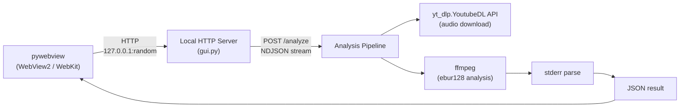
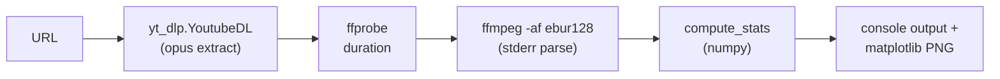
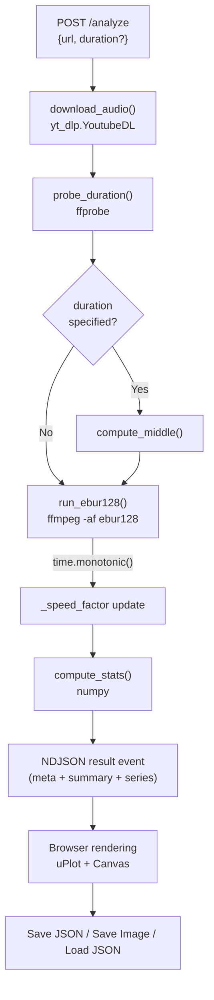
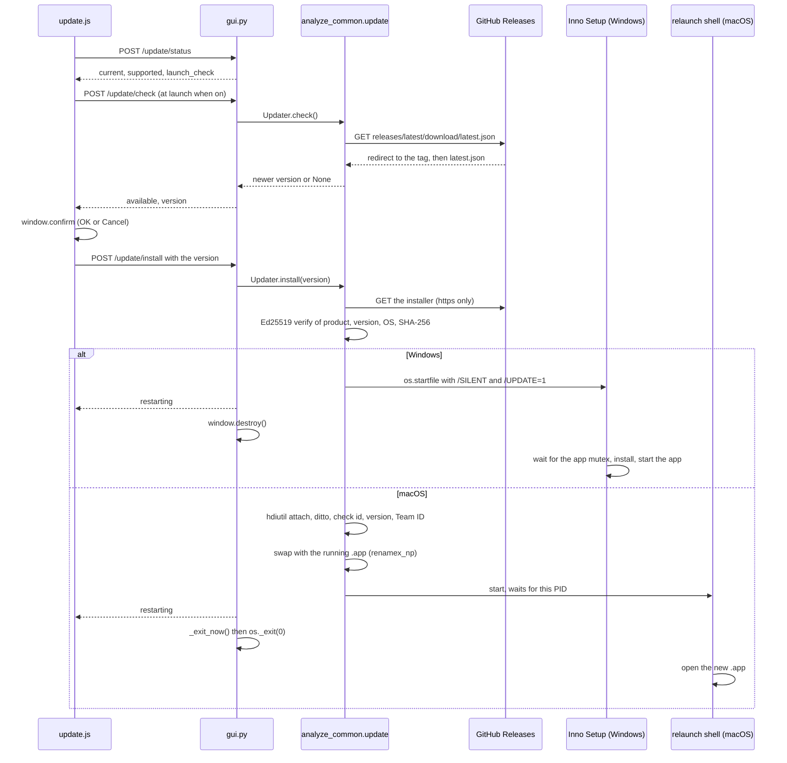

# Architecture Design Document

> For the English version, see [architecture.md](architecture.md).

## Overview

analyze-loudness は YouTube 動画の音声ラウドネスを BS.1770 / EBU R128 準拠で分析するツール。
CLI ツールとしてローカル実行可能であり、Windows / macOS の GUI アプリケーション (pywebview) としても提供する。

## System Architecture



## Components

### CLI Tool (`src/analyze_loudness/`)

| Module | Responsibility |
|--------|---------------|
| `cli.py` | argparse + orchestration, static-ffmpeg PATH setup |
| `download.py` | `yt_dlp.YoutubeDL` Python API でダウンロード + タイトル取得、ローカルファイルの解決 (`resolve_source`)、ffprobe duration, filename sanitization |
| `analysis.py` | ffmpeg ebur128 stderr parsing, numpy-based statistics |
| `plot.py` | matplotlib 4-row figure generation (timeline, histograms, segments); comparison figure (`plot_compare`) |
| `compare.py` | 単体結果 JSON の組み立て (`build_result`)・検証 (`validate_single`)、比較 JSON の組み立て (`build_compare`)・検証 (`validate_compare`)、切り詰めた範囲の統計 (`truncated_stats`) |

### GUI Application (`src/analyze_loudness/gui.py`)

| Component | Responsibility |
|-----------|---------------|
| `AnalyzeHandler` | py-analyze-common の `GuiHandler` (`analyze_common/server.py`) を継承。`GuiHandler` が frontend と `/common/*` の配信、Host と Content-Type の検査、`/browse`・`/save-image`・`/settings`・`/update/*` を受け持ち、このアプリの状態 (`updater()`・`ui_settings()`・`window()`・`dialog_lock()`・`exit_for_update()`) を渡す |
| `do_POST()` | `/analyze`, `/compare`, `/save`, `/load`, `/upload` と `GuiHandler` のエンドポイント (`_shared_handlers()`) のルーティング。Content-Type の検査 (`_check_content_type`) |
| `_handle_upload()` | ドロップされたファイルを一時ディレクトリ `_upload_dir` に保存 |
| `_run_analysis()` | download -> probe -> ebur128 (計時) -> stats -> result の NDJSON ストリーム |
| `_handle_save()` | JSON 保存 (ネイティブファイルダイアログ) |
| `_handle_compare()` | 2〜6 本の単体結果を受け取り、比較 JSON と切り詰めた範囲の統計を返す |
| `_handle_load()` | JSON 読み込み + バリデーション (ネイティブファイルダイアログ)。比較 JSON は統計を添えて返し、キャッシュには入れない |
| `_exit_now()` | macOS の更新で bundle を入れ替えた後の終了。atexit の後始末を行ってから `os._exit(0)` |
| `_speed_factor` | runtime-calibrated 速度係数。分析時間から次回の推定時間を算出 |
| `main()` | Windows AppUserModelID 設定 (`set_app_user_model_id`、タスクバーアイコン反映) + Windows の mutex の保持 (`hold_instance_mutex`) + HTTPServer (127.0.0.1:0) 起動 + pywebview ウインドウ表示 |

### Frontend (`frontend/`)

| File | Responsibility |
|------|---------------|
| `index.html` | SPA entry point, local vendor files |
| `main.js` | Fetch orchestration, NDJSON progress parsing, DOM rendering, save/load/image capture, theme toggle, language toggle, cancel (AbortController), `_addTip` ツールチップ, 比較の待ち行列 (`compareQueue`) と比較表示 (`renderCompare`) |
| `theme.js` | `isDark()`, `getTheme()` — theme detection + chart color provider (比較トラックの 6 色 `trackColors` を含む) |
| `i18n.js` | en / ja DICT。py-analyze-common の `/common/i18n.js` がこれを `window.i18n.t / setLang / onChange / applyStatic` にする。続く `/common/boot.js` が CSS の描画前にテーマと言語を `<html>` に付け、`/common/ui.js` (アイコン、ツールチップ、ボタン幅、エラー行) は `main.js` の前に読む |
| `gate.js` | `computeGate()` — BS.1770 の絶対 / 相対ゲートを `series.M` から再構成 |
| `charts/timeline.js` | uPlot time series (60-frame moving average, GATE lane, theme-aware)。比較用 `renderCompareTimeline` (トラックごとの線と GATE 帯、線の右端にトラック番号) |
| `charts/histogram.js` | Canvas density histogram (theme-aware, タイトルは HTML 側)。比較用 `renderHistogramCompare` (トラックごとの輪郭線、最頻ビンにトラック番号) |
| `charts/segments.js` | Canvas 5-min segment bar chart (theme-aware, タイトルは HTML 側)。比較ではトラック色を渡してトラックごとに 1 枚描く |
| `style.css` | CSS variables + `[data-theme="dark"]` rules, purple accent (#9C27B0) |
| `vendor/` | uPlot.iife.min.js, uPlot.min.css (bundled) |

### Shared Utilities (`src/analyze_loudness/__init__.py`)

| Function | Responsibility |
|----------|---------------|
| (import 時) | `vendor/py-analyze-common/src` を `sys.path` に加える |
| `_ffmpeg_kwargs()` | py-analyze-common の `ffmpeg_kwargs()`。OS ごとの subprocess の引数 (Windows frozen mode ではコンソールウインドウを非表示にする) に `LC_ALL=C` を加える |
| `_json_safe()` | py-analyze-common の `json_safe()`。NaN / Infinity を再帰的に None にする |

## Data Flow

### CLI



### GUI



### NDJSON Progress Stream

GUI の `/analyze` エンドポイントは `application/x-ndjson` でストリーミング応答する:

```
{"type":"progress","stage":"download","message":"Downloading audio..."}
{"type":"progress","stage":"download","message":"Downloaded: Video Title"}
{"type":"progress","stage":"analyze","message":"Running EBU R128 analysis...","estimate_sec":12,"duration_sec":600}
{"type":"progress","stage":"stats","message":"Computing statistics..."}
{"type":"result","data":{...}}
```

入力 validation 失敗 (URL/duration の型/範囲不正) は HTTP 400 + JSON で返す。
それ以降のダウンロード・解析フェーズで発生したエラーは **HTTP 200 + NDJSON `{"type":"error","error":"..."}`** として返る。
応答ヘッダ送信後に HTTP ステータスを変更できないための設計上の契約であり、クライアントは HTTP ステータスだけでなく NDJSON の `type` フィールドで成否を判定する。
`Content-Length` / `Transfer-Encoding: chunked` は付与せず、フレーム境界は `Connection: close` で確定させる。

## Key Design Decisions

### 1. ebur128 stderr parsing (not WAV decoding)

ffmpeg の ebur128 フィルタは stderr にフレーム毎のラウドネス値を出力する。
50分の音声を WAV デコードすると 4GB 超のメモリが必要になるため、
stderr テキストのみを処理し、メモリ消費を数MB に抑えている。

### 2. Local HTTP server + pywebview

pywebview は OS のネイティブ WebView (Windows: WebView2 / macOS: WebKit) を使用し、
バンドルサイズを小さく保てる。
`HTTPServer` を 127.0.0.1 のランダムポート (port 0) で起動し、
same-origin で frontend を配信する。

### 3. Runtime-calibrated time estimation

`_speed_factor` を分析の実測時間から更新し、次回以降の推定精度を向上。
初期値は 55.0 (実時間の約 55 倍速) で、各分析完了後に `analyze_sec / elapsed` で更新。

### 4. yt-dlp Python API (not bundled binary)

`yt_dlp.YoutubeDL` クラスを Python ライブラリとして直接呼び出し、`FFmpegExtractAudio` postprocessor で opus 抽出。`extract_info(download=True)` の戻り値にタイトルが含まれるため、並行実行が不要。

バイナリ同梱 (`yt-dlp_macos` など) を避けることで、macOS 向けの codesign 再署名時に発生する Team ID 不一致問題 (onefile バイナリ内部の Python.framework が再署名できず hardened runtime で拒否される) を根本的に回避している。Windows / Linux でも同方式で統一。

### 5. Middle extraction

長時間動画は中盤のみを分析する。`ffmpeg -ss <start> -t <duration>` で
ebur128 分析時に直接切り出し。

CLI のみが `--duration` オプションでこの機能を公開する。GUI にはこれに相当する入力 UI を実装しない (常に全尺を分析)。GUI は URL かローカルファイルのパスだけを受け取るシンプルなワークフローを優先し、部分抽出が必要な用途は CLI に委ねる方針。

### 6. Conditional static-ffmpeg (CLI only)

CLI ではシステムに ffmpeg がインストールされていれば `static-ffmpeg` を使わない。
py-analyze-common の `find_executable("ffmpeg")` (PATH のうち絶対パスの項目だけを探す。ffmpeg を起動するときと同じ探し方) で検出し、不在時のみ `static_ffmpeg.add_paths()` を呼ぶ。

### 7. uPlot ダークモードと CSS `!important`

uPlot は凡例・タイトルの `color` をインラインスタイルで設定するため、CSS から上書くには
`!important` が必要。JS で DOM を直接操作する方法もあるが、テーマ切替のたびに uPlot 内部 DOM を
走査する必要があり、バージョンアップ時の破綻リスクは CSS `!important` と同等かそれ以上。
uPlot のインラインスタイル上書きは `!important` の正当なユースケースであり、現状維持とする。

### 8. Dark mode (light / dark / auto)

CSS 変数 (`--bg`, `--text`, `--accent` 等。共通分は `analyze_common/web/common.css`) + `[data-theme="dark"]` でテーマを切り替え。
`theme.js` の `getTheme()` がチャート描画時のカラーパレットを返す。
fixed top-right pill ボタン (太陽 / 三日月 / 半分を塗った円の SVG) で light → dark → auto をサイクル。
`auto` は OS の `prefers-color-scheme` に追従し、`matchMedia` の `change` イベントでリアルタイム反映。
選択はアプリの設定ファイル (`settings.json`) の `theme` に `/settings` で保存し、`/common/settings.js` が次の起動のページへ渡す
(webview の localStorage が次の起動に残らない理由は「起動時に確認」の保存先と同じ)。ウィンドウの背景色も同じ値から決め、macOS ではページが描かれるまでその色を見せる (`show_window_color_until_paint()`。WKWebView が最初の描画まで描く白を消す)。言語も同じファイルの `lang` に置く。
UI は analyze-spectrum プロジェクトと統一。

### 9. Analysis cancel (AbortController)

分析中に Analyze ボタンが Cancel に変化 (赤色)。`AbortController.signal` を `fetch()` と
NDJSON `ReadableStream.getReader()` に渡し、キャンセル時にストリーム読み取りを中断。
`_isBusy` フラグで Load ボタンを無効化し、二重実行を防止。

### 10. Windows subprocess console hiding

PyInstaller frozen mode では `subprocess.STARTUPINFO` + `STARTF_USESHOWWINDOW` で
ffmpeg / ffprobe のコンソールウインドウを非表示にする。yt-dlp は Python API として動作するため subprocess 起動しない。

### 11. GATE lane

Integrated は BS.1770 の絶対ゲート (-70 LUFS) と相対ゲート (絶対ゲート通過ブロックの平均 -10 LU) を
越えた 400 ms ブロックだけを集計するが、タイムラインはこの取捨を表示していなかった。
Timeline の x 軸ガター (プロット領域とメモリラベルの間) に高さ 12 px の GATE 帯を置き、
除外ブロックを琥珀色 (相対ゲート以下) / スレート (絶対ゲート以下) で示す。

- **ffmpeg のウォームアップ 3 フレームを除外する**。100 ms ごとに出力されるが Momentary 窓は 400 ms
  のため、t = 0.1 / 0.2 / 0.3 は窓が埋まらず無音フロア -120.7 になる。ゲート対象ブロックではないので
  `_firstGatedIndex()` が `series.t` から先頭を判定し、統計の分母からも外す。
  実測で 36 秒クリップの無音 0.91% はすべてこのフレームだった (修正後 0.00%)。
- **相対ゲートは `summary.gate_threshold` (schema 2) を使い、無ければ `series.M` から再計算する**
  (`gate.js` の `computeGate(M, threshold)`)。schema 1 の保存済み JSON はフォールバック経路に乗る。
  再計算した Integrated は保存済み JSON 13 本すべてで保存値と 0.05 LU 以内で一致する。
  最長ファイル (116,299 ブロック) で `computeGate` は 1.03 ms → 0.25 ms。
  ffmpeg の値は小数 1 桁に丸められているため 2 経路の結果は完全一致せず、しきい値ちょうどに乗った
  ブロックの判定だけが変わる (実測最大 303 / 95,957 ブロック = 算入率で 0.3 ポイント)。
- **プロット領域は不変**。x 軸の `gap` / `size` とチャート高さを同じ 11 px ずつ広げて帯の場所を作るため、
  帯の有無でプロット bbox は 2160x540 device px のまま変わらない (実測)。
- **1 画素列に算入・除外が混在する場合は除外として描く**。
  この丸めのため、長尺では帯の塗り面積が実際の除外率を上回る (61-193 分の実ファイルで
  除外 10-25% に対し帯の塗り 27-80%)。x 軸をドラッグズームすると 1 列あたりのブロック数が減り、
  帯は実際の除外区間に収束する。
- 数値サマリー (算入率 / 除外率 / しきい値) はチャート直下の `.gate-caption` に置き、
  composite PNG には summary テキストの 1 行として焼き込む。

### 12. Comparison mode

2〜6 本の結果を先頭から重ね、一番短いトラックの長さで全トラックを切り詰めて比べる。

- **入力**: GUI は待ち行列 (`+ Add Track` で URL、待ち行列が空でないときの Load JSON で保存済みの単体 JSON) を
  Compare で処理する。URL の行は `/analyze` で順に分析し、全トラックを `/compare` へ送る。
  単体の結果を表示しているときに入力欄がその `source_url` と同じなら、`+ Add Track` は表示中の結果そのものを
  行に持たせる (`/load` のキャッシュは URL ごとに最後に読んだ結果だけを持つため、URL で引き直すと別の結果に入れ替わりうる)。
  CLI は位置引数を 2〜6 個受け取り、`.json` で終わるローカルパスを保存済みの単体 JSON として読む。
  比較では `--duration` を受け付けない。
- **切り詰め**: `compare.common_frames()` が一番短いトラックの最終時刻 (+ 半フレーム) までのフレーム数を
  各トラックで数え、その最小値で全トラックの `series` を切る。全トラックのフレーム数が揃うので、
  タイムラインは 1 本の時間軸を共有する。
- **統計は Python の 1 か所で計算する**。切り詰めた範囲の Integrated・S/M の中央値と P10/P90・無音率は
  `compare.truncated_stats()` が保存済みの系列から算出し、`/compare` と `/load` の応答に `stats` として添える。
  比較 JSON には保存しない。True Peak と LRA は系列から算出できない (True Peak) か ffmpeg と同じ値になる保証がない
  (LRA) ため、各トラックの全長の値を「(full)」と明示して表示する。
- **切り詰めた範囲の Integrated は相対ゲートを切り詰めた範囲で計算し直す**。全長の `summary.gate_threshold`
  を使わない。同梱 ffmpeg 8.1 で、全長の系列 M の先頭 T 秒から再計算した値と、同じ音声を `-t T` で測った
  ffmpeg の Integrated (`ebur128=metadata=1` の `lavfi.r128.I`、小数 3 桁) を照合した結果、
  4 本の音声 (33 秒〜144.5 分) × T = 20 / 37.3 / 60 / 300 / 1800 / 3600 秒のうち音声より短い 17 件で
  差は最大 0.014 LU。全長の `gate_threshold` を流用すると最大 2.92 LU ずれる。
  `-t T` で測った t / M / S は全長の先頭フレームと一致する (差 0)。
  フロントエンドの GATE 帯も `computeGate(M, t, null)` で相対ゲートを計算し直す。
- **比較 JSON** (schema 3): `{"meta": {...}, "compare": {"truncate_sec": T, "tracks": [単体結果, ...]}}`。
  各トラックの `summary` は全長の値、`series` は切り詰めた範囲。一番上に `summary` / `series` を置かないので、
  schema 2 以前の版は「missing summary or series」で読み込みを拒む。読み込みの分岐は `compare` の有無で行う。
  待ち行列が空でないときの比較 JSON の読み込みは拒否する。
- **サイズの上限**: `/compare` の要求本文は 64 MiB まで (`_MAX_BODY`)。保存済みの単体 JSON 9 本
  (43,092〜116,299 フレーム) を区切り無しで書き出すと 1 フレーム 18.2〜18.5 バイトで、6 トラック × 各 1010 分
  まで送れる。GUI と CLI は比較 JSON をインデント付きで保存し、3 トラック・12,123 フレームの比較 JSON で
  1 フレーム 56.4 バイト。その大きさで 6 × 1010 分の比較を保存しても開けるよう、`/load` の上限
  (`_MAX_LOAD_BYTES`) を 210 MB にしている。
- **トラックの区別**: 色は `theme.js` の `trackColors` (ライト / ダーク各 6 色、チャート背景とのコントラスト比は
  最小 3.05)。色だけに頼らないよう、タイムラインの線の右端・ヒストグラムの最頻ビン・GATE 帯のラベル・
  セグメントの見出しにトラック番号を描く。CLI の図はライトの 6 色 (`plot.py` の `TRACK_COLORS`) を使う。

### 13. Auto-update

インストール版 (frozen の Windows x64 / macOS arm64) は起動時に GitHub の最新の Release を確認し、
確認ダイアログで OK のときだけ更新を取得・検証・適用する。クライアントは py-analyze-common の
`analyze_common/update.py`、UI は `analyze_common/web/update.js` (`/common/update.js` で配信) で、
analyze-spectrum と共有する。このリポジトリの固有部分は `src/analyze_loudness/update.py` の `UPDATE_CONFIG`。



- **署名**: `latest.json` は OS ごとに `url` と `signature` を持つ。署名の対象は
  `analyze-update-v1\n{product}\n{version}\n{platform}\n{sha256}\n` で、版と OS が入るので、
  古い正規のインストーラーへの版番号の付け替えと別 OS のファイルの流用は検証で落ちる。Ed25519 の検証は
  純 Python (`analyze_common/ed25519.py`、RFC 8032) で、`cryptography` は bundle から除いたまま。
  署名は CI で `openssl pkeyutl -rawin` が作り、`analyze_common/update_manifest.py` がアプリの公開鍵で検証し直す。
- **macOS の終わり方**: PyInstaller は遅延 import のたびにアーカイブをパスで開き直すため、bundle を入れ替えた後に
  import が走ると新しい版のファイルを読む。入れ替えの後は `_exit_now()` が atexit の後始末を自分で行い、
  `os._exit(0)` で interpreter の終了処理を通らずに終わる。入れ替えはアプリ自身が行う (Tauri の updater と同じ方式)。
- **再起動したプロセスの環境**: `open` で起動したアプリには呼び出し側の環境変数が渡る (2026-10-20 に、
  テスト用の変数と `_PYI_PARENT_PROCESS_LEVEL=1` が再起動後のプロセスに渡ることを `ps -wwE` で確認)。
  PyInstaller 6.9 以降の bootloader は、`_PYI_ARCHIVE_FILE` が自分と同じなら親の worker として振る舞うので、
  再起動用のシェルとインストーラーに `PYINSTALLER_RESET_ENVIRONMENT=1` を渡して独立したプロセスとして起動させる。
- **Windows の UAC**: Inno Setup の loader は `asInvoker` で起動し、必要になってから昇格を求めるので、UAC はアプリが
  閉じた後に出る。拒否するとインストールされず、アプリは閉じたままになる (起動し直すと旧版が起動する)。
- **「起動時に確認」の保存先**: アプリの設定ファイル (`analyze_common/settings.py` の `SettingsStore`。macOS は
  `~/Library/Application Support/analyze-loudness/settings.json`、Windows は `%APPDATA%\analyze-loudness\settings.json`)。
  webview の localStorage は次の起動に残らない: pywebview 6.2.1 の `webview.start()` は既定で `private_mode=True` で、
  起動ごとに website data を消す。private mode を切っても、ローカルサーバーのポートは起動ごとに変わり origin が変わる
  (2026-10-20 に pywebview を 2 回起動して確認: private mode 既定・同じポートでも前回の値は読めず、private mode を切ると
  同じポートでは読め、別のポートでは読めない)。
- **同じアプリの別プロセス**: macOS では、同じ実行ファイルの別プロセスがあると入れ替えない (入れ替えた bundle の
  上で動き続けることになるため)。Windows はインストーラーが mutex の消えるのを待つ。
- **macOS の実機確認** (2026-10-20、ローカルでビルドした未署名の 1.4.1 / 1.4.2、ローカルの配信):
  1.4.1 から更新すると、`/update/install` の応答の 3.8 秒後に旧プロセスが終わり、4.1 秒後に同じパスから
  1.4.2 が起動した。一時ディレクトリと `.app` の隣のファイルは残らなかった。1 バイトを反転した DMG は拒否され、
  旧版が動き続けた。2 つ起動しているときは入れ替えなかった。frozen のビルドから github.com への確認は
  TLS とリダイレクトを通り、`v1.4.1` に `latest.json` が無いことによる 404 になった。

## Accessibility

### prefers-reduced-motion

`@media (prefers-reduced-motion: reduce)` (py-analyze-common の `analyze_common/web/common.css`) で CSS animation / transition を一括無効化している。

チャート描画 (uPlot, Canvas histogram, Canvas segments) についてはアニメーション処理を持たず、
全て即時描画のため個別対応は不要。uPlot のカーソル追従はユーザー操作に対するリアルタイム応答であり、
WCAG 2.3.3 が対象とするアニメーションには該当しない。

カウントダウン表示は `matchMedia("(prefers-reduced-motion: reduce)")` で更新間隔を
1 秒 → 5 秒に変更済み (main.js)。

### チャートの `role="img"` 配置

各チャートには統計値を含む説明文を `aria-label` として持つ `role="img"` ノードを置く。
histogram は canvas 自体に付与し (analyze-spectrum の `_addCanvasChart` と同形)、
timeline / segments は uPlot が DOM を生成する都合上コンテナ div に付与する。

タイトルの `<h3 class="chart-title">` は必ずこのノードの**外側**に置く。
ARIA は `role="img"` の子孫を presentational として扱うため、内側に入れると
タイトルと `_addTip()` が張る `aria-describedby` (ツールチップ本文) が
支援技術に渡らないエンジンが生じる。

## Build & Distribution

### CLI

```bash
python -m venv .venv
source .venv/bin/activate        # Windows: .venv\Scripts\activate
pip install -e ".[dev]"
analyze-loudness "https://www.youtube.com/watch?v=XXXXX"
```

### GUI (PyInstaller + Inno Setup)

```bash
python build.py              # download assets + PyInstaller bundle
python build.py --installer  # + Inno Setup installer (Windows) / DMG (macOS)
```

Build pipeline:
1. `build.py --skip-download` or auto-download: ffmpeg, ffprobe, deno, uPlot (yt-dlp は Python 依存)
2. PyInstaller (`analyze-loudness.spec`): bundles Python + dependencies + frontend + binaries
3. Inno Setup (`installer.iss`): Windows installer with license display. `vendor/py-analyze-common/installer/auto_update.iss` を include し、`build.py` が `/DMyAppMutex=` を渡す。macOS は `build.py --installer` が create-dmg で DMG を作る
4. `release.yaml`: インストーラーと DMG の SHA-256 に署名した `latest.json` を Release に載せる (13. Auto-update)。そのジョブは Python パッケージをハッシュで固定した `requirements/*.txt` からだけ入れ、Inno Setup と create-dmg を SHA256 を照合してから入れる (CLAUDE.md の「Pinned release dependencies」)

### Bundled Assets (`build_assets/bin/`)

| Binary | Source | License |
|--------|--------|---------|
| deno.exe | GitHub Releases (latest) | MIT |
| ffmpeg.exe | BtbN/FFmpeg-Builds (latest の、`build_assets/ffmpeg.json` の系列の gpl ビルド) | GPL-3.0+ |
| ffprobe.exe | BtbN/FFmpeg-Builds (latest の、`build_assets/ffmpeg.json` の系列の gpl ビルド) | GPL-3.0+ |
| deno (macOS) | GitHub Releases (latest、aarch64) | MIT |
| ffmpeg / ffprobe (macOS) | osxexperts.net (arm64、`build_assets/ffmpeg.json` の URL と SHA256 で固定) | GPL-2.0+ |

## Constants

| Constant | Value | Location | Description |
|----------|-------|----------|-------------|
| SCHEMA_VERSION | 3 | \_\_init\_\_.py | 結果 JSON のスキーマ版数 (2 = `summary.gate_threshold` 追加, 3 = 比較 JSON 追加) |
| MIN_TRACKS / MAX_TRACKS | 2 / 6 | compare.py, main.js | 比較できるトラック数 |
| SILENCE_THRESHOLD | -60 LUFS | analysis.py | Stats exclude frames <= this |
| GATE_ABSOLUTE | -70 LUFS | gate.js, compare.py | BS.1770 絶対ゲート |
| GATE_BLOCK_SEC | 0.4 s | gate.js, compare.py | Momentary 窓長。ウォームアップフレームの判定に使う |
| SHORT_TERM_WINDOW_SEC | 3.0 s | analysis.py | Short-term 窓長。無音率のウォームアップ判定に使う |
| SILENCE_PCT_THRESHOLD | -40 LUFS | analysis.py | 無音率の判定しきい値 |
| GATE_RELATIVE_OFFSET | -10 LU | gate.js, compare.py | BS.1770 相対ゲート (通過ブロック平均からのオフセット) |
| GATE_LANE_H | 12 px | timeline.js | GATE 帯の高さ |
| _speed_factor | 55.0 (initial) | gui.py | Runtime-calibrated analysis speed |
| Segment size | 5 min | plot.py, segments.js | Bar chart segment width |
| Moving average window | 60 frames | plot.py, timeline.js | Timeline smoothing window |
| Downsample target | ~3000 points | plot.py | Plot responsiveness |
| Default theme | "auto" | main.js | OS prefers-color-scheme 追従 |
| Theme setting key | "theme" | analyze_common/ui_settings.py | settings.json のキー (light/dark/auto) |
| Language setting key | "lang" | analyze_common/ui_settings.py | settings.json のキー (en/ja) |
