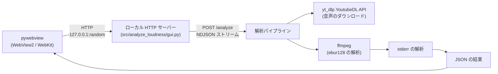
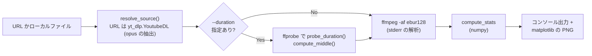
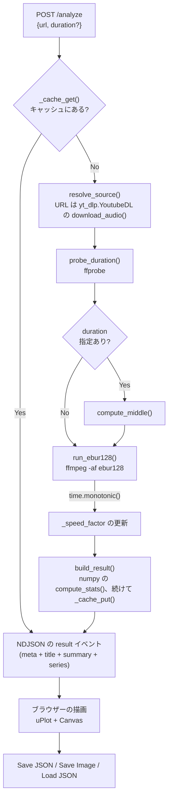

# アーキテクチャ

> For the English version, see [architecture.md](architecture.md).

## 概要

analyze-loudness は YouTube 動画とローカル音声ファイルの音声ラウドネスを ITU-R BS.1770 (国際電気通信連合のラウドネス測定の勧告。以下 BS.1770) と EBU R128 (欧州放送連合のラウドネスの勧告) に準拠して分析するツール。
コマンドラインインターフェース (CLI) のツールとしてローカルで実行でき、Windows / macOS のグラフィカルユーザーインターフェース (GUI) アプリケーション (pywebview) としても提供する。

GUI のページはローカルの Hypertext Transfer Protocol (HTTP) サーバーと通信する。サーバーは進捗と結果を、1 行に 1 つの JavaScript Object Notation (JSON) を置いた形式 (NDJSON、newline-delimited JSON) でストリーミングする。Uniform Resource Locator (URL) の音声は yt-dlp の Python のアプリケーションプログラミングインターフェース (API) で取得する。



## モジュール

### CLI ツール (`src/analyze_loudness/`)

| モジュール | 役割 |
|--------|---------------|
| `src/analyze_loudness/cli.py` | argparse + 処理の流れ、static-ffmpeg の PATH の設定 |
| `src/analyze_loudness/download.py` | ソースの解決 (`resolve_source`: URL は `download_audio()`、ローカルファイルはそのパス)、ネットワークパスの拒否 (`is_network_path`)、GUI が受け付ける拡張子 (`AUDIO_EXTENSIONS`)、ffprobe での長さの取得 (`probe_duration`)。`vendor/py-analyze-common/src/analyze_common/download.py` の `download_audio()` (`yt_dlp.YoutubeDL` の Python API でのダウンロード + タイトルの取得)、`compute_middle()`、`is_url()`、`sanitize_filename()` を再公開する |
| `src/analyze_loudness/analysis.py` | ffmpeg ebur128 の stderr の解析、numpy での統計 |
| `src/analyze_loudness/plot.py` | matplotlib の 4 段の図の生成 (集計表、タイムライン、ヒストグラム、セグメント)、比較の図 (`plot_compare`) |
| `src/analyze_loudness/compare.py` | 単体結果 JSON の組み立て (`build_result`)・検証 (`validate_single`)、比較 JSON の組み立て (`build_compare`)・検証 (`validate_compare`)、切り詰めた範囲の統計 (`truncated_stats`) |

### GUI アプリケーション (`src/analyze_loudness/gui.py`)

| 部品 | 役割 |
|-----------|---------------|
| `AnalyzeHandler` | py-analyze-common の `GuiHandler` (`vendor/py-analyze-common/src/analyze_common/server.py`) を継承。`GuiHandler` が frontend と `/common/*` の配信、Host と Content-Type の検査、`/browse`・`/save-image`・`/settings`・`/update/*` を受け持ち、このアプリの状態 (`updater()`・`ui_settings()`・`window()`・`dialog_lock()`・`exit_for_update()`) を渡す |
| `do_POST()` | `/analyze`, `/compare`, `/save`, `/load`, `/upload` と `GuiHandler` のエンドポイント (`_shared_handlers()`) のルーティング。Host の検査 (`_check_host`) と Content-Type の検査 (`_check_content_type`) |
| `_handle_upload()` | ドロップされたファイルを一時ディレクトリ `_upload_dir` に保存 |
| `_run_analysis()` | キャッシュがあればその結果の、無ければダウンロード、probe、ebur128 (計時)、統計、結果の NDJSON ストリーム |
| `_handle_save()` | JSON 保存 (ネイティブファイルダイアログ) |
| `_handle_compare()` | 2〜6 本の単体結果を受け取り、比較 JSON と切り詰めた範囲の統計を返す |
| `_handle_load()` | JSON 読み込み + バリデーション (ネイティブファイルダイアログ)。比較 JSON は統計を添えて返し、キャッシュには入れない |
| `_exit_now()` | macOS の更新で bundle を入れ替えた後の終了。atexit の後始末を行ってから `os._exit(0)` |
| `_speed_factor` | 実行時に校正する速度係数。分析時間から次回の推定時間を算出 |
| `main()` | Windows AppUserModelID 設定 (`set_app_user_model_id`、タスクバーアイコン反映) + Windows の mutex の保持 (`hold_instance_mutex`) + `_HTTPServer` (`ThreadingHTTPServer`、127.0.0.1:0) 起動 + pywebview ウインドウ表示 |
| `UPDATE_CONFIG` (`src/analyze_loudness/update.py`) | 自動更新でのこのアプリの情報: 製品名、リポジトリ、公開鍵、一時ディレクトリの接頭辞、mutex 名 |

### フロントエンド (`frontend/`)

| ファイル | 役割 |
|------|---------------|
| `frontend/index.html` | シングルページアプリケーション (SPA) の入口、ローカルの vendor ファイル |
| `frontend/main.js` | fetch の流れ、NDJSON の進捗の解析、Document Object Model (DOM) の描画、保存・読み込み・画像の取り込み、テーマの切り替え、言語の切り替え、キャンセル (AbortController)、`_addTip` でのツールチップの取り付け、比較の待ち行列 (`compareQueue`) と比較表示 (`renderCompare`) |
| `frontend/theme.js` | `isDark()`, `getTheme()`: テーマの判定 + チャートの色の提供 (比較トラックの 6 色 `trackColors` を含む) |
| `frontend/i18n.js` | en / ja DICT。py-analyze-common の `/common/i18n.js` がこれを `window.i18n.t / setLang / onChange / applyStatic` にする。続く `/common/boot.js` が Cascading Style Sheets (CSS) の描画前にテーマと言語を `<html>` に付け、`/common/ui.js` (アイコン、テーマ切り替えボタンの描画、待ち行列の行、結果のタイトル行、ツールチップ、ボタン幅、ドロップ時のオーバーレイの文字、エラー行) は `frontend/main.js` の前に読む |
| `frontend/gate.js` | `computeGate()`: BS.1770 の絶対 / 相対ゲートを `series.M` から再構成 |
| `frontend/charts/timeline.js` | uPlot の時系列 (60 フレーム移動平均、GATE レーン、テーマ対応)。比較用 `renderCompareTimeline` (トラックごとの線と GATE 帯、線の右端にトラック番号) |
| `frontend/charts/histogram.js` | Canvas の密度ヒストグラム (テーマ対応、タイトルは HyperText Markup Language (HTML) 側)。比較用 `renderHistogramCompare` (トラックごとの輪郭線、最頻ビンにトラック番号) |
| `frontend/charts/segments.js` | Canvas の 5 分セグメント棒グラフ (テーマ対応、タイトルは HTML 側)。比較では `frontend/main.js` がトラック色を渡してトラックごとに 1 枚描く |
| `frontend/style.css` | CSS 変数 + `[data-theme="dark"]` のルール、紫のアクセント (#9C27B0) |
| `frontend/vendor/` | uPlot.iife.min.js, uPlot.min.css (同梱) |

### 共通のユーティリティ (`src/analyze_loudness/__init__.py`)

| 関数 | 役割 |
|----------|---------------|
| (import 時) | `vendor/py-analyze-common/src` を `sys.path` に加える |
| `_ffmpeg_kwargs()` | py-analyze-common の `ffmpeg_kwargs()`。オペレーティングシステム (OS) ごとの subprocess の引数 (Windows frozen mode ではコンソールウインドウを非表示にする) に `LC_ALL=C` と `LANG=C` を加える |
| `_json_safe()` | py-analyze-common の `json_safe()`。NaN / Infinity を再帰的に None にする |
| `_find_executable()` | py-analyze-common の `find_executable()`。PATH のうち絶対パスの項目で見つけたプログラムの絶対パス、無ければ None |

## データの流れ

### CLI

単一のソースはコンソール出力と Portable Network Graphics (PNG) の図で終わる。



### GUI



### 比較モード

2〜6 本の結果を先頭から重ね、一番短いトラックの長さで全トラックを切り詰めて比べる。

- **入力**: 送信ボタンを押すと、入力欄の音源を待ち行列へ移す (待ち行列にある音源は入力欄に残る)。1 行なら単体の分析で (JSON の行は分析せずに表示する)、行が結果を持つ。2 行以上なら比較で、待ち行列と入力欄を合わせて 2 本以上あるときボタンは Compare になる。
  待ち行列には `+ Add Track` で URL とローカルファイルのパス、ドロップしたファイル (待ち行列が空のときに 1 ファイルだけドロップすると、入力欄に入る)、待ち行列が空でないときの Load JSON で保存済みの単体 JSON も入る。
  比較では、結果を持たない行を `/analyze` で順に分析し、全トラックを `/compare` へ送る。
  `+ Add Track`、行の削除、Load JSON、待ち行列に加わるドロップしたファイルは、待ち行列にトラックが残るときに表示中の結果を消す。Clear All も結果を消す。行を動かすと、表示中の比較の順番も入れ替わる。
  単体の結果を表示しているときに入力欄がその `source_url` と同じなら、`+ Add Track` は表示中の結果そのものを
  行に持たせる (`/load` のキャッシュは URL ごとに最後に読んだ結果だけを持つため、URL で引き直すと別の結果に入れ替わりうる)。
  CLI は位置引数を 2〜6 個受け取り、`.json` で終わるローカルパスを保存済みの単体 JSON として読む。
  比較では `--duration` を受け付けない。
- **切り詰め**: `src/analyze_loudness/compare.py` の `common_frames()` が一番短いトラックの最終時刻 (+ 半フレーム) までのフレーム数を
  各トラックで数え、その最小値で全トラックの `series` を切る。全トラックのフレーム数が揃うので、
  タイムラインは 1 本の時間軸を共有する。
- **統計は Python の 1 か所で計算する**。切り詰めた範囲の Integrated・Short-term (S) / Momentary (M) の中央値と 10 / 90 パーセンタイル (P10 / P90)・無音率は
  `src/analyze_loudness/compare.py` の `truncated_stats()` が保存済みの系列から算出し、`/compare` と `/load` の応答に `stats` として添える。
  比較 JSON には保存しない。True Peak とラウドネスレンジ (LRA) は系列から算出できない (True Peak) か ffmpeg と同じ値になる保証がない
  (LRA) ため、各トラックの全長の値を「(full)」と明示して表示する。
- **切り詰めた範囲の Integrated は相対ゲートを切り詰めた範囲で計算し直す**。全長の `summary.gate_threshold`
  を使わない。ffmpeg 9.0.2 で、全長の系列 M の先頭 T 秒から再計算した値と、同じ音声を `-t T` で測った
  ffmpeg の Integrated (`ebur128=metadata=1` の `lavfi.r128.I`、小数 3 桁) を照合した結果、
  4 本の音声 (33 秒〜144.5 分) × T = 20 / 37.3 / 60 / 300 / 1800 / 3600 秒のうち音声より短い 17 件で
  差は最大 0.014 ラウドネスユニット (LU)。全長の `gate_threshold` を流用すると最大 2.92 LU ずれる。
  `-t T` で測った t / M / S は全長の先頭フレームと一致する (差 0)。
  フロントエンドの GATE 帯も `computeGate(M, t, null)` で相対ゲートを計算し直す。
- **比較 JSON** (schema 3): `{"meta": {...}, "compare": {"truncate_sec": T, "tracks": [単体結果, ...]}}`。
  各トラックの `summary` は全長の値、`series` は切り詰めた範囲。一番上に `summary` / `series` を置かないので、
  schema 2 以前の版は「missing summary or series」で読み込みを拒む。読み込みの分岐は `compare` の有無で行う。
  待ち行列が空でないときの比較 JSON の読み込みは拒否する。
- **サイズの上限**: `/compare` の要求本文は 64 MiB まで (`_MAX_BODY`)。保存済みの単体 JSON 9 本
  (43,092〜116,299 フレーム) を区切り無しで書き出すと 1 フレーム 18.2〜18.5 バイトで、6 トラック × 各 1010 分
  まで送れる。GUI と CLI は比較 JSON をインデント付きで保存し、3 トラック・12,123 フレームの比較 JSON で
  1 フレーム 56.4 バイト。その大きさで 6 × 1010 分の比較を保存しても開けるよう、`/load` の上限
  (`_MAX_LOAD_BYTES`) を 210 MiB にしている。
- **トラックの区別**: 色は `frontend/theme.js` の `trackColors` (ライト / ダーク各 6 色、チャート背景とのコントラスト比は
  最小 3.05)。色だけに頼らないよう、タイムラインの線の右端・ヒストグラムの最頻ビン・GATE 帯のラベル・
  セグメントの見出しにトラック番号を描く。CLI の図はライトの 6 色 (`src/analyze_loudness/plot.py` の `TRACK_COLORS`) を使う。

## GUI

### 通信モデル

GUI の `/analyze` エンドポイントは `application/x-ndjson` でストリーミング応答する:

```
{"type":"progress","stage":"download","message":"Downloading audio..."}
{"type":"progress","stage":"download","message":"Downloaded: Video Title"}
{"type":"progress","stage":"analyze","message":"Running EBU R128 analysis...","estimate_sec":12,"duration_sec":600}
{"type":"progress","stage":"stats","message":"Computing statistics..."}
{"type":"result","data":{...}}
```

入力の検証の失敗 (URL/duration の型/範囲不正) は HTTP 400 + JSON で返す。
それ以降のダウンロード・解析フェーズで発生したエラーは **HTTP 200 + NDJSON `{"type":"error","error":"..."}`** として返る。
応答ヘッダ送信後に HTTP ステータスを変更できないための設計上の契約であり、クライアントは HTTP ステータスだけでなく NDJSON の `type` フィールドで成否を判定する。
`Content-Length` / `Transfer-Encoding: chunked` は付与せず、フレーム境界は `Connection: close` で確定させる。

### キャンセル

分析中に Analyze ボタンが Cancel に変化 (赤色)。`AbortController.signal` を `fetch()` と `readNdjsonStream()` に渡し、
`readNdjsonStream()` が `ReadableStream` の reader を取り消して、キャンセル時にストリーム読み取りを中断。
`_setBusy()` が `_isBusy` フラグを立て、Load JSON・Browse・`+ Add Track`・Clear All のボタンを無効化し、二重実行を防止。

### テーマ

CSS 変数 (`--bg`, `--text`, `--accent` 等。共通分は `vendor/py-analyze-common/src/analyze_common/web/common.css`) + `[data-theme="dark"]` でテーマを切り替え。
`frontend/theme.js` の `getTheme()` がチャート描画時のカラーパレットを返す。
画面の右上に固定したピル型のボタン (太陽 / 三日月 / 半分を塗った円の Scalable Vector Graphics (SVG)) で light、dark、auto をサイクル。
`auto` は OS の `prefers-color-scheme` に追従し、`matchMedia` の `change` イベントでリアルタイム反映。
選択はアプリの設定ファイル (`settings.json`) の `theme` に `/settings` で保存し、`/common/settings.js` が次の起動のページへ渡す
(webview の localStorage が次の起動に残らない理由は「起動時に確認」の保存先と同じ)。ウィンドウの背景色も同じ値から決め、macOS ではページが描かれるまでその色を見せる (`show_window_color_until_paint()`。WKWebView が最初の描画まで描く白を消す)。言語も同じファイルの `lang` に置く。
テーマの切り替えボタンの描画と共通の CSS 変数は、analyze-spectrum も使う py-analyze-common にある。

### 自動更新

更新の流れ、検証するもの、OS ごとの適用は [py-analyze-common の自動更新の文書](https://github.com/semnil/py-analyze-common/blob/main/docs/auto-update.ja.md) にある。このリポジトリが持つのは `src/analyze_loudness/update.py` の `UPDATE_CONFIG` と、`src/analyze_loudness/gui.py` の終了処理 (`_exit_now()`) である。

## チャート

### GATE レーン

Integrated は BS.1770 の絶対ゲート (-70 LUFS、loudness units relative to full scale) と相対ゲート (絶対ゲート通過ブロックの平均 -10 LU) を
越えた 400 ms ブロックだけを集計する。
タイムラインの x 軸ガター (プロット領域とメモリラベルの間) に置いた高さ 12 px の GATE 帯がこの取捨を示し、
除外ブロックを琥珀色 (相対ゲート以下) / スレート (絶対ゲート以下) で表す。

- **ffmpeg のウォームアップ 3 フレームを除外する**。100 ms ごとに出力されるが Momentary 窓は 400 ms
  のため、t = 0.1 / 0.2 / 0.3 は窓が埋まらず無音フロア -120.7 になる。ゲート対象ブロックではないので
  `_firstGatedIndex()` が `series.t` から先頭を判定し、統計の分母からも外す。
  実測で 36 秒クリップの無音 0.91% はすべてこのフレームだった (除外すると 0.00%)。
- **相対ゲートは `summary.gate_threshold` (schema 2) を使い、無ければ `series.M` から再計算する**
  (`frontend/gate.js` の `computeGate(M, t, threshold)`)。schema 1 の保存済み JSON はフォールバック経路に乗る。
  再計算した Integrated は保存済み JSON 13 本すべてで保存値と 0.05 LU 以内で一致する。
  最長ファイル (116,299 ブロック) で `computeGate` は 1.03 ms から 0.25 ms になった。
  ffmpeg の値は小数 1 桁に丸められているため 2 経路の結果は完全一致せず、しきい値ちょうどに乗った
  ブロックの判定だけが変わる (実測最大 303 / 95,957 ブロック = 算入率で 0.3 ポイント)。
- **プロット領域は不変**。x 軸の `gap` / `size` とチャート高さを同じ 11 px ずつ広げて帯の場所を作るため、
  帯の有無でプロットの外接矩形は 2160x540 device px のまま変わらない (実測)。
- **1 画素列に算入・除外が混在する場合は除外として描く**。
  この丸めのため、長尺では帯の塗り面積が実際の除外率を上回る (61-193 分の実ファイルで
  除外 10-25% に対し帯の塗り 27-80%)。x 軸をドラッグズームすると 1 列あたりのブロック数が減り、
  帯は実際の除外区間に収束する。
- 数値サマリー (算入率 / 除外率 / しきい値) はチャート直下の `.gate-caption` に置き、
  合成した PNG には summary テキストの 1 行として焼き込む。

## ビルドと配布

### CLI

```bash
python -m venv .venv
source .venv/bin/activate        # Windows: .venv\Scripts\activate
pip install -e ".[dev]"
analyze-loudness "https://www.youtube.com/watch?v=XXXXX"
```

### GUI (PyInstaller + Inno Setup)

```bash
python build.py              # アセットのダウンロード + PyInstaller のバンドル
python build.py --installer  # + Inno Setup インストーラー (Windows) / DMG (macOS)
```

ビルドの流れ:
1. `build.py` (py-analyze-common の `analyze_common.build` にこのアプリの名前を渡したもの) は `--skip-download` が無ければ ffmpeg、ffprobe、deno、uPlot をダウンロードし、uPlot を `build_assets/checksums.json` と照合する (yt-dlp は Python 依存)
2. PyInstaller (`analyze-loudness.spec`): Python + 依存 + frontend + バイナリをまとめる
3. Inno Setup (`installer.iss`): ライセンス表示付きの Windows インストーラー。`vendor/py-analyze-common/installer/auto_update.iss` を include し、`build.py` が `/DMyAppMutex=` を渡す。macOS は `build.py --installer` が create-dmg で DMG を作る
4. `.github/workflows/release.yaml`: インストーラーと DMG の SHA-256 に署名した `latest.json` を Release に載せる ([自動更新](#自動更新))。そのジョブは Python パッケージをハッシュで固定した `requirements/*.txt` からだけ入れ、Inno Setup と create-dmg を SHA-256 を照合してから入れる (`CLAUDE.md` の「Pinned release dependencies」)

### 同梱するアセット (`build_assets/bin/`)

ffmpeg のビルドのライセンスは GNU General Public License (GPL)。

| バイナリ | 取得元 | ライセンス |
|--------|--------|---------|
| deno.exe | GitHub Releases (latest) | MIT |
| ffmpeg.exe | BtbN/FFmpeg-Builds (latest の、`build_assets/ffmpeg.json` の系列の gpl ビルド) | GPL-3.0+ |
| ffprobe.exe | BtbN/FFmpeg-Builds (latest の、`build_assets/ffmpeg.json` の系列の gpl ビルド) | GPL-3.0+ |
| deno (macOS) | GitHub Releases (latest、aarch64) | MIT |
| ffmpeg / ffprobe (macOS) | osxexperts.net (arm64、`build_assets/ffmpeg.json` の URL と SHA-256 で固定) | GPL-2.0+ |

## アクセシビリティ

### `prefers-reduced-motion`

`@media (prefers-reduced-motion: reduce)` (`vendor/py-analyze-common/src/analyze_common/web/common.css`) で CSS の animation / transition を一括無効化している。

チャート描画 (uPlot, Canvas のヒストグラム, Canvas のセグメント) についてはアニメーション処理を持たず、
全て即時描画のため個別対応は不要。uPlot のカーソル追従はユーザー操作に対するリアルタイム応答であり、
Web Content Accessibility Guidelines (WCAG) 2.3.3 が対象とするアニメーションには該当しない。

カウントダウン表示は `matchMedia("(prefers-reduced-motion: reduce)")` で更新間隔を
1 秒から 5 秒に変える (`frontend/main.js`)。

### チャートの `role="img"` の配置

各チャートには統計値を含む説明文を `aria-label` として持つ `role="img"` ノードを置く。
ヒストグラムは canvas 自体に付ける。タイムラインは uPlot が中に DOM を生成するのでコンテナ div に付け、
セグメントのチャートは canvas を持つ div に付ける。

タイトルの `<h3 class="chart-title">` は必ずこのノードの**外側**に置く。
Accessible Rich Internet Applications (ARIA) は `role="img"` の子孫を presentational として扱うため、内側に入れると
タイトルと `_showTip()` が張る `aria-describedby` (ツールチップ本文) が
支援技術に渡らないエンジンが生じる。

## 設計判断

### ebur128 の stderr の解析 (音声そのものはデコードしない)

ffmpeg の ebur128 フィルタは stderr にフレーム毎のラウドネス値を出力する。
50 分の音声を Waveform Audio File Format (WAV) へデコードすると 4GB 超のメモリが必要になるため、
stderr テキストのみを処理し、メモリ消費を数 MB に抑えている。

### ローカル HTTP サーバー + pywebview

pywebview は OS のネイティブ WebView (Windows: WebView2 / macOS: WebKit) を使用し、
バンドルサイズを小さく保てる。
`_HTTPServer` (py-analyze-common の `GuiServer`。`ThreadingHTTPServer`) を 127.0.0.1 のランダムポート (port 0) で起動し、
same-origin で frontend を配信する。

### 実行時に校正する時間の推定

`_speed_factor` を分析の実測時間から更新し、次回以降の推定精度を向上。
初期値は 55.0 (実時間の約 55 倍速)。各分析完了後に、標本 `analyze_sec / elapsed` を重み 0.3 の指数移動平均で取り込み、5〜500 の外にある標本は無視する。

### yt-dlp の Python API (バイナリは同梱しない)

`yt_dlp.YoutubeDL` クラスを Python ライブラリとして直接呼び出し、`FFmpegExtractAudio` postprocessor で opus 抽出。`extract_info(download=True)` の戻り値にタイトルが含まれるため、並行実行が不要。

バイナリ同梱 (`yt-dlp_macos` など) を避けることで、macOS 向けの codesign 再署名時に発生する Team ID 不一致問題 (onefile バイナリ内部の Python.framework が再署名できず hardened runtime で拒否される) を根本的に回避している。Windows / Linux でも同方式で統一。

### 中盤の抽出

`--duration` を付けると、長時間動画は中盤のみを分析する。`ffmpeg -ss <start> -t <duration>` で
ebur128 分析時に直接切り出し。

CLI のみが `--duration` オプションでこの機能を公開する。GUI にはこれに相当する入力 UI を実装しない (常に全尺を分析)。GUI は URL かローカルファイルのパスだけを受け取るシンプルなワークフローを優先し、部分抽出が必要な用途は CLI に委ねる方針。

### 条件付きの static-ffmpeg (CLI のみ)

CLI ではシステムに ffmpeg がインストールされていれば `static-ffmpeg` を使わない。
py-analyze-common の `find_executable("ffmpeg")` (PATH のうち絶対パスの項目だけを探す。ffmpeg を起動するときと同じ探し方) で検出し、不在時のみ `static_ffmpeg.add_paths()` を呼ぶ。

### Windows の subprocess のコンソール非表示

PyInstaller frozen mode では `subprocess.STARTUPINFO` + `STARTF_USESHOWWINDOW` で
アプリが起動する ffmpeg / ffprobe のコンソールウインドウを非表示にする。yt-dlp は Python API として動作し、yt-dlp 自身の `Popen` (`yt_dlp/utils/_utils.py`) が、自分の起動する ffmpeg / ffprobe / deno に Windows で `STARTF_USESHOWWINDOW` を付ける。

## 定数

| 定数 | 値 | 場所 | 説明 |
|----------|-------|----------|-------------|
| `SCHEMA_VERSION` | 3 | `src/analyze_loudness/__init__.py` | 結果 JSON のスキーマ版数 (2 = `summary.gate_threshold` 追加, 3 = 比較 JSON 追加) |
| `MIN_TRACKS` / `MAX_TRACKS` | 2 / 6 | `src/analyze_loudness/compare.py`, `frontend/main.js` | 比較できるトラック数 |
| `SILENCE_THRESHOLD` | -60 LUFS | `src/analyze_loudness/analysis.py` | 統計はこの値以下のフレームを除く |
| `GATE_ABSOLUTE` | -70 LUFS | `frontend/gate.js`, `src/analyze_loudness/compare.py` | BS.1770 絶対ゲート |
| `GATE_BLOCK_SEC` | 0.4 s | `frontend/gate.js`, `src/analyze_loudness/compare.py` | Momentary 窓長。ウォームアップフレームの判定に使う |
| `SHORT_TERM_WINDOW_SEC` | 3.0 s | `src/analyze_loudness/analysis.py` | Short-term 窓長。無音率のウォームアップ判定に使う |
| `SILENCE_PCT_THRESHOLD` | -40 LUFS | `src/analyze_loudness/analysis.py` | 無音率の判定しきい値 |
| `GATE_RELATIVE_OFFSET` | -10 LU | `frontend/gate.js`, `src/analyze_loudness/compare.py` | BS.1770 相対ゲート (通過ブロック平均からのオフセット) |
| `GATE_LANE_H` | 12 px | `frontend/charts/timeline.js` | GATE 帯の高さ |
| `_speed_factor` | 55.0 (初期値) | `src/analyze_loudness/gui.py` | 実行時に校正する分析速度 |
| セグメントの長さ | 5 分 | `src/analyze_loudness/plot.py`, `frontend/charts/segments.js` | 棒グラフのセグメント幅 |
| 移動平均の窓 | 60 サンプル | `src/analyze_loudness/plot.py` (間引いた系列), `frontend/charts/timeline.js` (60 フレーム) | タイムラインの平滑化の窓 |
| 間引きの目標 | 約 3000 点 | `src/analyze_loudness/plot.py` | 図の描画の応答性 |
| テーマの既定値 | "auto" | `frontend/main.js` | OS の prefers-color-scheme に追従 |
| テーマの設定キー | "theme" | `vendor/py-analyze-common/src/analyze_common/ui_settings.py` | settings.json のキー (light/dark/auto) |
| 言語の設定キー | "lang" | `vendor/py-analyze-common/src/analyze_common/ui_settings.py` | settings.json のキー (en/ja) |
