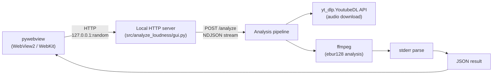
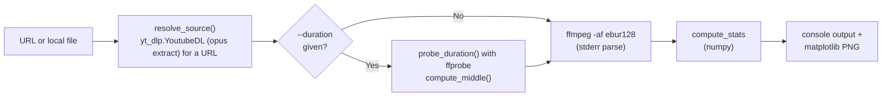
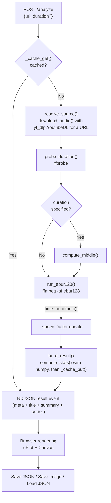

# Architecture

> 日本語版は [architecture.ja.md](architecture.ja.md) を参照してください.

## Overview

analyze-loudness analyzes the audio loudness of YouTube videos and local audio files in compliance with ITU-R BS.1770 (the International Telecommunication Union's loudness measurement recommendation, BS.1770 below) and EBU R128 (the European Broadcasting Union's loudness recommendation).
It can run locally as a command-line interface (CLI) tool, and is also provided as a Windows / macOS graphical user interface (GUI) application (pywebview).

The GUI's page talks to a local Hypertext Transfer Protocol (HTTP) server, which streams its progress and result as newline-delimited JavaScript Object Notation (JSON) lines (NDJSON). The audio of a Uniform Resource Locator (URL) comes from yt-dlp's Python application programming interface (API).



## Modules

### CLI tool (`src/analyze_loudness/`)

| Module | Responsibility |
|--------|---------------|
| `src/analyze_loudness/cli.py` | argparse + orchestration, static-ffmpeg PATH setup |
| `src/analyze_loudness/download.py` | Resolving a source (`resolve_source`: `download_audio()` for a URL, the path as is for a local file), refusing network paths (`is_network_path`), the extensions the GUI accepts (`AUDIO_EXTENSIONS`), ffprobe duration (`probe_duration`). Re-exports `download_audio()` (download + title retrieval with the `yt_dlp.YoutubeDL` Python API), `compute_middle()`, `is_url()` and `sanitize_filename()` from `vendor/py-analyze-common/src/analyze_common/download.py` |
| `src/analyze_loudness/analysis.py` | ffmpeg ebur128 stderr parsing, numpy-based statistics |
| `src/analyze_loudness/plot.py` | matplotlib 4-row figure generation (summary table, timeline, histograms, segments); comparison figure (`plot_compare`) |
| `src/analyze_loudness/compare.py` | Building (`build_result`) and validating (`validate_single`) single-result JSON, building (`build_compare`) and validating (`validate_compare`) comparison JSON, statistics over the truncated range (`truncated_stats`) |

### GUI application (`src/analyze_loudness/gui.py`)

| Component | Responsibility |
|-----------|---------------|
| `AnalyzeHandler` | Extends py-analyze-common's `GuiHandler` (`vendor/py-analyze-common/src/analyze_common/server.py`), which serves the frontend and the `/common/*` files, checks the Host and the Content-Type, and handles `/browse`, `/save-image`, `/settings` and `/update/*`. Gives it this app's state (`updater()`, `ui_settings()`, `window()`, `dialog_lock()`, `exit_for_update()`) |
| `do_POST()` | Routing of `/analyze`, `/compare`, `/save`, `/load`, `/upload` and `GuiHandler`'s endpoints (`_shared_handlers()`). Host check (`_check_host`) and Content-Type check (`_check_content_type`) |
| `_handle_upload()` | Saves a dropped file to the temporary directory `_upload_dir` |
| `_run_analysis()` | NDJSON stream of the cached result when there is one, otherwise of download, probe, ebur128 (timed), stats and result |
| `_handle_save()` | JSON save (native file dialog) |
| `_handle_compare()` | Receives 2-6 single results and returns the comparison JSON and the statistics over the truncated range |
| `_handle_load()` | JSON loading + validation (native file dialog). Returns comparison JSON with the statistics attached, and does not put it in the cache |
| `_exit_now()` | Exit after a macOS update has swapped the bundle. Runs the atexit cleanup, then `os._exit(0)` |
| `_speed_factor` | Runtime-calibrated speed factor. Computes the next estimated time from the analysis time |
| `main()` | Sets the Windows AppUserModelID (`set_app_user_model_id`, reflected in the taskbar icon) + holds the Windows mutex (`hold_instance_mutex`) + starts the `_HTTPServer` (a `ThreadingHTTPServer`, 127.0.0.1:0) + shows the pywebview window |
| `UPDATE_CONFIG` (`src/analyze_loudness/update.py`) | This app's identity for auto-update: product name, repository, public key, temporary directory prefix, mutex name |

### Frontend (`frontend/`)

| File | Responsibility |
|------|---------------|
| `frontend/index.html` | Single-page application (SPA) entry point, local vendor files |
| `frontend/main.js` | Fetch orchestration, NDJSON progress parsing, Document Object Model (DOM) rendering, save/load/image capture, theme toggle, language toggle, cancel (AbortController), attaching tooltips with `_addTip`, the comparison queue (`compareQueue`) and comparison display (`renderCompare`) |
| `frontend/theme.js` | `isDark()`, `getTheme()`: theme detection + chart color provider (includes the 6 comparison track colors `trackColors`) |
| `frontend/i18n.js` | en / ja DICT, which py-analyze-common's `/common/i18n.js` turns into `window.i18n.t / setLang / onChange / applyStatic`. `/common/boot.js` then sets the theme and the language on `<html>` before the Cascading Style Sheets (CSS) paint, and `/common/ui.js` (icons, the theme toggle's drawing, the queue's rows, the result title row, tooltips, button widths, the drop overlay's text, the error line) loads before `frontend/main.js` |
| `frontend/gate.js` | `computeGate()`: rebuilds the BS.1770 absolute / relative gates from `series.M` |
| `frontend/charts/timeline.js` | uPlot time series (60-frame moving average, GATE lane, theme-aware). `renderCompareTimeline` for comparison (a line and GATE band per track, the track number at the right end of the line) |
| `frontend/charts/histogram.js` | Canvas density histogram (theme-aware, the title is on the HyperText Markup Language (HTML) side). `renderHistogramCompare` for comparison (an outline per track, the track number at the mode bin) |
| `frontend/charts/segments.js` | Canvas 5-min segment bar chart (theme-aware, the title is on the HTML side). In comparison, `frontend/main.js` passes the track color and draws one chart per track |
| `frontend/style.css` | CSS variables + `[data-theme="dark"]` rules, purple accent (#9C27B0) |
| `frontend/vendor/` | uPlot.iife.min.js, uPlot.min.css (bundled) |

### Shared utilities (`src/analyze_loudness/__init__.py`)

| Function | Responsibility |
|----------|---------------|
| (on import) | Adds `vendor/py-analyze-common/src` to `sys.path` |
| `_ffmpeg_kwargs()` | py-analyze-common's `ffmpeg_kwargs()`. Adds `LC_ALL=C` and `LANG=C` to the per-operating-system (per-OS) subprocess arguments (which hide the console window in Windows frozen mode) |
| `_json_safe()` | py-analyze-common's `json_safe()`. Recursively replaces NaN / Infinity with None |
| `_find_executable()` | py-analyze-common's `find_executable()`. Absolute path of a program found in the absolute entries of PATH, or None |

## Data flow

### CLI

A single source ends in console output and a Portable Network Graphics (PNG) figure.



### GUI



### Comparison mode

2-6 results are overlaid from the start, and all tracks are truncated to the length of the shortest track for comparison.

- **Input**: pressing the submit button moves the input field's source into the queue (a source the queue already holds stays in the field). One row is a single analysis (a JSON row is shown without one), and the row keeps its result. Two or more rows are a comparison, and the button reads Compare while the queue and the field hold two or more sources.
  The queue also takes URLs and local file paths with `+ Add Track`, dropped files (one file dropped on an empty queue goes into the input field instead), and saved single JSON with Load JSON while the queue is not empty (that request carries `{"queue": true}`, and the server does not cache the result for its URL: the row holds it).
  The queue and a source in the input field that the queue does not hold count together toward `MAX_TRACKS`: a track past it is refused with the limit error, and a drop stops at that file.
  In a comparison, rows without a result are analyzed in order with `/analyze`, and all tracks are sent to `/compare`.
  `+ Add Track`, removing a row, Load JSON and a dropped file that joins the queue drop the results on screen when tracks stay in the queue, Clear All drops them too, and moving a row reorders a comparison on screen.
  When a single result is displayed and the input field equals its `source_url`, `+ Add Track` gives the row the displayed result itself
  (the `/load` cache holds only the last loaded result per URL, so looking it up again by URL could swap in a different result).
  The CLI takes 2-6 positional arguments, and reads local paths ending in `.json` as saved single JSON.
  Comparison does not accept `--duration`.
- **Truncation**: `common_frames()` in `src/analyze_loudness/compare.py` counts, for each track, the frames up to the last time of the shortest track (+ half a frame),
  and cuts the `series` of all tracks at the minimum of those counts. All tracks have the same number of frames, so
  the timeline shares a single time axis.
- **Statistics are computed in one place, in Python**. The Integrated, the Short-term (S) / Momentary (M) median and 10th / 90th percentiles (P10 / P90), and the silence ratio over the truncated range are
  computed by `truncated_stats()` in `src/analyze_loudness/compare.py` from the saved series, and attached as `stats` to the `/compare` and `/load` responses.
  They are not saved in the comparison JSON. True Peak and loudness range (LRA) either cannot be computed from the series (True Peak) or are not guaranteed to equal ffmpeg's value
  (LRA), so each track's full-length value is shown, marked explicitly as "(full)".
- **The Integrated over the truncated range recomputes the relative gate over the truncated range**. The full-length `summary.gate_threshold`
  is not used. With ffmpeg 9.0.2, the value recomputed from the first T seconds of the full-length series M was checked against
  ffmpeg's Integrated measured on the same audio with `-t T` (`lavfi.r128.I` of `ebur128=metadata=1`, 3 decimal places);
  across 4 audio files (33 seconds to 144.5 minutes) × T = 20 / 37.3 / 60 / 300 / 1800 / 3600 seconds, in the 17 cases shorter than the audio
  the difference was at most 0.014 loudness units (LU). Reusing the full-length `gate_threshold` deviates by up to 2.92 LU.
  The t / M / S measured with `-t T` match the leading frames of the full length (difference 0).
  The frontend GATE band also recomputes the relative gate with `computeGate(M, t, null)`.
- **Comparison JSON** (schema 3): `{"meta": {...}, "compare": {"truncate_sec": T, "tracks": [single result, ...]}}`.
  Each track's `summary` holds the full-length values, and its `series` the truncated range. There is no `summary` / `series` at the top level, so
  versions up to schema 2 refuse to load it with "missing summary or series". Loading branches on the presence of `compare`.
  Loading a comparison JSON while the queue is not empty is refused.
- **Size limits**: the `/compare` request body is up to 64 MiB (`_MAX_BODY`). Writing out the 9 saved single JSON files
  (43,092-116,299 frames) without separators gives 18.2-18.5 bytes per frame, so up to 6 tracks × 1010 minutes each
  can be sent. The GUI and the CLI save comparison JSON with indentation, and a comparison JSON of 3 tracks and 12,123 frames is
  56.4 bytes per frame. So that a 6 × 1010-minute comparison saved at that size can still be opened, the `/load` limit
  (`_MAX_LOAD_BYTES`) is set to 210 MiB.
- **Telling tracks apart**: the colors are `trackColors` in `frontend/theme.js` (6 colors each for light / dark; the contrast ratio against the chart background is
  at least 3.05). So as not to rely on color alone, the track number is drawn at the right end of the timeline line, at the mode bin of the histogram, on the GATE band label,
  and in the segment heading. The CLI figure uses the 6 light colors (`TRACK_COLORS` in `src/analyze_loudness/plot.py`).

## GUI

### Communication model

The GUI `/analyze` endpoint streams its response as `application/x-ndjson`:

```
{"type":"progress","stage":"download","message":"Downloading audio..."}
{"type":"progress","stage":"download","message":"Downloaded: Video Title"}
{"type":"progress","stage":"analyze","message":"Running EBU R128 analysis...","estimate_sec":12,"duration_sec":600}
{"type":"progress","stage":"stats","message":"Computing statistics..."}
{"type":"result","data":{...}}
```

Input validation failures (invalid type/range of URL/duration) are returned as HTTP 400 + JSON.
Errors that occur in the later download and analysis phases are returned as **HTTP 200 + NDJSON `{"type":"error","error":"..."}`**.
This is a design contract that follows from the HTTP status being unchangeable after the response headers are sent; the client judges success or failure by the NDJSON `type` field, not only by the HTTP status.
`Content-Length` / `Transfer-Encoding: chunked` are not set, and the frame boundary is fixed by `Connection: close`.

### Cancel

During analysis the Analyze button changes to Cancel (red). `AbortController.signal` is passed to `fetch()` and to `readNdjsonStream()`,
which cancels the `ReadableStream` reader, and stream reading is interrupted on cancel.
`_setBusy()` sets the `_isBusy` flag and disables the Load JSON, Browse, `+ Add Track` and Clear All buttons, preventing double execution.

### Theme

Themes are switched with CSS variables (`--bg`, `--text`, `--accent` etc. The shared ones are in `vendor/py-analyze-common/src/analyze_common/web/common.css`) + `[data-theme="dark"]`.
`getTheme()` in `frontend/theme.js` returns the color palette used when drawing charts.
A fixed top-right pill button (a Scalable Vector Graphics (SVG) sun / crescent moon / half-filled circle) cycles light, dark and auto.
`auto` follows the OS `prefers-color-scheme`, and reflects changes in real time through the `matchMedia` `change` event.
The choice is saved to `theme` in the app's settings file (`settings.json`) through `/settings`, and `/common/settings.js` passes it to the page on the next launch
(the reason the webview's localStorage does not survive to the next launch is the same as for the storage location of "Check at launch"). The window background color is also decided from the same value, and on macOS that color is shown until the page is drawn (`show_window_color_until_paint()`. It removes the white that WKWebView draws until its first paint). The language is also kept in `lang` of the same file.
The theme toggle's drawing and the shared CSS variables are in py-analyze-common, which analyze-spectrum uses too.

### Auto-update

How an update runs, what is verified and how each OS applies it are in [py-analyze-common's auto-update document](https://github.com/semnil/py-analyze-common/blob/main/docs/auto-update.md). What this repository owns is `UPDATE_CONFIG` in `src/analyze_loudness/update.py`, and the exit handling (`_exit_now()`) in `src/analyze_loudness/gui.py`.

## Charts

### GATE lane

Integrated aggregates only the 400 ms blocks that pass the BS.1770 absolute gate (-70 loudness units relative to full scale, LUFS) and relative gate (the mean of the blocks that passed the absolute gate -10 LU).
A 12 px high GATE band in the timeline's x-axis gutter (between the plot area and the tick labels) shows this selection,
with excluded blocks in amber (at or below the relative gate) / slate (at or below the absolute gate).

- **Exclude ffmpeg's 3 warm-up frames**. Frames are output every 100 ms, but the Momentary window is 400 ms,
  so at t = 0.1 / 0.2 / 0.3 the window is not filled and the value is the silence floor -120.7. These are not gated blocks, so
  `_firstGatedIndex()` determines the start from `series.t` and also removes them from the denominator of the statistics.
  Measured: the 0.91% silence of a 36-second clip was entirely these frames (0.00% with them excluded).
- **The relative gate uses `summary.gate_threshold` (schema 2), and is recomputed from `series.M` when it is absent**
  (`computeGate(M, t, threshold)` in `frontend/gate.js`). Saved JSON from schema 1 goes through the fallback path.
  The recomputed Integrated matches the saved value within 0.05 LU for all 13 saved JSON files.
  For the longest file (116,299 blocks), `computeGate` went from 1.03 ms to 0.25 ms.
  ffmpeg's values are rounded to 1 decimal place, so the results of the 2 paths do not match exactly; only the decision for blocks that land exactly on the threshold
  changes (measured maximum 303 / 95,957 blocks = 0.3 points of included ratio).
- **The plot area is unchanged**. The x-axis `gap` / `size` and the chart height are widened by the same 11 px each to make room for the band, so
  the plot's bounding box stays 2160x540 device px with or without the band (measured).
- **When a single pixel column mixes included and excluded blocks, it is drawn as excluded**.
  Because of this rounding, on long recordings the painted area of the band exceeds the actual excluded ratio (on real files of 61-193 minutes,
  excluded 10-25% against band paint 27-80%). Drag-zooming the x axis reduces the number of blocks per column, and
  the band converges to the actual excluded ranges.
- The numeric summary (included ratio / excluded ratio / threshold) is placed in `.gate-caption` directly below the chart,
  and is burned into the composite PNG as one line of the summary text.

## Build & distribution

### CLI

```bash
python -m venv .venv
source .venv/bin/activate        # Windows: .venv\Scripts\activate
pip install -e ".[dev]"
analyze-loudness "https://www.youtube.com/watch?v=XXXXX"
```

### GUI (PyInstaller + Inno Setup)

```bash
python build.py              # download assets + PyInstaller bundle
python build.py --installer  # + Inno Setup installer (Windows) / DMG (macOS)
```

Build pipeline:
1. `build.py` (py-analyze-common's `analyze_common.build` with this app's names) downloads ffmpeg, ffprobe, deno and uPlot unless `--skip-download` is given, and checks uPlot against `build_assets/checksums.json` (yt-dlp is a Python dependency)
2. PyInstaller (`analyze-loudness.spec`): bundles Python + dependencies + frontend + binaries
3. Inno Setup (`installer.iss`): Windows installer with license display. Includes `vendor/py-analyze-common/installer/auto_update.iss`, and `build.py` passes `/DMyAppMutex=`. On macOS, `build.py --installer` makes the DMG with create-dmg
4. `.github/workflows/release.yaml`: puts `latest.json`, which signs the SHA-256 of the installer and the DMG, on the Release ([Auto-update](#auto-update)). Its jobs install Python packages only from the hash-pinned `requirements/*.txt`, and Inno Setup / create-dmg only after a SHA-256 check ("Pinned release dependencies" in `AGENTS.md`)

### Bundled assets (`build_assets/bin/`)

The ffmpeg builds carry the GNU General Public License (GPL).

| Binary | Source | License |
|--------|--------|---------|
| deno.exe | GitHub Releases (latest) | MIT |
| ffmpeg.exe | BtbN/FFmpeg-Builds (the gpl build of the `build_assets/ffmpeg.json` series in latest) | GPL-3.0+ |
| ffprobe.exe | BtbN/FFmpeg-Builds (the gpl build of the `build_assets/ffmpeg.json` series in latest) | GPL-3.0+ |
| deno (macOS) | GitHub Releases (latest, aarch64) | MIT |
| ffmpeg / ffprobe (macOS) | osxexperts.net (arm64, pinned by the URL and SHA-256 in `build_assets/ffmpeg.json`) | GPL-2.0+ |

## Accessibility

### `prefers-reduced-motion`

CSS animation / transition are disabled all at once with `@media (prefers-reduced-motion: reduce)` (in `vendor/py-analyze-common/src/analyze_common/web/common.css`).

Chart drawing (uPlot, Canvas histogram, Canvas segments) has no animation processing,
and everything is drawn immediately, so no individual handling is needed. uPlot's cursor tracking is a real-time response to user operation, and
does not fall under the animation that Web Content Accessibility Guidelines (WCAG) 2.3.3 covers.

The countdown display changes its update interval from
1 second to 5 seconds with `matchMedia("(prefers-reduced-motion: reduce)")` (`frontend/main.js`).

### Placement of the charts' `role="img"`

Each chart has a `role="img"` node whose `aria-label` holds a description that includes the statistics.
The histograms attach it to the canvas itself. The timeline attaches it to the container div, because uPlot generates the DOM inside it,
and the segments chart attaches it to the div that holds its canvas.

The title `<h3 class="chart-title">` is always placed **outside** this node.
Accessible Rich Internet Applications (ARIA) treats descendants of `role="img"` as presentational, so placing it inside creates engines in which
the title and the `aria-describedby` (tooltip text) set by `_showTip()`
do not reach assistive technology.

## Design decisions

### ebur128 stderr parsing (no raw audio decode)

ffmpeg's ebur128 filter outputs per-frame loudness values to stderr.
Decoding 50 minutes of audio to Waveform Audio File Format (WAV) requires more than 4GB of memory, so
only the stderr text is processed, keeping memory consumption to a few MB.

### Local HTTP server + pywebview

pywebview uses the OS's native WebView (Windows: WebView2 / macOS: WebKit),
which keeps the bundle size small.
`_HTTPServer` (py-analyze-common's `GuiServer`, a `ThreadingHTTPServer`) is started on a random port (port 0) on 127.0.0.1,
and serves the frontend from the same origin.

### Runtime-calibrated time estimation

`_speed_factor` is updated from the measured analysis time, improving the accuracy of later estimates.
The initial value is 55.0 (about 55 times real-time speed). After each analysis completes, the sample `analyze_sec / elapsed` is blended in as an exponential moving average with weight 0.3, and a sample outside 5-500 is ignored.

### yt-dlp Python API (not a bundled binary)

The `yt_dlp.YoutubeDL` class is called directly as a Python library, and opus is extracted with the `FFmpegExtractAudio` postprocessor. The return value of `extract_info(download=True)` includes the title, so parallel execution is not needed.

Avoiding a bundled binary (`yt-dlp_macos` etc.) avoids at its root the Team ID mismatch problem that occurs during codesign re-signing for macOS (the Python.framework inside a onefile binary cannot be re-signed and is rejected by the hardened runtime). The same approach is used on Windows / Linux as well.

### Middle extraction

With `--duration`, only the middle portion of a long video is analyzed. It is cut out directly during the ebur128 analysis with
`ffmpeg -ss <start> -t <duration>`.

Only the CLI exposes this feature, through the `--duration` option. The GUI does not implement an equivalent input UI (it always analyzes the full length). The policy is that the GUI favors a simple workflow that only takes a URL or a local file path, and leaves uses that need partial extraction to the CLI.

### Conditional static-ffmpeg (CLI only)

In the CLI, `static-ffmpeg` is not used if ffmpeg is installed on the system.
It is detected with py-analyze-common's `find_executable("ffmpeg")` (the absolute entries of PATH only; the same lookup that starts ffmpeg), and `static_ffmpeg.add_paths()` is called only when it is absent.

### Windows subprocess console hiding

In PyInstaller frozen mode, `subprocess.STARTUPINFO` + `STARTF_USESHOWWINDOW` hide
the console windows of the ffmpeg / ffprobe the app starts. yt-dlp runs as a Python API, and its own `Popen` (`yt_dlp/utils/_utils.py`) sets `STARTF_USESHOWWINDOW` on Windows for the ffmpeg / ffprobe / deno it starts.

## Constants

| Constant | Value | Location | Description |
|----------|-------|----------|-------------|
| `SCHEMA_VERSION` | 3 | `src/analyze_loudness/__init__.py` | Schema version of the result JSON (2 = `summary.gate_threshold` added, 3 = comparison JSON added) |
| `MIN_TRACKS` / `MAX_TRACKS` | 2 / 6 | `src/analyze_loudness/compare.py`, `frontend/main.js` | Number of tracks that can be compared |
| `SILENCE_THRESHOLD` | -60 LUFS | `src/analyze_loudness/analysis.py` | Stats exclude frames <= this |
| `GATE_ABSOLUTE` | -70 LUFS | `frontend/gate.js`, `src/analyze_loudness/compare.py` | BS.1770 absolute gate |
| `GATE_BLOCK_SEC` | 0.4 s | `frontend/gate.js`, `src/analyze_loudness/compare.py` | Momentary window length. Used to detect the warm-up frames |
| `SHORT_TERM_WINDOW_SEC` | 3.0 s | `src/analyze_loudness/analysis.py` | Short-term window length. Used to detect the warm-up for the silence ratio |
| `SILENCE_PCT_THRESHOLD` | -40 LUFS | `src/analyze_loudness/analysis.py` | Threshold for the silence ratio |
| `GATE_RELATIVE_OFFSET` | -10 LU | `frontend/gate.js`, `src/analyze_loudness/compare.py` | BS.1770 relative gate (offset from the mean of the passing blocks) |
| `GATE_LANE_H` | 12 px | `frontend/charts/timeline.js` | Height of the GATE band |
| `_speed_factor` | 55.0 (initial) | `src/analyze_loudness/gui.py` | Runtime-calibrated analysis speed |
| Segment size | 5 min | `src/analyze_loudness/plot.py`, `frontend/charts/segments.js` | Bar chart segment width |
| Moving average window | 60 samples | `src/analyze_loudness/plot.py` (of the downsampled series), `frontend/charts/timeline.js` (60 frames) | Timeline smoothing window |
| Downsample target | ~3000 points | `src/analyze_loudness/plot.py` | Plot responsiveness |
| Default theme | "auto" | `frontend/main.js` | Follows OS prefers-color-scheme |
| Theme setting key | "theme" | `vendor/py-analyze-common/src/analyze_common/ui_settings.py` | Key in settings.json (light/dark/auto) |
| Language setting key | "lang" | `vendor/py-analyze-common/src/analyze_common/ui_settings.py` | Key in settings.json (en/ja) |
