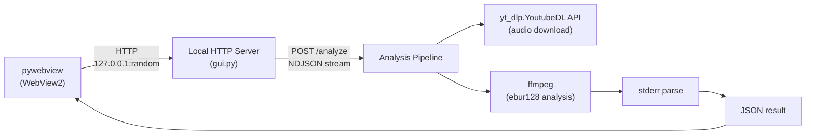
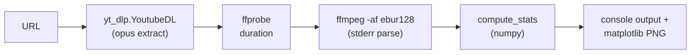
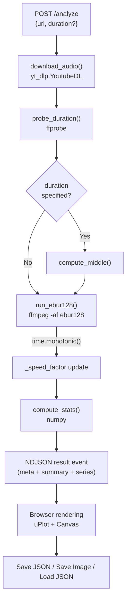
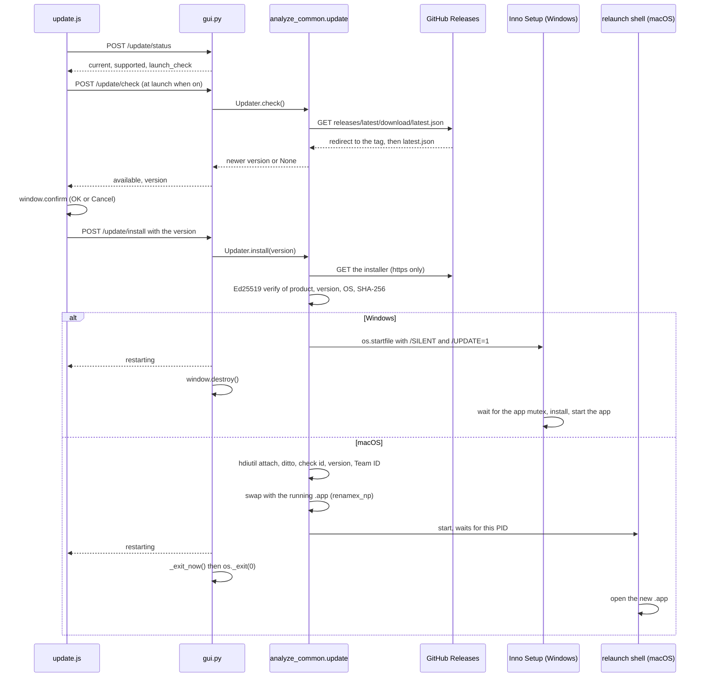

# Architecture Design Document

> 日本語版は [architecture.ja.md](architecture.ja.md) を参照してください.

## Overview

analyze-loudness is a tool that analyzes the audio loudness of YouTube videos in compliance with BS.1770 / EBU R128.
It can run locally as a CLI tool, and is also provided as a Windows GUI application (pywebview).

## System Architecture



## Components

### CLI Tool (`src/analyze_loudness/`)

| Module | Responsibility |
|--------|---------------|
| `cli.py` | argparse + orchestration, static-ffmpeg PATH setup |
| `download.py` | Download + title retrieval with the `yt_dlp.YoutubeDL` Python API, resolving local files (`resolve_source`), ffprobe duration, filename sanitization |
| `analysis.py` | ffmpeg ebur128 stderr parsing, numpy-based statistics |
| `plot.py` | matplotlib 4-row figure generation (timeline, histograms, segments); comparison figure (`plot_compare`) |
| `compare.py` | Building (`build_result`) and validating (`validate_single`) single-result JSON, building (`build_compare`) and validating (`validate_compare`) comparison JSON, statistics over the truncated range (`truncated_stats`) |

### GUI Application (`src/analyze_loudness/gui.py`)

| Component | Responsibility |
|-----------|---------------|
| `AnalyzeHandler` | Inherits `SimpleHTTPRequestHandler`. Serves the frontend + handles the POST endpoints |
| `do_POST()` | Routing of `/analyze`, `/compare`, `/save`, `/save-image`, `/load`, `/browse`, `/upload`, `/settings`, `/update/status`, `/update/settings`, `/update/check`, `/update/install`. Content-Type check (`_check_content_type`) |
| `_handle_browse()` | Native dialog for choosing a local audio file |
| `_handle_upload()` | Saves a dropped file to the temporary directory `_upload_dir` |
| `_run_analysis()` | NDJSON stream of download -> probe -> ebur128 (timed) -> stats -> result |
| `_handle_save()` | JSON save (native file dialog) |
| `_handle_save_image()` | base64 PNG → binary save (native file dialog) |
| `_handle_compare()` | Receives 2-6 single results and returns the comparison JSON and the statistics over the truncated range |
| `_handle_load()` | JSON loading + validation (native file dialog). Returns comparison JSON with the statistics attached, and does not put it in the cache |
| `_handle_update_*()` | Auto-update status, check and apply. The work is passed to `_updater` (`analyze_common.update.Updater`) |
| `_exit_now()` | Exit after a macOS update has swapped the bundle. Runs the atexit cleanup, then `os._exit(0)` |
| `_speed_factor` | runtime-calibrated speed factor. Computes the next estimated time from the analysis time |
| `_set_application_user_model_id()` | Sets the Windows AppUserModelID (reflected in the taskbar icon) |
| `main()` | Holds the Windows mutex (`hold_instance_mutex`) + starts the HTTPServer (127.0.0.1:0) + shows the pywebview window |

### Frontend (`frontend/`)

| File | Responsibility |
|------|---------------|
| `index.html` | SPA entry point, local vendor files |
| `main.js` | Fetch orchestration, NDJSON progress parsing, DOM rendering, save/load/image capture, theme toggle, language toggle, cancel (AbortController), `_addTip` tooltips, the comparison queue (`compareQueue`) and comparison display (`renderCompare`) |
| `theme.js` | `isDark()`, `getTheme()` — theme detection + chart color provider (includes the 6 comparison track colors `trackColors`) |
| `i18n.js` | en / ja DICT + `window.i18n.t / setLang / onChange / applyStatic` |
| `gate.js` | `computeGate()` — rebuilds the BS.1770 absolute / relative gates from `series.M` |
| `charts/timeline.js` | uPlot time series (60-frame moving average, GATE lane, theme-aware). `renderCompareTimeline` for comparison (a line and GATE band per track, the track number at the right end of the line) |
| `charts/histogram.js` | Canvas density histogram (theme-aware, the title is on the HTML side). `renderHistogramCompare` for comparison (an outline per track, the track number at the mode bin) |
| `charts/segments.js` | Canvas 5-min segment bar chart (theme-aware, the title is on the HTML side). In comparison, passes the track color and draws one chart per track |
| `style.css` | CSS variables + `[data-theme="dark"]` rules, purple accent (#9C27B0) |
| `vendor/` | uPlot.iife.min.js, uPlot.min.css (bundled) |

### Shared Utilities (`src/analyze_loudness/__init__.py`)

| Function | Responsibility |
|----------|---------------|
| `_subprocess_kwargs()` | Hides the subprocess console window in Windows frozen mode |

## Data Flow

### CLI



### GUI



### NDJSON Progress Stream

The GUI `/analyze` endpoint streams its response as `application/x-ndjson`:

```
{"type":"progress","stage":"download","message":"Downloading audio..."}
{"type":"progress","stage":"download","message":"Downloaded: Video Title"}
{"type":"progress","stage":"analyze","message":"Running EBU R128 analysis...","estimate_sec":12,"duration_sec":600}
{"type":"progress","stage":"stats","message":"Computing statistics..."}
{"type":"result","data":{...}}
```

Input validation failures (invalid type/range of URL/duration) are returned as HTTP 400 + JSON.
Errors that occur in the later download and analysis phases are returned as **HTTP 200 + NDJSON `{"type":"error","error":"..."}`**.
This is a design contract that follows from the HTTP status being unchangeable after the response headers are sent; the client judges success or failure by the NDJSON `type` field, not only by the HTTP status.
`Content-Length` / `Transfer-Encoding: chunked` are not set, and the frame boundary is fixed by `Connection: close`.

## Key Design Decisions

### 1. ebur128 stderr parsing (not WAV decoding)

ffmpeg's ebur128 filter outputs per-frame loudness values to stderr.
WAV-decoding 50 minutes of audio requires more than 4GB of memory, so
only the stderr text is processed, keeping memory consumption to a few MB.

### 2. Local HTTP server + pywebview

pywebview uses the OS's native WebView (Windows: WebView2),
which keeps the bundle size small.
`HTTPServer` is started on a random port (port 0) on 127.0.0.1,
and serves the frontend from the same origin.

### 3. Runtime-calibrated time estimation

`_speed_factor` is updated from the measured analysis time, improving the accuracy of later estimates.
The initial value is 55.0 (about 55 times real-time speed), and it is updated with `analyze_sec / elapsed` after each analysis completes.

### 4. yt-dlp Python API (not bundled binary)

The `yt_dlp.YoutubeDL` class is called directly as a Python library, and opus is extracted with the `FFmpegExtractAudio` postprocessor. The return value of `extract_info(download=True)` includes the title, so parallel execution is not needed.

Avoiding a bundled binary (`yt-dlp_macos` etc.) avoids at its root the Team ID mismatch problem that occurs during codesign re-signing for macOS (the Python.framework inside a onefile binary cannot be re-signed and is rejected by the hardened runtime). The same approach is used on Windows / Linux as well.

### 5. Middle extraction

Long videos have only their middle portion analyzed. It is cut out directly during the ebur128 analysis with
`ffmpeg -ss <start> -t <duration>`.

Only the CLI exposes this feature, through the `--duration` option. The GUI does not implement an equivalent input UI (it always analyzes the full length). The policy is that the GUI favors a simple workflow that only takes a URL or a local file path, and leaves uses that need partial extraction to the CLI.

### 6. Conditional static-ffmpeg (CLI only)

In the CLI, `static-ffmpeg` is not used if ffmpeg is installed on the system.
It is detected with `shutil.which("ffmpeg")`, and `static_ffmpeg.add_paths()` is called only when it is absent.

### 7. uPlot dark mode and CSS `!important`

uPlot sets the `color` of the legend and title with inline styles, so overriding it from CSS requires
`!important`. Manipulating the DOM directly from JS is also possible, but it requires walking uPlot's internal DOM
on every theme switch, and its risk of breaking on version upgrades is equal to or greater than that of CSS `!important`.
Overriding uPlot's inline styles is a legitimate use case for `!important`, and it is kept as is.

### 8. Dark mode (light / dark / auto)

Themes are switched with CSS variables (`--bg`, `--text`, `--accent` etc. The shared ones are in `analyze_common/web/common.css`) + `[data-theme="dark"]`.
`getTheme()` in `theme.js` returns the color palette used when drawing charts.
A fixed top-right pill button (a sun / crescent moon / half-filled circle SVG) cycles light → dark → auto.
`auto` follows the OS `prefers-color-scheme`, and reflects changes in real time through the `matchMedia` `change` event.
The choice is saved to `theme` in the app's settings file (`settings.json`) through `/settings`, and `/common/settings.js` passes it to the page on the next launch
(the reason the webview's localStorage does not survive to the next launch is the same as for the storage location of "Check at launch"). The window background color is also decided from the same value, and on macOS that color is shown until the page is drawn (`show_window_color_until_paint()`. It removes the white that WKWebView draws until its first paint). The language is also kept in `lang` of the same file.
The UI is unified with the analyze-spectrum project.

### 9. Analysis cancel (AbortController)

During analysis the Analyze button changes to Cancel (red). `AbortController.signal` is passed to `fetch()` and
NDJSON `ReadableStream.getReader()`, and stream reading is interrupted on cancel.
The `_isBusy` flag disables the Load button, preventing double execution.

### 10. Windows subprocess console hiding

In PyInstaller frozen mode, `subprocess.STARTUPINFO` + `STARTF_USESHOWWINDOW` hide
the ffmpeg / ffprobe console windows. yt-dlp runs as a Python API, so it does not start a subprocess.

### 11. GATE lane (option C)

Integrated aggregates only the 400 ms blocks that pass the BS.1770 absolute gate (-70 LUFS) and relative gate (the mean of the blocks that passed the absolute gate -10 LU),
but the timeline did not show this selection.
A 12 px high GATE band is placed in the timeline's x-axis gutter (between the plot area and the tick labels),
showing excluded blocks in amber (at or below the relative gate) / slate (at or below the absolute gate).

- **Exclude ffmpeg's 3 warm-up frames**. Frames are output every 100 ms, but the Momentary window is 400 ms,
  so at t = 0.1 / 0.2 / 0.3 the window is not filled and the value is the silence floor -120.7. These are not gated blocks, so
  `_firstGatedIndex()` determines the start from `series.t` and also removes them from the denominator of the statistics.
  Measured: the 0.91% silence of a 36-second clip was entirely these frames (0.00% after the fix).
- **The relative gate uses `summary.gate_threshold` (schema 2), and is recomputed from `series.M` when it is absent**
  (`computeGate(M, threshold)` in `gate.js`). Saved JSON from schema 1 goes through the fallback path.
  The recomputed Integrated matches the saved value within 0.05 LU for all 13 saved JSON files.
  For the longest file (116,299 blocks), `computeGate` went from 1.03 ms → 0.25 ms.
  ffmpeg's values are rounded to 1 decimal place, so the results of the 2 paths do not match exactly; only the decision for blocks that land exactly on the threshold
  changes (measured maximum 303 / 95,957 blocks = 0.3 points of included ratio).
- **The plot area is unchanged**. The x-axis `gap` / `size` and the chart height are widened by the same 11 px each to make room for the band, so
  the plot bbox stays 2160x540 device px with or without the band (measured).
- **When a single pixel column mixes included and excluded blocks, it is drawn as excluded** (the binarization of option C).
  Because of this rounding, on long recordings the painted area of the band exceeds the actual excluded ratio (on real files of 61-193 minutes,
  excluded 10-25% against band paint 27-80%). Drag-zooming the x axis reduces the number of blocks per column, and
  the band converges to the actual excluded ranges.
- The numeric summary (included ratio / excluded ratio / threshold) is placed in `.gate-caption` directly below the chart,
  and is burned into the composite PNG as one line of the summary text.

### 12. Comparison mode

2-6 results are overlaid from the start, and all tracks are truncated to the length of the shortest track for comparison.

- **Input**: the GUI processes the queue (URLs with `+ Add Track`, saved single JSON with Load JSON while the queue is not empty) with
  Compare. URL rows are analyzed in order with `/analyze`, and all tracks are sent to `/compare`.
  When a single result is displayed and the input field equals its `source_url`, `+ Add Track` gives the row the displayed result itself
  (the `/load` cache holds only the last loaded result per URL, so looking it up again by URL could swap in a different result).
  The CLI takes 2-6 positional arguments, and reads local paths ending in `.json` as saved single JSON.
  Comparison does not accept `--duration`.
- **Truncation**: `compare.common_frames()` counts, for each track, the frames up to the last time of the shortest track (+ half a frame),
  and cuts the `series` of all tracks at the minimum of those counts. All tracks have the same number of frames, so
  the timeline shares a single time axis.
- **Statistics are computed in one place, in Python**. The Integrated, the S/M median and P10/P90, and the silence ratio over the truncated range are
  computed by `compare.truncated_stats()` from the saved series, and attached as `stats` to the `/compare` and `/load` responses.
  They are not saved in the comparison JSON. True Peak and LRA either cannot be computed from the series (True Peak) or are not guaranteed to equal ffmpeg's value
  (LRA), so each track's full-length value is shown, marked explicitly as "(full)".
- **The Integrated over the truncated range recomputes the relative gate over the truncated range**. The full-length `summary.gate_threshold`
  is not used. With the bundled ffmpeg 8.1, the value recomputed from the first T seconds of the full-length series M was checked against
  ffmpeg's Integrated measured on the same audio with `-t T` (`lavfi.r128.I` of `ebur128=metadata=1`, 3 decimal places);
  across 4 audio files (33 seconds to 144.5 minutes) × T = 20 / 37.3 / 60 / 300 / 1800 / 3600 seconds, in the 17 cases shorter than the audio
  the difference was at most 0.014 LU. Reusing the full-length `gate_threshold` deviates by up to 2.92 LU.
  The t / M / S measured with `-t T` match the leading frames of the full length (difference 0).
  The frontend GATE band also recomputes the relative gate with `computeGate(M, t, null)`.
- **Comparison JSON** (schema 3): `{"meta": {...}, "compare": {"truncate_sec": T, "tracks": [single result, ...]}}`.
  Each track's `summary` holds the full-length values, and its `series` the truncated range. There is no `summary` / `series` at the top level, so
  versions up to schema 2 refuse to load it with "missing summary or series". Loading branches on the presence of `compare`.
  Loading a comparison JSON while the queue is not empty is refused.
- **Size limits**: the `/compare` request body is up to 64 MiB (`_MAX_BODY_BYTES`). Writing out the 9 saved single JSON files
  (43,092-116,299 frames) without separators gives 18.2-18.5 bytes per frame, so up to 6 tracks × 1010 minutes each
  can be sent. The GUI and the CLI save comparison JSON with indentation, and a comparison JSON of 3 tracks and 12,123 frames is
  56.4 bytes per frame. So that a 6 × 1010-minute comparison saved at that size can still be opened, the `/load` limit
  (`_MAX_LOAD_BYTES`) is set to 210 MB.
- **Telling tracks apart**: the colors are `trackColors` in `theme.js` (6 colors each for light / dark; the contrast ratio against the chart background is
  at least 3.05). So as not to rely on color alone, the track number is drawn at the right end of the timeline line, at the mode bin of the histogram, on the GATE band label,
  and in the segment heading. The CLI figure uses the 6 light colors (`TRACK_COLORS` in `plot.py`).

### 13. Auto-update

The installed version (frozen Windows x64 / macOS arm64) checks GitHub's latest Release at launch,
and fetches, verifies and applies the update only when OK is chosen in the confirmation dialog. The client is py-analyze-common's
`analyze_common/update.py`, and the UI is `analyze_common/web/update.js` (served as `/common/update.js`); both are
shared with analyze-spectrum. The part specific to this repository is `UPDATE_CONFIG` in `src/analyze_loudness/update.py`.



- **Signature**: `latest.json` holds a `url` and a `signature` per OS. The signed statement is
  `analyze-update-v1\n{product}\n{version}\n{platform}\n{sha256}\n`, and since it includes the version and OS,
  relabeling an older genuine installer with a new version number and reusing a file for another OS fail verification. Ed25519 verification is
  pure Python (`analyze_common/ed25519.py`, RFC 8032), and `cryptography` stays excluded from the bundle.
  The signature is made in CI by `openssl pkeyutl -rawin`, and `analyze_common/update_manifest.py` re-verifies it with the app's public key.
- **How macOS exits**: PyInstaller reopens the archive by path on every lazy import, so if an import runs after the bundle has been swapped,
  it reads the new version's files. After the swap, `_exit_now()` runs the atexit cleanup itself, and
  exits with `os._exit(0)` without going through the interpreter's shutdown. The app does the swap itself (the same approach as Tauri's updater).
- **Environment of the relaunched process**: an app started with `open` receives the caller's environment variables (on 2026-10-20,
  confirmed with `ps -wwE` that a test variable and `_PYI_PARENT_PROCESS_LEVEL=1` reach the relaunched process).
  The bootloader of PyInstaller 6.9 and later behaves as the parent's worker when `_PYI_ARCHIVE_FILE` is the same as itself, so
  `PYINSTALLER_RESET_ENVIRONMENT=1` is passed to the relaunch shell and the installer to make them start as independent processes.
- **Windows UAC**: Inno Setup's loader starts `asInvoker` and asks for elevation only when it becomes necessary, so UAC appears after the app
  has closed. If it is refused, nothing is installed and the app stays closed (starting it again starts the old version).
- **Storage location of "Check at launch"**: the app's settings file (`SettingsStore` in `analyze_common/settings.py`. On macOS
  `~/Library/Application Support/analyze-loudness/settings.json`, on Windows `%APPDATA%\analyze-loudness\settings.json`).
  The webview's localStorage does not survive to the next launch: `webview.start()` in pywebview 6.2.1 defaults to `private_mode=True`, and
  clears website data on every launch. Even with private mode off, the local server's port changes on every launch, so the origin changes
  (confirmed on 2026-10-20 by launching pywebview twice: with private mode at its default, the previous value could not be read even on the same port; with private mode off,
  it could be read on the same port and could not be read on a different port).
- **Another process of the same app**: on macOS, the swap is not done when another process of the same executable exists (because that process would keep running on top of the swapped
  bundle). On Windows, the installer waits for the mutex to disappear.
- **macOS real-device check** (2026-10-20, locally built unsigned 1.4.1 / 1.4.2, served locally):
  when updating from 1.4.1, the old process ended 3.8 seconds after the `/update/install` response, and 4.1 seconds after it
  1.4.2 started from the same path. No temporary directory or file next to the `.app` was left behind. A DMG with one byte flipped was rejected, and
  the old version kept running. When two were running, it did not swap. The check from the frozen build to github.com
  went through TLS and the redirect, and ended in a 404 because `v1.4.1` has no `latest.json`.

## Accessibility

### prefers-reduced-motion

CSS animation / transition are disabled all at once with `@media (prefers-reduced-motion: reduce)`.

Chart drawing (uPlot, Canvas histogram, Canvas segments) has no animation processing,
and everything is drawn immediately, so no individual handling is needed. uPlot's cursor tracking is a real-time response to user operation, and
does not fall under the animation that WCAG 2.3.3 covers.

The countdown display already changes its update interval from
1 second → 5 seconds with `matchMedia("(prefers-reduced-motion: reduce)")` (main.js).

### Placement of the charts' `role="img"`

Each chart has a `role="img"` node whose `aria-label` holds a description that includes the statistics.
histogram attaches it to the canvas itself (the same form as analyze-spectrum's `_addCanvasChart`), and
timeline / segments attach it to the container div because uPlot generates the DOM.

The title `<h3 class="chart-title">` is always placed **outside** this node.
ARIA treats descendants of `role="img"` as presentational, so placing it inside creates engines in which
the title and the `aria-describedby` (tooltip text) set by `_addTip()`
do not reach assistive technology.

## Build & Distribution

### CLI

```bash
python -m venv .venv
source .venv/bin/activate        # Windows: .venv\Scripts\activate
pip install -e ".[dev]"
analyze-loudness "https://www.youtube.com/watch?v=XXXXX"
```

### GUI (PyInstaller + Inno Setup)

```bash
python build.py              # download assets + PyInstaller bundle
python build.py --installer  # + Inno Setup installer
```

Build pipeline:
1. `build.py --skip-download` or auto-download: ffmpeg, ffprobe, deno, uPlot (yt-dlp is a Python dependency)
2. PyInstaller (`analyze-loudness.spec`): bundles Python + dependencies + frontend + binaries
3. Inno Setup (`installer.iss`): Windows installer with license display. Includes `vendor/py-analyze-common/installer/auto_update.iss`, and `build.py` passes `/DMyAppMutex=`
4. `release.yaml`: puts `latest.json`, which signs the SHA-256 of the installer and the DMG, on the Release (13. Auto-update)

### Bundled Assets (`build_assets/bin/`)

| Binary | Source | License |
|--------|--------|---------|
| deno.exe | GitHub Releases (latest) | MIT |
| ffmpeg.exe | BtbN/FFmpeg-Builds (the gpl build of the `build_assets/ffmpeg.json` series in latest) | GPL-3.0+ |
| ffprobe.exe | BtbN/FFmpeg-Builds (the gpl build of the `build_assets/ffmpeg.json` series in latest) | GPL-3.0+ |

## Constants

| Constant | Value | Location | Description |
|----------|-------|----------|-------------|
| SCHEMA_VERSION | 3 | \_\_init\_\_.py | Schema version of the result JSON (2 = `summary.gate_threshold` added, 3 = comparison JSON added) |
| MIN_TRACKS / MAX_TRACKS | 2 / 6 | compare.py, main.js | Number of tracks that can be compared |
| SILENCE_THRESHOLD | -60 LUFS | analysis.py | Stats exclude frames <= this |
| GATE_ABSOLUTE | -70 LUFS | gate.js, compare.py | BS.1770 absolute gate |
| GATE_BLOCK_SEC | 0.4 s | gate.js, compare.py | Momentary window length. Used to detect the warm-up frames |
| SHORT_TERM_WINDOW_SEC | 3.0 s | analysis.py | Short-term window length. Used to detect the warm-up for the silence ratio |
| SILENCE_PCT_THRESHOLD | -40 LUFS | analysis.py | Threshold for the silence ratio |
| GATE_RELATIVE_OFFSET | -10 LU | gate.js, compare.py | BS.1770 relative gate (offset from the mean of the passing blocks) |
| GATE_LANE_H | 12 px | timeline.js | Height of the GATE band |
| _speed_factor | 55.0 (initial) | gui.py | Runtime-calibrated analysis speed |
| Segment size | 5 min | plot.py, segments.js | Bar chart segment width |
| Moving average window | 60 frames | plot.py, timeline.js | Timeline smoothing window |
| Downsample target | ~3000 points | plot.py | Plot responsiveness |
| Default theme | "auto" | main.js | Follows OS prefers-color-scheme |
| Theme setting key | "theme" | analyze_common/ui_settings.py | Key in settings.json (light/dark/auto) |
| Language setting key | "lang" | analyze_common/ui_settings.py | Key in settings.json (en/ja) |
