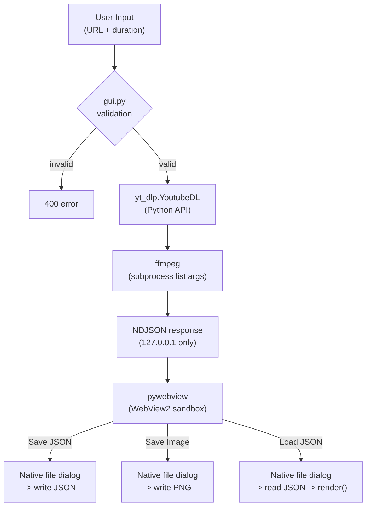

# Security Audit Report

**Date**: 2026-04-04 (the first edition is from 2026-04-03, SEC-16 and the Summary counts were added on 2026-04-04, the CI/CD section was checked on 2026-09-30, SEC-17 to SEC-19 were added on 2026-10-17, SEC-20 was added on 2026-10-20, saving the theme and language was checked on 2026-10-20)
**Scope**:
- Audit of 2026-04-03 to 04: CLI (`src/analyze_loudness/`), GUI (`src/analyze_loudness/gui.py`), Frontend SPA (`frontend/`), Build/Distribution (`build.py`, `analyze-loudness.spec`, `installer.iss`)
- Check of 2026-09-30: action pinning and its check in CI (`.github/workflows/`, `.github/tests/`) (CI/CD section)
- Check of 2026-10-17: local file input (local paths in `/analyze`, `/browse`, `/upload`) and the POST Content-Type (SEC-17 to SEC-19)
- Check of 2026-10-20: saving the theme and language (`/settings`, `/common/settings.js`)
- Check of 2026-10-20: auto-update (`/update/*`, `analyze_common/update.py` / `ed25519.py` / `update_manifest.py` / `installer/auto_update.iss` in `vendor/py-analyze-common`, the signing in `release.yaml`) (SEC-20)

## Summary

| Category | Findings | Open | Resolved | Accepted |
|----------|----------|------|----------|----------|
| Local HTTP Server | 3 | 0 | 2 | 1 |
| Input Validation | 3 | 0 | 3 | 0 |
| Command Injection | 1 | 0 | 0 | 1 |
| File I/O (Save/Load/Upload) | 5 | 0 | 0 | 5 |
| Data Exposure | 1 | 0 | 0 | 1 |
| XSS | 1 | 0 | 0 | 1 |
| Subprocess Management | 2 | 0 | 1 | 1 |
| Bundled Binaries | 2 | 0 | 2 | 0 |
| Resource Management | 1 | 0 | 0 | 1 |
| Auto-update | 1 | 0 | 1 | 0 |
| **Total** | **20** | **0** | **9** | **11** |

**Open: 0** / Resolved: 9 / Accepted (risk acknowledged): 11

The Summary counts are as of adding SEC-20 on 2026-10-20 (when SEC-17 to SEC-19 were added on 2026-10-17 it was 19 findings, Resolved 8) (when SEC-16 was added on 2026-04-04 it was 16 findings, Resolved 7, Accepted 9) (the first edition of 2026-04-03 had the 15 findings SEC-01 to SEC-15, Accepted 8). The body of each finding has been updated to match later code changes (the history is in `git log -- docs/security-audit.md`). The 2026-09-30 check of the CI/CD section is not included in this table.

---

## Resolved Findings

### SEC-01: Integrity verification of bundled binaries -- RESOLVED

- **Risk**: LOW -> RESOLVED
- **Location**: [build.py](../build.py), [build_assets/checksums.json](../build_assets/checksums.json), [build_assets/ffmpeg.json](../build_assets/ffmpeg.json)
- **Resolution**: The way of checking differs by source. In every case, a git-tracked file holds the values.
  - uPlot (jsDelivr CDN, version pinned): checked against the SHA256 in `build_assets/checksums.json`, and the build stops on a mismatch. `python build.py --update-checksums` downloads it and rewrites the value
  - macOS ffmpeg / ffprobe (osxexperts.net): the binaries inside the zip are checked against the SHA256 in `build_assets/ffmpeg.json`, and the build stops on a mismatch (`analyze_common.ffmpeg_release.fetch_macos_binary()`). The values are the ones the osxexperts.net page lists
  - Windows ffmpeg / ffprobe (the latest of the series in BtbN/FFmpeg-Builds) and deno (the latest in GitHub Releases): the contents can change on every fetch, so the SHA256 is not pinned, and the HTTPS source is trusted
  - Distributed ffmpeg / ffprobe: the release build (`release.yaml`) runs the copies that go into the installer and the DMG through `tests/test_ffmpeg_binary.py`, and when it fails, does not proceed to uploading the artifacts and creating the Draft Release. The Windows build does not pin the SHA256, so the distributed files themselves are confirmed by this check
  - The JSON structure is unified with analyze-spectrum

### SEC-02: Local HTTP server accessible from other than loopback -- RESOLVED

- **Risk**: LOW -> RESOLVED
- **Location**: [gui.py:293](../src/analyze_loudness/gui.py)
- **Resolution**: Binds to 127.0.0.1 with `HTTPServer(("127.0.0.1", 0), ...)`. Not accessible from external networks. The port is assigned automatically by the OS (port 0), which also avoids conflicts with other apps.

### SEC-03: URL input validation (GUI) -- RESOLVED

- **Risk**: LOW -> RESOLVED
- **Location**: [gui.py:73-75](../src/analyze_loudness/gui.py)
- **Resolution**: Checks that the `url` field exists and is of type `str`. An empty string is refused with a 400 error.
- **Note**: The user enters a URL or a local file path themselves, and the local machine accesses YouTube or reads that file (local paths are SEC-18).

### SEC-04: Validation of the duration parameter -- RESOLVED

- **Risk**: LOW -> RESOLVED
- **Location**: [gui.py:77-85](../src/analyze_loudness/gui.py)
- **Resolution**: `float()` conversion + positive-number check. Invalid values are refused with a 400 error.

### SEC-05: Windows subprocess console hiding -- RESOLVED

- **Risk**: LOW -> RESOLVED
- **Location**: [__init__.py](../src/analyze_loudness/__init__.py)
- **Resolution**: `_subprocess_kwargs()` sets `STARTF_USESHOWWINDOW` in frozen mode. Suppresses the subprocess console window and improves the UX.

### SEC-06: Version management of bundled binaries -- RESOLVED

- **Risk**: MEDIUM -> RESOLVED
- **Location**: [build.py](../build.py)
- **Resolution**: `build.py` fetches the latest stable version from the GitHub API. The `--skip-download` flag also allows reusing existing binaries. Downloads over HTTPS.

### SEC-15: Handling of malformed JSON request bodies -- RESOLVED

- **Risk**: LOW -> RESOLVED
- **Location**: [gui.py:44-49](../src/analyze_loudness/gui.py)
- **Resolution**: `_read_json_body()` catches `JSONDecodeError` / `ValueError` and returns an empty dict. A malformed request body does not cause a 500 error.

### SEC-17: The POST Content-Type was not checked -- RESOLVED

- **Added**: 2026-10-17
- **Risk**: LOW -> RESOLVED
- **Location**: [gui.py](../src/analyze_loudness/gui.py) (`_check_content_type`)
- **Finding**: The server processed the body as JSON without looking at the Content-Type. `text/plain` and `application/x-www-form-urlencoded` are simple requests that need no preflight, so an external site that guessed the port number could make it run `/analyze` (confirmed on 2026-10-17 that a `text/plain` POST is processed).
- **Resolution**: Anything other than `application/json` for the JSON endpoints and `application/octet-stream` for `/upload` is refused with 415. The browser sends a preflight (OPTIONS) before a cross-origin POST of these types, and the server does not respond to it, so the actual POST is not sent.

### SEC-20: Authenticity of the installer fetched by auto-update -- RESOLVED

- **Added**: 2026-10-20
- **Risk**: HIGH (without countermeasures) -> RESOLVED
- **Location**: [update.py](../src/analyze_loudness/update.py) (`UPDATE_CONFIG`), [gui.py](../src/analyze_loudness/gui.py) (`/update/*`), `vendor/py-analyze-common/src/analyze_common/update.py` / `ed25519.py` / `update_manifest.py`, [release.yaml](../.github/workflows/release.yaml) (Sign Update Manifest)
- **Finding**: Auto-update runs and installs an executable fetched from the network after the user's confirmation. Without confirming that what was fetched is a genuine build, anyone who can rewrite the distribution path (GitHub's Release, and the communication before it) can run code on the user's computer. On macOS, a DMG fetched from the network gets no quarantine attribute, so the Gatekeeper check does not work either.
- **Resolution**:
  - Each Release's `latest.json` holds the URL and the Ed25519 signature of the installer for each OS. The signed statement is the text that joins `analyze-update-v1` / product name / version / OS / installer SHA-256 with newlines, and it is verified with the public key built into the app (`PUBLIC_KEY`). A file that fails verification is deleted, and is neither run nor installed. The private key is kept only in the repository secret `UPDATE_SIGNING_KEY`, and `release.yaml` re-verifies with `PUBLIC_KEY` right after signing (if they disagree, the release fails)
  - Since the version is included in the signature, a replacement with an older genuine installer labeled with a new version number (downgrade) fails verification. Since the OS and the product name are also included, reusing a file for another OS or another app also fails. The update is offered only when the manifest's version is newer than the running version
  - Fetching is over HTTPS (the CA is certifi). Only URLs of the form `https://github.com/semnil/analyze-loudness/releases/download/<tag>/<name>` are accepted, and only redirects that stay https are followed. The limits are 64 KiB for the manifest, and 1 GiB and a 600-second deadline for the installer
  - On macOS, before the swap, it also confirms that the identifier and version of the `.app` inside the DMG match, and, when the current version is signed with a Team ID, that `codesign --verify --deep --strict` passes with the same Team ID
  - `/update/install` accepts only the version that the preceding `/update/check` reported. Even when it is called from the local page, only updates whose signature can be verified are applied (calls from external sites need a preflight because of the Content-Type check of SEC-17)
  - Verification: tests in `vendor/py-analyze-common/tests/` for Ed25519 (RFC 8032 test vectors), tampering, version relabeling, another OS's signature, another key, size limits, deadlines, URLs out of range and redirects that change the scheme, and a test that the app-side verification accepts a signature made with OpenSSL. On 2026-10-20, on a real macOS machine (locally built unsigned 1.4.1 / 1.4.2), it was confirmed that a DMG with 1 byte flipped is rejected with "The downloaded update does not match its signature", and that the old version keeps running as is

---

## Accepted Findings (risk acknowledged)

### SEC-07: Same-host attack surface of the local HTTP server -- ACCEPTED

- **Risk**: VERY LOW
- **Location**: [gui.py:293](../src/analyze_loudness/gui.py)
- **Analysis**: Because of the 127.0.0.1 binding, other processes on the same machine can access the `/analyze` endpoint. However:
  - The port is random (port 0), so it is hard to predict
  - CSRF from external sites is blocked, because the server limits the Content-Type to `application/json` (`application/octet-stream` for `/upload`), which makes a preflight mandatory, and the server does not respond to the preflight (SEC-17)
  - A standard design pattern for local apps
  - At worst, an analysis of YouTube audio is run (no data destruction)

### SEC-08: Passing the URL directly to subprocess -- SAFE

- **Risk**: NOT VULNERABLE
- **Location**: [download.py:57-63](../src/analyze_loudness/download.py)
- **Analysis**:
  - `subprocess.run(cmd, ...)` list arguments (`shell=False`) -> shell injection is impossible
  - The URL the user entered themselves is run locally, so no attack vector holds

### SEC-09: Frontend XSS -- SAFE

- **Risk**: NOT VULNERABLE
- **Location**: [main.js](../frontend/main.js)
- **Analysis**:
  - `title` -> `textContent` (no HTML parsing)
  - `innerHTML` table -> only the `.toFixed()` output of `fmt()` (number -> string)
  - User-derived strings are not in the `innerHTML` path
  - The GATE lane caption (`_buildGateCaption`) also uses only `textContent` / `createTextNode`.
    The values are numbers that `computeGate()` computes from `series.M`, formatted with `fmt()`, and
    no string from the loaded JSON goes through it

### SEC-10: Internal information in error messages -- ACCEPTED

- **Risk**: VERY LOW
- **Location**: [gui.py:97](../src/analyze_loudness/gui.py)
- **Analysis**: Error messages are sent as NDJSON only to 127.0.0.1. Since this is a local app, the risk of exposing debug information is effectively zero.

### SEC-11: Temporary file cleanup -- SAFE

- **Risk**: NOT VULNERABLE
- **Location**: [gui.py:100](../src/analyze_loudness/gui.py), [cli.py](../src/analyze_loudness/cli.py)
- **Analysis**: `tempfile.TemporaryDirectory` + `with` block. Deleted automatically after the analysis completes.

### SEC-12: File writes through the `/save` endpoint -- ACCEPTED

- **Risk**: VERY LOW
- **Location**: [gui.py:175-205](../src/analyze_loudness/gui.py)
- **Analysis**: A `/save` POST can write JSON data to a path the user chooses. However:
  - The destination path is chosen by the user in pywebview's native file dialog
  - 127.0.0.1 + random port, so no access from outside
  - Write errors are caught as OSError, and an error response is returned
  - The written content is only the analysis result JSON (not executable code)

### SEC-13: PNG writes through the `/save-image` endpoint -- ACCEPTED

- **Risk**: VERY LOW
- **Location**: [gui.py:207-235](../src/analyze_loudness/gui.py)
- **Analysis**: A `/save-image` POST writes a base64-encoded PNG to a path the user chooses.
  - Validates the `data:image/png;base64,` prefix, and refuses an invalid format with 400
  - `base64.b64decode` rejects invalid base64 as `ValueError` (caught)
  - As in SEC-12, the destination is chosen by the user in a native dialog
  - 127.0.0.1 + random port, so it cannot be called from outside

### SEC-14: File reads through the `/load` endpoint -- ACCEPTED

- **Risk**: VERY LOW
- **Location**: [gui.py:237-261](../src/analyze_loudness/gui.py)
- **Analysis**: A `/load` POST reads JSON from a path the user chooses and returns it to the frontend.
  - The read path is chosen by the user in pywebview's native file dialog
  - Validates that the `summary` and `series` fields exist, and refuses invalid JSON with 400
  - Catches `OSError` / `JSONDecodeError` and returns an error response
  - The loaded data is passed to the frontend's `render()`, but user-derived strings are displayed safely through `textContent` (see SEC-09)
  - 127.0.0.1 + random port, so it cannot be called from outside

### SEC-18: Local file reads through `/analyze` -- ACCEPTED

- **Added**: 2026-10-17
- **Risk**: VERY LOW
- **Location**: [gui.py](../src/analyze_loudness/gui.py) (`/analyze`), [download.py](../src/analyze_loudness/download.py) (`resolve_source`)
- **Analysis**: `/analyze` treats input other than http(s) as a local path, and reads it with ffmpeg (list arguments). Schemes other than http(s) that contain `://`, and `javascript:`, are 400.
  - It returns only the loudness series and statistics, not the contents of the file
  - A path that does not exist gives a 400 with `File not found`, so a process on the same machine can learn whether a file exists
  - UNC paths and device paths (starting with `\\` or `//`) are refused with 400 before path resolution and `os.path.isfile` (`download.is_network_path`). Even when the `meta.source_url` of a received saved JSON goes back into the input field and is Analyzed as is, it does not proceed to path resolution or the existence check (whether a connection is made on Windows is not measured)
  - It cannot be called from external sites because of SEC-17. Only processes on the same machine that reach the random port on 127.0.0.1 can call it (SEC-07)
- **Accepted**: Processes on the same machine can read files directly with the user's privileges, so they gain nothing new

### SEC-19: Writes to the temporary directory through `/upload` -- ACCEPTED

- **Added**: 2026-10-17
- **Risk**: LOW
- **Location**: [gui.py](../src/analyze_loudness/gui.py) (`_handle_upload`)
- **Analysis**: Writes the dropped file to `_upload_dir` (`tempfile.mkdtemp`, deleted on exit).
  - Up to 500 MB per request (`_MAX_UPLOAD`), and only the extensions in `AUDIO_EXTENSIONS`
  - For the file name, `sanitize_filename` replaces separators, reserved characters and control characters with `_`, and `os.path.commonpath` refuses anything outside `_upload_dir`. A duplicate name gets `_1`, `_2` ... appended and is not overwritten
  - `X-Filename` is a custom header, so a preflight is mandatory from external sites (blocked together with SEC-17)
  - There is no limit on the number of requests, so a process on the same machine can grow the temporary directory by sending repeatedly
- **Accepted**: The write destination is limited to the temporary directory, which is deleted on exit

### SEC-16: subprocess orphaning on client disconnect -- ACCEPTED

- **Added**: 2026-04-04 (added after the first edition of 2026-04-03. The Summary counts were also updated at this point)
- **Risk**: LOW
- **Location**: [gui.py:116-148](../src/analyze_loudness/gui.py), [download.py](../src/analyze_loudness/download.py)
- **Analysis**: When the frontend's Cancel (AbortController) interrupts the stream reading, the server-side `_send_event()` raises `_ClientDisconnected` and interrupts the analysis. However, if `yt_dlp.YoutubeDL.extract_info()` or `subprocess.run()` (ffmpeg) is blocking, that processing keeps running until it completes.
  - `_ClientDisconnected` is detected only at the next `_send_event()` call
  - Even when canceled during the yt_dlp download (3-8 seconds) or the ffmpeg analysis (~11 seconds), that processing runs until it completes
  - After it completes, `_send_event()` raises `_ClientDisconnected`, and the rest of the processing is interrupted
  - `TemporaryDirectory` is cleaned up when the `with` block ends, so no temporary files leak
  - A fix requires changing to a `subprocess.Popen` base and calling `process.kill()` on cancel, but in a single-user local app the actual harm is small and does not justify the added complexity
- **Accepted**: At most a dozen or so seconds of unneeded subprocess execution. No risk of DoS or resource exhaustion

---

## CI/CD (GitHub Actions)

**Checked on**: 2026-09-30. Checked the actual file of each workflow and the current values of the master ruleset and the Actions permissions policy. Not included in the 2026-04-03 to 04 audit. The "Dependabot auto-merge" row, and, in the "External action pinning" and "Required checks" rows, the descriptions of `dependabot-auto-merge.yml`, `Test 🧪` and `auto-merge` were added on 2026-10-20.

| Item | Countermeasure |
|------|------|
| External action pinning | The `uses:` in `ci.yaml` / `release.yaml` / `tag-release.yml` / `ffmpeg-watch.yml` / `workflow-checks-test.yml` / `dependabot-auto-merge.yml` are pinned with a commit SHA (40 characters) and a version comment on the same line (`@<sha> # vX.Y.Z`). They are not tag references, so moving a tag does not change what runs |
| Pin check (`workflow-checks.yml`) | For each PR, runs the default branch's definition with `pull_request_target`, fetches the workflow and action files of the PR head as data through the GitHub API (git trees / blobs), and reads them with yq. It neither checks out nor runs the PR's code, and the token is `contents: read`. The targets are `jobs.<id>.uses` / `jobs.<id>.steps[*].uses` / `runs.steps[*].uses` of `action.yml` |
| Same-repository references | A `./` in a step is resolved against the runner's workspace (it can run content placed by an earlier step), so it is refused, and `$/` (resolved to the running commit) is required instead. For job-level reusable workflows, both `./` / `$/` are read from the same commit as the caller, so they are allowed. Local reference paths are limited to `A-Z a-z 0-9 . _ -` and `/`, and empty, `.`, `..` and trailing-`.` elements, and symbolic links and submodules in the git tree along the path to the target (matched ASCII case-insensitively), are refused |
| Soundness of the fetched targets | Fails when a workflow or action file is not a regular file (a symbolic link etc.), or when an action file name is not lowercase `action.yml` / `action.yaml` |
| Check on dispatch (`workflow-checks.yml`, added 2026-10-20) | Passing a PR number to `workflow_dispatch` runs the same check also on PRs where `pull_request_target` does not run (ones created by GITHUB_TOKEN). Fails when started on a ref other than the default branch, when the PR is not open, when the PR's base is not the default branch, or when the head is not a 40-character SHA. The token of the check's `action-pins` job stays `contents: read`. The `report` job, which has only `checks: write`, puts the result on the PR's head commit as a check run named `action-pins` (`failure` when the check failed or was interrupted) |
| Preventing the check from modifying itself | A PR whose `workflow-checks.yml` path, mode or blob SHA does not match the default branch fails. To change the check, temporarily remove the required check, then merge |
| Required checks | The master ruleset requires `action-pins`, `Test 🧪` (`ci.yaml`) and `auto-merge` (`dependabot-auto-merge.yml`), and requires being up to date with the base branch (`strict_required_status_checks_policy: true`). No bypass is configured |
| Regression tests of the check | `workflow-checks-test.yml` runs `.github/tests/workflow-checks-test.sh` (on PRs that change the check file or the tests, and on pushes to master). A fake `gh` returns fixture git trees, and the tests check the decisions for references that must be refused and references that must pass, and the failure reasons. They also check the dispatch entry point (the decisions in resolving the PR, the contents of the check run that `report` puts, and the job permissions and wiring) |
| Tag creation from version bumps (`tag-release.yml`, added 2026-10-17) | With `workflow_run`, it runs after CI completes, processes only runs that succeeded on a `push` to master, and checks out the `head_sha` that CI checked. `workflow_dispatch` (added 2026-10-20, because a version bump that `ffmpeg-watch.yml` merged with GITHUB_TOKEN does not start CI on push) handles the commit of the input `sha`, and confirms before checkout that it is a 40-character SHA, and after checkout that it is on master and that `ci.yaml` succeeded on that commit or on a parent commit with the same tree. The permissions are `contents: write` (pushing the tag) and `actions: write` (dispatching `release.yaml`). Existing tags are not moved |
| Dependabot auto-merge (`dependabot-auto-merge.yml`, added 2026-10-20) | Runs with `pull_request` for each PR, and runs the `dependabot/fetch-metadata` and `gh` steps only when the PR's author is `dependabot[bot]` (on other PRs the steps are skipped and the job reports success). It neither checks out nor runs the PR's code, and passes the PR-derived values (URL, head SHA, update type) through environment variables. Only when the update type is a semver patch does it schedule an auto-merge (merge commit) conditioned on the head SHA it read (`--match-head-commit`); for other types it cancels the schedule, and when it cannot read whether a schedule exists, it fails the job. The job `auto-merge` is a required check on master, so the PR is not merged before the decision for that head comes out. The permissions are job-level `contents: write` and `pull-requests: write`, and the token used is `GITHUB_TOKEN` (no secret is used). A merge by auto-merge is made by `GITHUB_TOKEN`, so the push to master does not start workflows. On `workflow_dispatch` (added 2026-10-20), both steps are skipped, and `auto-merge` is reported on the head commit of the branch it was started on. This is for PRs created by GITHUB_TOKEN (`ffmpeg-watch.yml`), whose `pull_request` runs wait for approval. A dispatch on a `dependabot/` branch and a dispatch for a commit contained in a PR created by `dependabot[bot]` fail (the check run attaches to the commit, so the branch name alone cannot refuse it), and the decision is made only by that PR's `pull_request` run (`.github/tests/dependabot-auto-merge-test.sh` confirms this) |
| Patch release from an ffmpeg update (`ffmpeg-watch.yml`, added 2026-10-20) | Runs on schedule and `workflow_dispatch`, only on master (it fails on other refs). The tokens of detect and smoke are `contents: read`. Only land has `contents: write` (pushing the bot's branches), `pull-requests: write` (creating and merging PRs) and `actions: write` (dispatching CI, `dependabot-auto-merge.yml`, `workflow-checks.yml` and `tag-release.yml`), and it merges the pin PR and the version-bump PR without review. Before merging, it waits for the success of the CI, `auto-merge` and `action-pins` dispatched on each PR, and for `gh pr checks --required`. After the version bump is merged, it passes that merge commit to start `tag-release.yml`, and the check before tagging is done by `tag-release.yml`. The new pinned values are built from the osxexperts.net page, with the series limited to `MAJOR.MINOR` and the URL limited to a zip on `https://www.osxexperts.net/`, and only values whose two files match the page's SHA256 are used (`analyze_common.ffmpeg_release`). Values between jobs are passed through `env:`, and expressions are not embedded in `run:`. Publishing the Release is done by a person |
| Allowing `pull_request_target` | `pull_request_target` in public repositories needs explicit permission from 2026-11-02, so an Actions permissions policy that targets `workflow-checks.yml` is configured |

---

## Threat Model

### Attack Surface

| Entry Point | Protocol | Auth | Validation |
|------------|----------|------|------------|
| CLI args | Local | N/A | argparse + `_positive_float` |
| GUI HTTP | 127.0.0.1 only | N/A (localhost) | Content-Type + URL / local path + duration + JSON body validation |
| Frontend SPA | pywebview (WebView2) | N/A | Static files, no SSR |
| File dialogs | Native OS | User interaction required | pywebview SAVE_DIALOG / OPEN_DIALOG, `_dialog_lock` non-blocking try-lock (409 on concurrent) |
| Update check / download | HTTPS to github.com (outbound) | N/A | Ed25519 signature over product / version / OS / SHA-256, URL prefix, https-only redirects, size and time caps (SEC-20) |

### Abuse Scenarios

| Scenario | Impact | Mitigation | Status |
|----------|--------|------------|--------|
| External network access | Remote attack | 127.0.0.1 bind | Not vulnerable |
| Shell injection via URL | RCE | `subprocess.run` list args | Not vulnerable |
| Malicious bundled binary | Code execution | SHA256 checksum verification | Resolved (SEC-01) |
| Local CSRF | Unintended analysis | Random port, Content-Type preflight | Very low risk |
| Disk exhaustion (large video) | DoS | `TemporaryDirectory` auto-cleanup | Low risk |
| Arbitrary file write via /save | Data overwrite | Native dialog + 127.0.0.1 + random port | Very low risk |
| Arbitrary file read via /load | Info disclosure | Native dialog + 127.0.0.1 + random port | Very low risk |
| Cross-site simple POST | Unintended analysis | Content-Type gate forces preflight | Resolved (SEC-17) |
| Local file analysis via /analyze | File existence probe | 127.0.0.1 + random port + SEC-17 | Accepted (SEC-18) |
| Repeated /upload | Temp disk usage | 500 MB per request, extension allowlist, temp dir removed on exit | Accepted (SEC-19) |
| XSS via loaded JSON title | Code execution | `textContent` (no HTML parse) | Not vulnerable |
| Edited settings.json | Script in /common/settings.js | Only the allowed theme / language values are written into the script | Not vulnerable |
| Invalid base64 in /save-image | Server crash | `ValueError` caught | Resolved |
| Cancel during subprocess | Orphaned process (~11s) | `_ClientDisconnected` + `TemporaryDirectory` cleanup | Accepted (low) |
| Tampered installer or manifest on the release path | Code execution | Ed25519 signature checked before anything runs | Resolved (SEC-20) |
| Older genuine installer relabelled as newer | Downgrade | Version is part of the signed statement | Resolved (SEC-20) |
| Redirect to plain HTTP or another host | Tampering in transit | https-only redirects, URL prefix check | Resolved (SEC-20) |

## Compliance Notes

- No user data stored (stateless analysis, temp files auto-deleted)
- No authentication tokens or cookies
- No PII processing
- No network listeners on external interfaces
- Outbound: the update check reads `latest.json` from github.com at launch (turned off by "Check at launch" in Settings). The request carries the app name and version (User-Agent) and nothing about the user or the analysed media
- YouTube content analyzed locally, deleted after display
- ffmpeg bundled under GPL-3.0+ (Windows, BtbN gpl build) and GPL-2.0+ (macOS, osxexperts.net build), both with libx264 / libx265; the GPL v2 / v3 texts are bundled from `licenses/`; source availability required for redistribution
- THIRD_PARTY_LICENSES.txt included in installer
