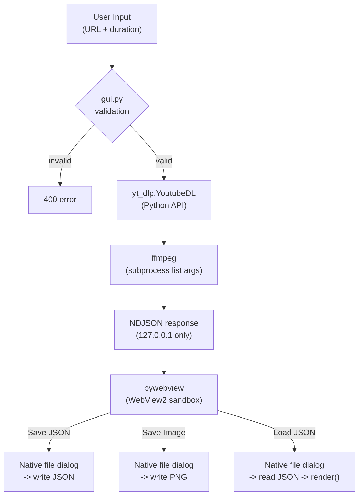

# Security Audit Report

**Date**: 2026-04-04 (初版は 2026-04-03、SEC-16 と Summary の件数は 2026-04-04 に追加、CI/CD 節は 2026-09-30 に確認、SEC-17〜SEC-19 は 2026-10-17 に追加、SEC-20 は 2026-10-20 に追加、テーマと言語の保存は 2026-10-20 に確認)
**Scope**:
- 2026-04-03〜04 の監査: CLI (`src/analyze_loudness/`), GUI (`src/analyze_loudness/gui.py`), Frontend SPA (`frontend/`), Build/Distribution (`build.py`, `analyze-loudness.spec`, `installer.iss`)
- 2026-09-30 の確認: CI (`.github/workflows/`, `.github/tests/`) の action の固定と検査 (CI/CD 節)
- 2026-10-17 の確認: ローカルファイル入力 (`/analyze` のローカルパス、`/browse`、`/upload`) と POST の Content-Type (SEC-17〜SEC-19)
- 2026-10-20 の確認: テーマと言語の保存 (`/settings`、`/common/settings.js`)
- 2026-10-20 の確認: 自動更新 (`/update/*`、`vendor/py-analyze-common` の `analyze_common/update.py` / `ed25519.py` / `update_manifest.py` / `installer/auto_update.iss`、`release.yaml` の署名) (SEC-20)

## Summary

| Category | Findings | Open | Resolved | Accepted |
|----------|----------|------|----------|----------|
| Local HTTP Server | 3 | 0 | 2 | 1 |
| Input Validation | 3 | 0 | 3 | 0 |
| Command Injection | 1 | 0 | 0 | 1 |
| File I/O (Save/Load/Upload) | 5 | 0 | 0 | 5 |
| Data Exposure | 1 | 0 | 0 | 1 |
| XSS | 1 | 0 | 0 | 1 |
| Subprocess Management | 2 | 0 | 1 | 1 |
| Bundled Binaries | 2 | 0 | 2 | 0 |
| Resource Management | 1 | 0 | 0 | 1 |
| Auto-update | 1 | 0 | 1 | 0 |
| **Total** | **20** | **0** | **9** | **11** |

**Open: 0** / Resolved: 9 / Accepted (risk acknowledged): 11

Summary の件数は 2026-10-20 に SEC-20 を追加した時点のもの (2026-10-17 に SEC-17〜SEC-19 を追加した時点では 19 件、Resolved 8) (2026-04-04 に SEC-16 を追加した時点では 16 件、Resolved 7、Accepted 9) (2026-04-03 の初版は SEC-01〜SEC-15 の 15 件、Accepted 8)。個々の指摘の本文は、その後のコード変更に合わせて更新されている (履歴は `git log -- docs/security-audit.md`)。2026-09-30 の CI/CD 節の確認はこの表に含まない。

---

## Resolved Findings

### SEC-01: バンドルバイナリの整合性検証 -- RESOLVED

- **Risk**: LOW -> RESOLVED
- **Location**: [build.py](../build.py), [build_assets/checksums.json](../build_assets/checksums.json)
- **Resolution**: `build_assets/checksums.json` にダウンロード済みアセット (ffmpeg, ffprobe, deno, uPlot) の SHA256 ハッシュをプラットフォーム別 (`windows` / `macos`) に記録。ビルド時に `_PLATFORM_KEY` で現在のプラットフォームのハッシュを照合し、不一致で停止する。
  - `python build.py --update-checksums`: ダウンロード + ハッシュ算出 + checksums.json 更新
  - `python build.py`: ダウンロード + checksums.json と照合 (不一致で停止)
  - checksums.json は git 管理対象
  - JSON 構造は analyze-spectrum と統一 (`{ "windows": {...}, "macos": {...} }`)

### SEC-02: ローカル HTTP サーバーがループバック以外からアクセス可能 -- RESOLVED

- **Risk**: LOW -> RESOLVED
- **Location**: [gui.py:293](../src/analyze_loudness/gui.py)
- **Resolution**: `HTTPServer(("127.0.0.1", 0), ...)` で 127.0.0.1 にバインド。外部ネットワークからのアクセス不可。ポートは OS が自動割当 (port 0) するため、他アプリとの競合も回避。

### SEC-03: URL 入力のバリデーション (GUI) -- RESOLVED

- **Risk**: LOW -> RESOLVED
- **Location**: [gui.py:73-75](../src/analyze_loudness/gui.py)
- **Resolution**: `url` フィールドの存在と `str` 型をチェック。空文字列は 400 エラーで拒否。
- **Note**: ユーザー自身が URL かローカルファイルのパスを入力し、ローカルマシンから YouTube にアクセスするか、そのファイルを読む (ローカルパスは SEC-18)。

### SEC-04: duration パラメータのバリデーション -- RESOLVED

- **Risk**: LOW -> RESOLVED
- **Location**: [gui.py:77-85](../src/analyze_loudness/gui.py)
- **Resolution**: `float()` 変換 + 正数チェック。不正値は 400 エラーで拒否。

### SEC-05: Windows subprocess コンソール非表示 -- RESOLVED

- **Risk**: LOW -> RESOLVED
- **Location**: [__init__.py](../src/analyze_loudness/__init__.py)
- **Resolution**: `_subprocess_kwargs()` で frozen mode 時に `STARTF_USESHOWWINDOW` を設定。subprocess のコンソールウインドウを抑制し、UX を改善。

### SEC-06: バンドルバイナリのバージョン管理 -- RESOLVED

- **Risk**: MEDIUM -> RESOLVED
- **Location**: [build.py](../build.py)
- **Resolution**: `build.py` が GitHub API から最新安定版を取得。`--skip-download` フラグで既存バイナリの再利用も可能。HTTPS 経由でダウンロード。

### SEC-15: 不正 JSON リクエストボディの処理 -- RESOLVED

- **Risk**: LOW -> RESOLVED
- **Location**: [gui.py:44-49](../src/analyze_loudness/gui.py)
- **Resolution**: `_read_json_body()` で `JSONDecodeError` / `ValueError` を catch し、空 dict を返す。不正なリクエストボディで 500 エラーが発生しない。

### SEC-17: POST の Content-Type を検査していなかった -- RESOLVED

- **Added**: 2026-10-17
- **Risk**: LOW -> RESOLVED
- **Location**: [gui.py](../src/analyze_loudness/gui.py) (`_check_content_type`)
- **Finding**: サーバーは Content-Type を見ずに本文を JSON として処理していた。`text/plain` や `application/x-www-form-urlencoded` は preflight の要らない単純リクエストなので、ポート番号を当てた外部サイトが `/analyze` を実行させられた (2026-10-17 に `text/plain` の POST が処理されることを確認)。
- **Resolution**: JSON のエンドポイントは `application/json`、`/upload` は `application/octet-stream` 以外を 415 で拒否する。ブラウザはこれらの型の cross-origin POST の前に preflight (OPTIONS) を送り、サーバーは応答しないため、本体の POST は送られない。

### SEC-20: 自動更新で取得するインストーラーの真正性 -- RESOLVED

- **Added**: 2026-10-20
- **Risk**: HIGH (対策がなければ) -> RESOLVED
- **Location**: [update.py](../src/analyze_loudness/update.py) (`UPDATE_CONFIG`)、[gui.py](../src/analyze_loudness/gui.py) (`/update/*`)、`vendor/py-analyze-common/src/analyze_common/update.py` / `ed25519.py` / `update_manifest.py`、[release.yaml](../.github/workflows/release.yaml) (Sign Update Manifest)
- **Finding**: 自動更新はネットワークから取得した実行ファイルを、ユーザーの確認の後に実行・インストールする。取得物が正規のビルドであることを確かめなければ、配布経路 (GitHub の Release、その手前の通信) を書き換えられる者がユーザーの計算機でコードを実行できる。macOS では、ネットワークから取得した DMG に quarantine 属性が付かないため、Gatekeeper の検査も働かない。
- **Resolution**:
  - 各 Release の `latest.json` が OS ごとのインストーラーの URL と Ed25519 署名を持つ。署名の対象は `analyze-update-v1` / 製品名 / 版 / OS / インストーラーの SHA-256 を改行でつないだ文で、アプリに組み込んだ公開鍵 (`PUBLIC_KEY`) で検証する。検証に通らないファイルは削除し、実行もインストールもしない。秘密鍵はリポジトリの secret `UPDATE_SIGNING_KEY` にだけ置き、`release.yaml` が署名の直後に `PUBLIC_KEY` で検証し直す (食い違えばリリースが失敗する)
  - 版を署名に含めるので、古い正規のインストーラーに新しい版番号を付けた差し替え (ダウングレード) は検証で落ちる。OS と製品名も含めるので、別 OS 向けや別アプリのファイルの流用も落ちる。マニフェストの版が実行中の版より新しいときだけ更新を出す
  - 取得は HTTPS (CA は certifi)。URL は `https://github.com/semnil/analyze-loudness/releases/download/<tag>/<name>` の形だけを受け付け、リダイレクトは https のままのものだけを辿る。マニフェストは 64 KiB、インストーラーは 1 GiB と 600 秒の締め切りを上限にする
  - macOS は、DMG の中の `.app` の識別子と版が一致すること、現在の版が Team ID 付きで署名されているときは同じ Team ID で `codesign --verify --deep --strict` が通ることも確かめてから入れ替える
  - `/update/install` は直前の `/update/check` が示した版だけを受け付ける。ローカルのページから呼ばれても、署名を検証できる更新しか適用されない (外部サイトからの呼び出しは SEC-17 の Content-Type の検査で preflight が要る)
  - 検証: `vendor/py-analyze-common/tests/` の Ed25519 (RFC 8032 の検証ベクトル)、改ざん・版の付け替え・別 OS の署名・別の鍵・サイズ上限・締め切り・URL の範囲外・scheme の変わるリダイレクトのテストと、OpenSSL で作った署名をアプリ側の検証が受け付けるテスト。2026-10-20 に macOS の実機 (ローカルでビルドした未署名の 1.4.1 / 1.4.2) で、1 バイトを反転した DMG が "The downloaded update does not match its signature" で拒否され、旧版がそのまま動き続けることを確認した

---

## Accepted Findings (risk acknowledged)

### SEC-07: ローカル HTTP サーバーの同一ホスト攻撃面 -- ACCEPTED

- **Risk**: VERY LOW
- **Location**: [gui.py:293](../src/analyze_loudness/gui.py)
- **Analysis**: 127.0.0.1 バインドのため、同一マシン上の他プロセスからは `/analyze` エンドポイントにアクセス可能。ただし:
  - ポートはランダム (port 0) のため予測困難
  - 外部サイトからの CSRF は、サーバーが Content-Type を `application/json` (`/upload` は `application/octet-stream`) に限るため preflight が必須になり、サーバーが preflight に応答しないので阻止される (SEC-17)
  - ローカルアプリの標準的な設計パターン
  - 最悪でも YouTube 音声の分析が実行されるのみ（データ破壊なし）

### SEC-08: subprocess への URL 直接渡し -- SAFE

- **Risk**: NOT VULNERABLE
- **Location**: [download.py:57-63](../src/analyze_loudness/download.py)
- **Analysis**:
  - `subprocess.run(cmd, ...)` リスト引数 (`shell=False`) -> shell injection 不可
  - ユーザーが自分で入力した URL をローカルで実行するため、攻撃ベクトルが成立しない

### SEC-09: フロントエンド XSS -- SAFE

- **Risk**: NOT VULNERABLE
- **Location**: [main.js](../frontend/main.js)
- **Analysis**:
  - `title` -> `textContent` (HTML パース不可)
  - `innerHTML` テーブル -> `fmt()` の `.toFixed()` 出力のみ (数値 -> 文字列)
  - ユーザー由来文字列は `innerHTML` パスに含まれない
  - GATE レーンの caption (`_buildGateCaption`) も `textContent` / `createTextNode` のみ。
    値は `computeGate()` が `series.M` から算出した数値を `fmt()` で整形したもので、
    読み込んだ JSON の文字列は経由しない

### SEC-10: エラーメッセージによる内部情報 -- ACCEPTED

- **Risk**: VERY LOW
- **Location**: [gui.py:97](../src/analyze_loudness/gui.py)
- **Analysis**: エラーメッセージは NDJSON で 127.0.0.1 にのみ送信される。ローカルアプリのためデバッグ情報の露出リスクは実質ゼロ。

### SEC-11: 一時ファイルのクリーンアップ -- SAFE

- **Risk**: NOT VULNERABLE
- **Location**: [gui.py:100](../src/analyze_loudness/gui.py), [cli.py](../src/analyze_loudness/cli.py)
- **Analysis**: `tempfile.TemporaryDirectory` + `with` ブロック。分析完了後に自動削除。

### SEC-12: `/save` エンドポイントによるファイル書き込み -- ACCEPTED

- **Risk**: VERY LOW
- **Location**: [gui.py:175-205](../src/analyze_loudness/gui.py)
- **Analysis**: `/save` POST で JSON データをユーザー選択パスに書き込み可能。ただし:
  - 保存先パスは pywebview のネイティブファイルダイアログでユーザーが選択
  - 127.0.0.1 + ランダムポートのため外部からのアクセス不可
  - 書き込みエラーは OSError でキャッチし、エラーレスポンスを返却
  - 書き込む内容は分析結果 JSON のみ (実行可能コードではない)

### SEC-13: `/save-image` エンドポイントによる PNG 書き込み -- ACCEPTED

- **Risk**: VERY LOW
- **Location**: [gui.py:207-235](../src/analyze_loudness/gui.py)
- **Analysis**: `/save-image` POST で base64 エンコード PNG をユーザー選択パスに書き込み。
  - `data:image/png;base64,` prefix を検証し、不正な形式は 400 で拒否
  - `base64.b64decode` が不正な base64 を `ValueError` として拒否（catch 済み）
  - 保存先は SEC-12 と同様にネイティブダイアログでユーザーが選択
  - 127.0.0.1 + ランダムポートのため外部からの呼び出し不可

### SEC-14: `/load` エンドポイントによるファイル読み込み -- ACCEPTED

- **Risk**: VERY LOW
- **Location**: [gui.py:237-261](../src/analyze_loudness/gui.py)
- **Analysis**: `/load` POST でユーザー選択パスから JSON を読み込み、フロントエンドに返却。
  - 読み込みパスは pywebview のネイティブファイルダイアログでユーザーが選択
  - `summary` と `series` フィールドの存在を検証し、不正な JSON は 400 で拒否
  - `OSError` / `JSONDecodeError` を catch しエラーレスポンスを返却
  - 読み込んだデータはフロントエンドの `render()` に渡されるが、ユーザー由来文字列は `textContent` 経由で安全に表示（SEC-09 参照）
  - 127.0.0.1 + ランダムポートのため外部からの呼び出し不可

### SEC-18: `/analyze` によるローカルファイルの読み取り -- ACCEPTED

- **Added**: 2026-10-17
- **Risk**: VERY LOW
- **Location**: [gui.py](../src/analyze_loudness/gui.py) (`/analyze`), [download.py](../src/analyze_loudness/download.py) (`resolve_source`)
- **Analysis**: `/analyze` は http(s) 以外の入力をローカルパスとして扱い、ffmpeg (list 引数) で読み取る。`://` を含む http(s) 以外のスキームと `javascript:` は 400。
  - 返すのはラウドネスの系列と統計だけで、ファイルの中身は返さない
  - 存在しないパスは `File not found` の 400 になるため、同じマシンのプロセスはファイルの有無を知りうる
  - UNC パス・デバイスパス (先頭が `\\` か `//`) は、パスの解決や `os.path.isfile` の前に 400 で拒否する (`download.is_network_path`)。受け取った保存済み JSON の `meta.source_url` が入力欄へ戻り、そのまま Analyze された場合も、パスの解決や存在確認に進まない (Windows での接続の有無は未計測)
  - 外部サイトからは SEC-17 により呼べない。呼べるのは 127.0.0.1 のランダムポートに届く同じマシンのプロセスだけ (SEC-07)
- **Accepted**: 同じマシンのプロセスはユーザー権限でファイルを直接読めるため、新たに得るものは無い

### SEC-19: `/upload` による一時ディレクトリへの書き込み -- ACCEPTED

- **Added**: 2026-10-17
- **Risk**: LOW
- **Location**: [gui.py](../src/analyze_loudness/gui.py) (`_handle_upload`)
- **Analysis**: ドロップされたファイルを `_upload_dir` (`tempfile.mkdtemp`、終了時に削除) に書く。
  - 1 リクエスト 500 MB まで (`_MAX_UPLOAD`)、拡張子は `AUDIO_EXTENSIONS` のみ
  - ファイル名は `sanitize_filename` が区切り文字・予約文字・制御文字を `_` に置き換え、`os.path.commonpath` で `_upload_dir` の外を拒否。同名は `_1`, `_2` … を付けて上書きしない
  - `X-Filename` は独自ヘッダーなので、外部サイトからは preflight が必須 (SEC-17 と合わせて阻止)
  - 回数の上限は無いため、同じマシンのプロセスは繰り返しの送信で一時ディレクトリを大きくできる
- **Accepted**: 書き込み先は一時ディレクトリに限られ、終了時に削除される

### SEC-16: クライアント切断時の subprocess orphaning -- ACCEPTED

- **Added**: 2026-04-04 (2026-04-03 の初版の後に追加。Summary の件数もこの時点で更新)
- **Risk**: LOW
- **Location**: [gui.py:116-148](../src/analyze_loudness/gui.py), [download.py](../src/analyze_loudness/download.py)
- **Analysis**: フロントエンドの Cancel (AbortController) でストリーム読み取りを中断すると、サーバー側の `_send_event()` が `_ClientDisconnected` を発生させて分析を中断する。ただし `yt_dlp.YoutubeDL.extract_info()` や `subprocess.run()` (ffmpeg) がブロッキング中の場合、該当処理は完了まで実行が継続する。
  - `_ClientDisconnected` は次の `_send_event()` 呼び出し時にのみ検出される
  - yt_dlp ダウンロード中 (3-8秒) や ffmpeg 分析中 (~11秒) にキャンセルしても、該当処理は完了まで実行
  - 完了後に `_send_event()` が `_ClientDisconnected` を送出し、以降の処理を中断
  - `TemporaryDirectory` は `with` ブロック終了時にクリーンアップされるため、一時ファイルのリークは発生しない
  - 修正には `subprocess.Popen` ベースに変更し、キャンセル時に `process.kill()` する必要があるが、単一ユーザーのローカルアプリでは実害が小さく、複雑性増加に見合わない
- **Accepted**: 最大でも十数秒の不要な subprocess 実行のみ。DoS やリソース枯渇のリスクなし

---

## CI/CD (GitHub Actions)

**確認日**: 2026-09-30。各ワークフローの実物と、master のルールセット・Actions の許可ポリシーの現在値を確認した。2026-04-03〜04 の監査には含まれない。「Dependabot の自動マージ」の行と、「外部 action のピン留め」「必須チェック」の行のうち `dependabot-auto-merge.yml`・`Test 🧪`・`auto-merge` の記述は 2026-10-20 に追加した。

| 項目 | 対策 |
|------|------|
| 外部 action のピン留め | `ci.yaml` / `release.yaml` / `tag-release.yml` / `workflow-checks-test.yml` / `dependabot-auto-merge.yml` の `uses:` はコミット SHA (40 桁) と同じ行のバージョンコメント (`@<sha> # vX.Y.Z`) で固定する。タグ参照ではないため、タグの付け替えで実行内容が変わらない |
| 固定の検査 (`workflow-checks.yml`) | PR ごとに `pull_request_target` で既定ブランチの定義を実行し、PR の head のワークフロー・action ファイルを GitHub API (git trees / blobs) でデータとして取得して yq で読む。PR のコードは checkout も実行もせず、トークンは `contents: read`。対象は `jobs.<id>.uses` / `jobs.<id>.steps[*].uses` / `action.yml` の `runs.steps[*].uses` |
| 同一リポジトリの参照 | ステップの `./` は runner の作業領域に対して解決される (前のステップが置いた内容を実行しうる) ため拒否し、`$/` (実行中のコミットに解決) を使わせる。ジョブ単位の再利用ワークフローは `./` / `$/` とも呼び出し元と同じコミットから読まれるため許可する。ローカル参照のパスは `A-Z a-z 0-9 . _ -` と `/` に限り、空・`.`・`..`・末尾が `.` の要素と、参照先までの経路上の git tree のシンボリックリンク・サブモジュール (ASCII の大文字小文字を区別せず照合) を拒否する |
| 取得対象の健全性 | ワークフロー・action ファイルが通常ファイルでない (シンボリックリンク等) とき、action ファイル名が小文字の `action.yml` / `action.yaml` でないときは失敗する |
| 検査の自己改変の防止 | `workflow-checks.yml` のパス・mode・blob SHA が既定ブランチと一致しない PR は失敗する。検査を変更するときは必須チェックを一時的に外してからマージする |
| 必須チェック | master のルールセットで `action-pins`・`Test 🧪` (`ci.yaml`)・`auto-merge` (`dependabot-auto-merge.yml`) を必須とし、ベースブランチへの追随を求める (`strict_required_status_checks_policy: true`)。バイパスは設定していない |
| 検査の回帰テスト | `.github/tests/workflow-checks-test.sh` を `workflow-checks-test.yml` が実行する (検査ファイル・テストを変更する PR と master への push)。偽の `gh` がフィクスチャの git tree を返し、拒否すべき参照と通すべき参照の判定と失敗理由を検査する |
| 版上げからのタグ作成 (`tag-release.yml`、2026-10-17 追加) | `workflow_run` で CI の完了後に走り、master への `push` で成功した run だけを処理する。checkout するのは CI が検査した `head_sha`。権限は `contents: write` (タグの push) と `actions: write` (`release.yaml` の dispatch)。既存のタグは動かさない |
| Dependabot の自動マージ (`dependabot-auto-merge.yml`、2026-10-20 追加) | PR ごとに `pull_request` で走り、PR の作成者が `dependabot[bot]` のときだけ `dependabot/fetch-metadata` と `gh` のステップを実行する (他の PR ではステップを skip し、ジョブは成功を報告する)。PR のコードは checkout も実行もせず、PR 由来の値 (URL・head SHA・更新種別) は環境変数で渡す。更新種別が semver の patch のときだけ、読んだ head SHA を条件 (`--match-head-commit`) に自動マージ (merge commit) を予約し、それ以外の種別では予約を解除する。ジョブ `auto-merge` は master の必須チェックで、その head についての判定が出る前にはマージされない。権限はジョブ単位の `contents: write` と `pull-requests: write` で、使うトークンは `GITHUB_TOKEN` (secret は使わない)。自動マージによるマージは `GITHUB_TOKEN` によるもので、master への push はワークフローを起動しない |
| `pull_request_target` の許可 | public リポジトリの `pull_request_target` は 2026-11-02 から明示的な許可が必要なため、`workflow-checks.yml` を対象とした Actions の許可ポリシーを設定している |

---

## Threat Model

### Attack Surface

| Entry Point | Protocol | Auth | Validation |
|------------|----------|------|------------|
| CLI args | Local | N/A | argparse + `_positive_float` |
| GUI HTTP | 127.0.0.1 only | N/A (localhost) | Content-Type + URL / local path + duration + JSON body validation |
| Frontend SPA | pywebview (WebView2) | N/A | Static files, no SSR |
| File dialogs | Native OS | User interaction required | pywebview SAVE_DIALOG / OPEN_DIALOG, `_dialog_lock` non-blocking try-lock (409 on concurrent) |
| Update check / download | HTTPS to github.com (outbound) | N/A | Ed25519 signature over product / version / OS / SHA-256, URL prefix, https-only redirects, size and time caps (SEC-20) |

### Abuse Scenarios

| Scenario | Impact | Mitigation | Status |
|----------|--------|------------|--------|
| External network access | Remote attack | 127.0.0.1 bind | Not vulnerable |
| Shell injection via URL | RCE | `subprocess.run` list args | Not vulnerable |
| Malicious bundled binary | Code execution | SHA256 checksum verification | Resolved (SEC-01) |
| Local CSRF | Unintended analysis | Random port, Content-Type preflight | Very low risk |
| Disk exhaustion (large video) | DoS | `TemporaryDirectory` auto-cleanup | Low risk |
| Arbitrary file write via /save | Data overwrite | Native dialog + 127.0.0.1 + random port | Very low risk |
| Arbitrary file read via /load | Info disclosure | Native dialog + 127.0.0.1 + random port | Very low risk |
| Cross-site simple POST | Unintended analysis | Content-Type gate forces preflight | Resolved (SEC-17) |
| Local file analysis via /analyze | File existence probe | 127.0.0.1 + random port + SEC-17 | Accepted (SEC-18) |
| Repeated /upload | Temp disk usage | 500 MB per request, extension allowlist, temp dir removed on exit | Accepted (SEC-19) |
| XSS via loaded JSON title | Code execution | `textContent` (no HTML parse) | Not vulnerable |
| Edited settings.json | Script in /common/settings.js | Only the allowed theme / language values are written into the script | Not vulnerable |
| Invalid base64 in /save-image | Server crash | `ValueError` caught | Resolved |
| Cancel during subprocess | Orphaned process (~11s) | `_ClientDisconnected` + `TemporaryDirectory` cleanup | Accepted (low) |
| Tampered installer or manifest on the release path | Code execution | Ed25519 signature checked before anything runs | Resolved (SEC-20) |
| Older genuine installer relabelled as newer | Downgrade | Version is part of the signed statement | Resolved (SEC-20) |
| Redirect to plain HTTP or another host | Tampering in transit | https-only redirects, URL prefix check | Resolved (SEC-20) |

## Compliance Notes

- No user data stored (stateless analysis, temp files auto-deleted)
- No authentication tokens or cookies
- No PII processing
- No network listeners on external interfaces
- Outbound: the update check reads `latest.json` from github.com at launch (turned off by "Check at launch" in Settings). The request carries the app name and version (User-Agent) and nothing about the user or the analysed media
- YouTube content analyzed locally, deleted after display
- ffmpeg bundled under GPL-2.0+ (source availability required for redistribution)
- THIRD_PARTY_LICENSES.txt included in installer
